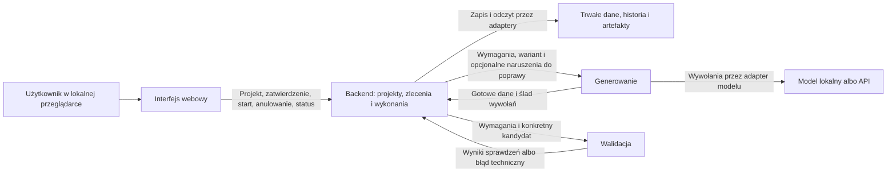
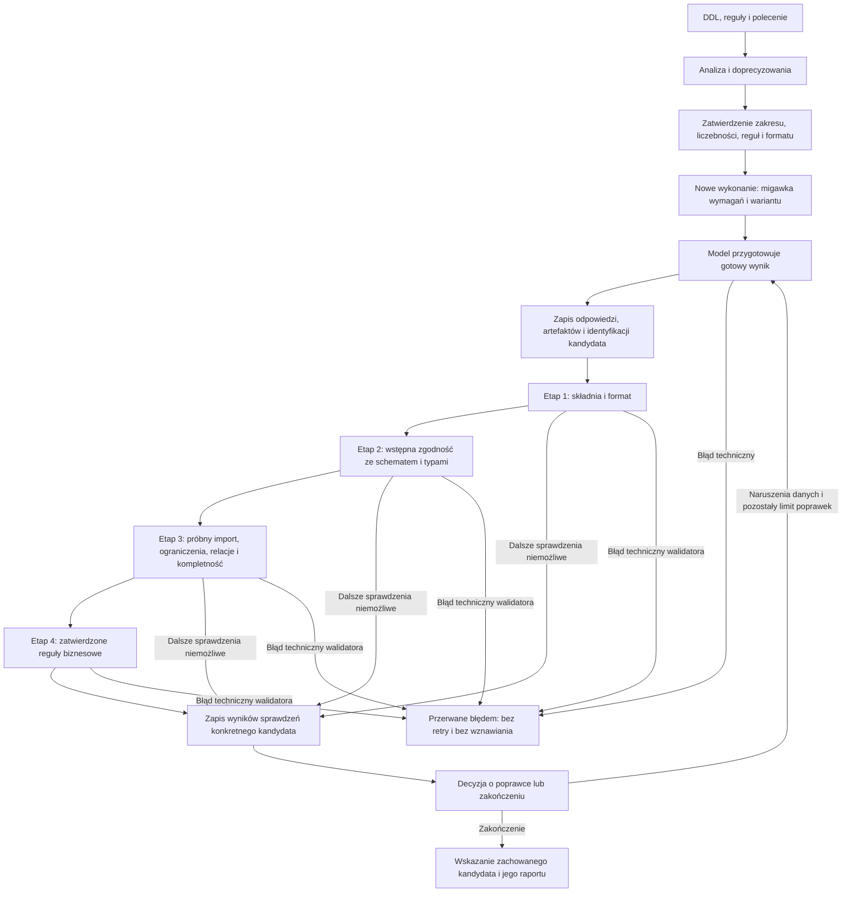

# Architektura ogólna i przepływ danych

**Data:** 21 października 2026.

**Aktualizacja:** 21 października 2026.

**Status:** robocza architektura z zapisanymi kierunkami technologii; fizyczny podział procesów pozostaje propozycją. Lokalna aplikacja webowa, gotowy wynik przygotowywany przez model, brak wznawiania i rozróżnienie błędów technicznych od naruszeń danych są uzgodnione.

**Podstawa:** [specyfikacja MVP](specyfikacja_mvp.md), [podział implementacji](podzial_implementacji.md) i [przygotowanie do hostowania](przygotowanie_do_hostowania.md).

## 1. Co oznacza podział usług

Chodzi o wskazanie, które części są osobno uruchamianymi programami, za co odpowiadają i kto jest właścicielem ich danych. Nie oznacza to osobnego serwisu dla każdego modelu, agenta lub biblioteki ani obowiązku kupienia kilku zewnętrznych usług.

Proponujemy cztery logiczne odpowiedzialności: projekty i zlecenia, wykonania, generowanie oraz walidacja. Dla lokalnego MVP proponujemy umieścić pierwsze dwie w jednym backendzie, a generowanie i walidację za odrębnymi granicami usług. To propozycja niewielkiego układu usług, nie zatwierdzenie pełnego podziału na niezależne mikroserwisy.

| Część | Odpowiedzialność | Własność danych |
| --- | --- | --- |
| Interfejs webowy | Wprowadzanie danych, zatwierdzanie, start i anulowanie, odczyt statusu i pobieranie wyniku. | Nie jest źródłem prawdy o zadaniu ani właścicielem trwałej historii. |
| Backend zarządzający | Moduł projektów i zleceń oraz moduł wykonań. Kontrola dostępu, migawki wymagań, limit poprawek, historia i raport. | Projekty, zatwierdzone zlecenia, wykonania, historia, wskazania kandydatów i raporty. Zapis przez własne adaptery. |
| Usługa generowania | Realizacja wybranego wariantu modelowego, przygotowanie gotowego SQL albo treści CSV, reakcja na zleconą poprawkę. | Dane robocze konkretnej operacji; nie potrzebuje osobnej bazy historii. Zwraca artefakty i ślad wywołań do utrwalenia. |
| Usługa walidacji | Sekwencja sprawdzeń gotowego kandydata, z rzeczywistym próbnym importem do odizolowanego PostgreSQL. | Dane tymczasowe konkretnego sprawdzenia; trwały raport jest przypisany do wykonania przez backend. |

Gotowy serwer modelu lokalnego lub API dostawcy jest zależnością usługi generowania, a nie dodatkowym serwisem biznesowym, który musimy napisać.

Nie każdy komponent potrzebuje własnego trwałego magazynu. Pozostałe usługi nie odczytują bezpośrednio wewnętrznych tabel backendu. Artefakty są przekazywane przez ograniczone referencje lub uzgodniony transfer, nie założenie wspólnego katalogu na dysku.

## 2. Diagram odpowiedzialności i komunikacji

Połączenia oznaczają logiczne kontrakty. Nie wybieramy jeszcze protokołu ani kolejki. Interfejs może być dostarczany przez backend; diagram nie wymaga osobnego serwera plików UI.

Przygotowanie zlecenia może także korzystać z operacji modelowych do interpretacji polecenia i reguł. Proponujemy użyć tej samej granicy integracji modeli, bez implementowania drugiego zestawu klientów w backendzie. Wynik interpretacji jest propozycją, a nie samodzielnym zatwierdzeniem wymagań.

## 3. Kontrakt gotowego kandydata

Uzgodniono: model przygotowuje gotowe polecenia `INSERT` albo treść plików CSV zgodnie z formatem zlecenia. Nie przyjmujemy jako podstawowego przebiegu model → pośrednie rekordy → deterministyczny generator SQL/CSV w aplikacji.

Kandydat potrzebuje także metadanych: identyfikacji wykonania i wersji, wybranego formatu, listy artefaktów oraz powiązania z wymaganiami. Dokładny format transportowy pozostaje do wyboru.

Aplikacja może wyodrębnić zadeklarowaną zawartość, zapisać ją, odczytać do walidacji, policzyć rekordy, spakować pliki i dołączyć metadane importu. Nie może po cichu dopisywać lub usuwać rekordów, poprawiać wartości i relacji, zastępować błędnego SQL własnym ani zmieniać wymagań.

Surowa odpowiedź modelu pozostaje w historii. Wyodrębnione pliki stanowią zidentyfikowany kandydat, do którego odnosi się walidacja. Dalsza poprawka danych tworzy nowego kandydata, nie nadpisuje sprawdzonej wersji. Pakowanie do pobrania nie może zmieniać sprawdzonej zawartości.

## 4. Przepływ danych i etapy walidacji

Etap drugi jest kontrolą wstępną, nie własnym pełnym systemem typów. Rzeczywisty import w etapie trzecim potwierdza zgodność z typami i obsługiwanymi ograniczeniami PostgreSQL. Osobno sprawdzamy kompletność: same prawidłowe typy i udany import nie dowodzą wymaganej liczby rekordów.

Jeżeli wcześniejszy etap uniemożliwia dalsze sprawdzenie, niewykonane testy są jawnie oznaczane. Nie otrzymują wyniku pozytywnego. Metodę próbnego importu potwierdzono 21 października 2026; zakres typów i ograniczeń (OD-01), szczegóły środowiska (pozostała część OD-02) oraz wykonywalna postać dodatkowych reguł pozostają do doprecyzowania. [Projekt walidacji](lld/walidacja.md) zapisuje te statusy osobno.

Pętla poprawek jest potwierdzona: naruszenia danych uruchamiają poprawki zgodnie z REQ-032–REQ-037, domyślnie maksymalnie 3 rundy po pierwszym wygenerowaniu dla całego wykonania. Błąd techniczny na dowolnym etapie kończy wykonanie zgodnie z REQ-070. Nie jest wynikiem negatywnej walidacji danych ani powodem rozpoczęcia kolejnej rundy.

## 5. Start, anulowanie i brak wznawiania

Uzgodniono możliwość rozpoczęcia i przerwania wykonania oraz brak wznawiania. Ponowna próba tworzy nowe wykonanie i zaczyna generowanie od początku. Odczyt historii, odświeżenie statusu i odzyskanie zapisanych raportów nie są wznawianiem procesu.

Proponujemy, aby zamknięcie lub odświeżenie strony nie było samo w sobie poleceniem anulowania. Użytkownik zleca zatrzymanie konkretnego wykonania. Po zatrzymaniu nie rozpoczynamy kolejnego etapu; spóźniona odpowiedź modelu nie może ponownie uruchomić zakończonego procesu.

Po utracie procesu nie kontynuujemy zadania z checkpointu. Przy kolejnym uruchomieniu proponujemy rozpoznać pozostawione wykonanie jako przerwane, zachować historię i umożliwić nowe wykonanie. Nie deklarujemy jako przyczyny anulowania, jeżeli nie pochodziło ono od użytkownika.

**Uzgodnione zasady błędów:**

- naruszenie sprawdzanego warunku danych jest wynikiem walidacji i uruchamia ograniczone poprawki, jeśli pozostał limit;
- błąd połączenia, awaria modelu lub walidatora kończy wykonanie; nowe wykonanie może uruchomić użytkownik;
- nie ma automatycznego retry nieudanej operacji ani przełączenia wariantu po błędzie; klienci modeli i pozostałe biblioteki nie mogą ukrywać takich ponowień;
- nie ma automatycznego wznawiania; konkretne timeouty i raportowanie niepełnych informacji o nieudanym wywołaniu pozostają w OD-07.

Niepoprawna treść SQL/CSV otrzymana w działającym wywołaniu jest błędem danych, a nie samym w sobie błędem połączenia. Po timeoutcie zewnętrzny model może nadal obsługiwać żądanie, ale spóźniona odpowiedź nie uruchamia kolejnych etapów zakończonego procesu.

Nie rozszerzamy tutaj zasad udostępniania danych po anulowaniu lub błędzie operacyjnym; to nadal OD-08.

## 6. Co pozostaje przed finalnym wyborem technologii

1. Potwierdzenie proponowanego rozmieszczenia odpowiedzialności i własności danych.
2. Sprawdzenie kandydatów technologicznych pod kątem wymaganej walidacji i kontraktu gotowych danych; nie zatwierdzamy parsera lub silnika wyłącznie na podstawie listy funkcji.

Nie potrzebujemy przed tym etapu pełnego projektu kont, wielu workerów ani infrastruktury chmurowej.

## 7. Analiza kandydatów technologicznych

21 października 2026 przygotowano [wstępne porównanie technologii](analiza_technologii.md). Zawiera faworyta, alternatywy i próby wymagane przed zatwierdzeniem. Nie zastępuje to decyzji o podziale procesów ani nie zmienia kontraktu gotowego SQL/CSV i zasad błędów.

## 8. Zapisane kierunki i projekt szczegółowy

[Rejestr ustaleń](ustalenia_architektoniczne.md) rozróżnia wymagania, zapisane kierunki i nierozstrzygnięte propozycje. Utrwalono PostgreSQL jako źródło danych, opcjonalny pgvector, dobór kontekstu za portem oraz LiteLLM SDK jako preferowany adapter po próbach zgodności i przeglądzie wersji.

[Serwisy i technologie](serwisy_i_technologie.md) rozwijają ten diagram do funkcji interfejsu oraz trzech proponowanych serwisów: `application-api`, `generation-service` i `validation-service`. Dokument obejmuje narzędzia, kontrakty, model danych, ślad wywołań, transfer artefaktów, runner i obsługę awarii. Bazuje na wariancie Python/FastAPI + React/TypeScript; nie zamyka OD-01–OD-12.

[LLD v0.1](lld/README.md) uszczegóławia implementację: kierunki zależności modułów, model tabel, transakcje, koperty API, maszynę stanów oraz ochronę przed przyjęciem skutków starej operacji. To projekt do oceny przed kodowaniem.
