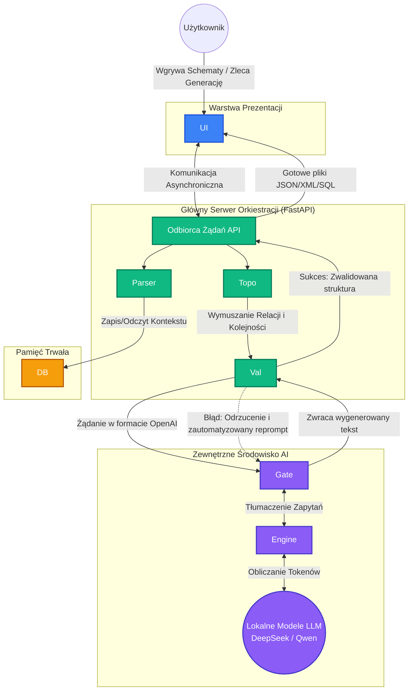

# Dokumentacja Techniczna Systemu Generowania Syntetycznych Danych Testowych

Niniejsza dokumentacja opisuje architekturę hybrydową systemu sztucznej inteligencji, którego celem jest zautomatyzowane generowanie strukturalnych danych testowych (JSON, XML, SQL) z bezwzględnym zachowaniem integralności referencyjnej.

## 1. Jak będzie działał projekt (Przepływ Pracy / Workflow)
System działa jako zautomatyzowany potok (pipeline) przetwarzania danych:

1. **Inicjalizacja (Wejście):** Użytkownik ładuje schemat bazy (SQL DDL) lub specyfikację API (Swagger/OpenAPI w formacie YAML/JSON) przez interfejs graficzny.
2. **Parsowanie i Abstrakcja:** Schematy są zamieniane na wewnętrzne, zrozumiałe dla maszyny drzewa zależności. Wyodrębniane są klucze obce i relacje.
3. **Zapis i Indeksowanie (Schema RAG):** Każdy wgrany schemat jest na stałe zapisywany na dysku i indeksowany w bazie wektorowej. Baza wyciąga tylko te tabele, o które poprosił użytkownik, oszczędzając pamięć modelu.
4. **Generowanie z Sortowaniem Topologicznym:** Algorytmy grafowe określają kolejność tworzenia danych. System generuje najpierw tabele-rodziców, by potem wymusić użycie ich ID przy generowaniu tabel-dzieci.
5. **Walidacja i Samonaprawianie:** Wygenerowany plik JSON/XML trafia do walidatora. Jeśli wystąpi błąd, specjalny moduł automatycznie wysyła reprompt do LLM z prośbą o poprawę[cite: 2].
6. **Zakończenie (Wyjście):** Gotowe pakiety danych są zwracane użytkownikowi[cite: 2].

---

## 2. Serwisy i Komponenty Systemu (Architektura)

Zgodnie z dobrymi praktykami (Separation of Concerns), system podzielony jest na mikroserwisy[cite: 2]:
* **Warstwa Prezentacji (Frontend):** Oparta na zdarzeniach (event-driven), nie blokuje się podczas generowania tekstu[cite: 2].
* **Serwer Orkiestracji (Główny Backend API):** Centralny mózg zarządzający topologią grafów i wykonywaniem skryptów walidacyjnych[cite: 2].
* **Baza Wektorowa (Vector Store):** Pamięć długotrwała projektów[cite: 2].
* **Brama Sztucznej Inteligencji (LLM Gateway):** Zunifikowany router, który tłumaczy standardowe zapytania OpenAI i kieruje je do lokalnego silnika[cite: 2].
* **Fizyczny Silnik Wykonawczy (Inference Engine):** Zespół izolowanych modeli odpalanych na karcie graficznej[cite: 2].

### 2.1 Wizualizacja Architektury



3. Użyte Technologie i Uzasadnienie Wyboru
Ekosystem opiera się całkowicie na języku Python, co ułatwia integrację bibliotek AI[cite: 2].

Komponent	Wybrana Technologia	Uzasadnienie
Frontend	Flet	
Kompiluje się do responsywnej aplikacji bez przeładowywania stanu (w przeciwieństwie do Streamlit)[cite: 2].

Backend	FastAPI	
Asynchroniczna obsługa zapytań nie zawiesza serwera w trakcie pracy LLM-a[cite: 2].

Baza Wektorowa	LanceDB	
Lekka baza in-process (bezserwerowa) świetna do lokalnych środowisk roboczych[cite: 2].

AI Gateway	LiteLLM	
Działa jako pośrednik obsługujący standaryzację komunikacji do API OpenAI[cite: 2].

Serwer AI	vLLM / Ollama	
Ollama do środowiska dev, vLLM zoptymalizowany pod produkcję masową na GPU[cite: 2].

Modele (LLM)	DeepSeek-R1 / Qwen2.5-Coder	
DeepSeek świetnie nadaje się do rozumowania relacji (tag <think>), a Qwen do taśmowego generowania kodu i JSON[cite: 2].

Parsery	SQLGlot / MCP	
Bezpieczne budowanie drzew zmiennych bez uruchamiania ich na fizycznej bazie[cite: 2].

Walidator	Pydantic V2 / Instructor	
Ekstremalnie szybka walidacja w oparciu o Rust. Biblioteka Instructor dba o wychwytywanie wyjątków i uzdrawianie danych[cite: 2].


***

Kiedy wkleisz to do PyCharma, edytor automatycznie rozpozna blok `` ```mermaid `` i na podglądzie wyświetli ładny graf architektury ze strzałkami, bez konieczności zabawy w zrzuty ekranu! Gdy wypchniesz (push) ten plik na GitHuba, diagram będzie również widoczny z poziomu przeglądarki.