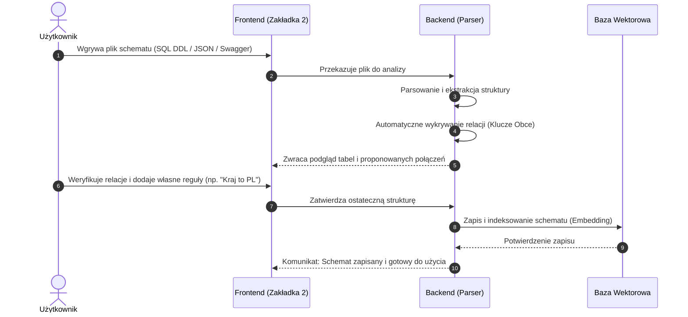

# Diagramy Przepływu Danych (Sequence Diagrams)

Niniejszy dokument wizualizuje dwa główne procesy biznesowe aplikacji: zarządzanie wiedzą (konfiguracja bazy) oraz zautomatyzowany potok generowania i walidacji danych.

## 1. Przepływ: Wgrywanie schematów i konfiguracja (Zakładka 2)
Ten diagram przedstawia, co dzieje się, gdy użytkownik dostarcza systemowi wiedzę o strukturze swoich baz danych (Swagger, DDL, JSON). System nie tylko zapisuje plik, ale proaktywnie wykrywa relacje.

2. Przepływ: Generowanie i Samonaprawianie Danych (Zakładka 1)
Ten diagram przedstawia główną oś aplikacji (tzw. "mięso" pracy magisterskiej). Pokazuje, jak prosty prompt użytkownika uruchamia skomplikowany proces doboru schematów, generowania danych przez LLM i bezwzględnej weryfikacji w kodzie Python.

```mermaid
sequenceDiagram
    autonumber
    actor U as Użytkownik
    participant UI as Frontend (Zakładka 1)
    participant BE as Backend (Orkiestrator)
    participant DB as Baza Wektorowa
    participant LLM as Lokalny Model (Ollama)
    participant VAL as Walidator (Python/Pydantic)

    U->>UI: Wpisuje prompt (np. "Wygeneruj 100 transakcji VIP")
    UI->>BE: Żądanie generacji
    BE->>DB: Analiza intencji (Agentic RAG)
    DB-->>BE: Zwraca tylko niezbędne schematy (np. Klienci, Transakcje)
    BE->>BE: Ustalenie kolejności generowania (Topologia grafu)
    
    rect rgb(50, 50, 50)
    Note right of BE: PĘTLA HYBRYDOWA: Generowanie i Walidacja
    BE->>LLM: Prompt systemowy + Kontekst (Schematy)
    LLM-->>VAL: Zwraca wygenerowany surowy plik JSON/SQL
    VAL->>VAL: Sprawdzenie składni, typów i reguł użytkownika
    
    alt Błąd Walidacji (np. litery zamiast cyfr w ID)
        VAL-->>BE: Zgłasza błąd i dokładną lokalizację
        BE->>LLM: Reprompt (Auto-healing) z prośbą o poprawę
    else Pełen Sukces (dane poprawne)
        VAL-->>BE: Zatwierdzenie poprawności strukturalnej
    end
    end

    BE-->>UI: Przesłanie gotowej, poprawnej paczki danych
    UI-->>U: Wyświetla podgląd (max 50 wierszy)
    U->>UI: Pobiera pełny plik lub kopiuje do schowka
```

