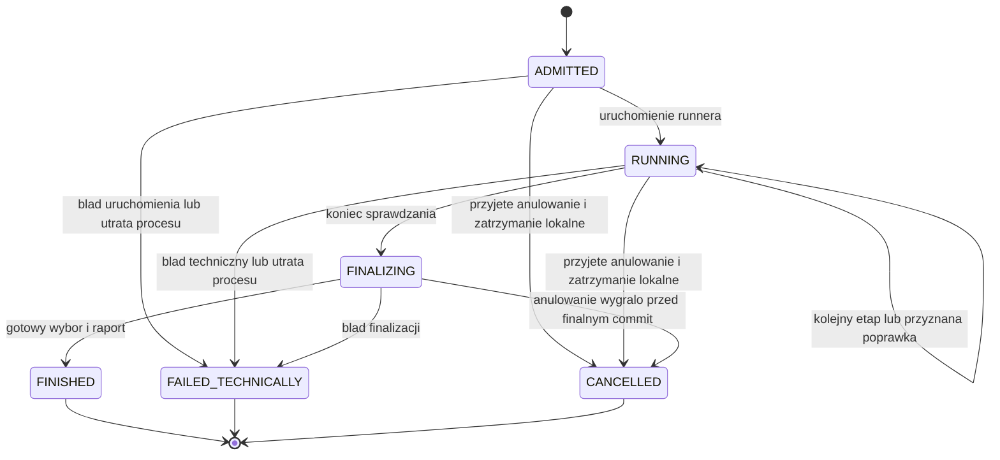

# LLD — maszyna stanów i wykonawca

**Data:** 21 października 2026. **Status:** projekt v0.1, z proponowaną semantyką LP-02–LP-04; szczegóły OD-07 i OD-08 nadal wymagają zatwierdzenia.

[Założenia](README.md) · [Model danych](model_danych.md) · [API](kontrakty_api.md)

## 1. Cykl życia, faza i ocena



`cancel_requested_at` może być ustawione w dowolnym stanie nieterminalnym. Od tego momentu nie przyjmujemy kolejnego kroku. To trwała blokada, a nie obietnica natychmiastowego zakończenia pracy u dostawcy.

`FINISHED` ma `outcome=FULFILLED` albo `UNFULFILLED`. W `FAILED_TECHNICALLY` i `CANCELLED` nie dopisujemy normalnego sukcesu, nawet jeśli w historii istnieje użyteczny kandydat. Jego dostępność po przerwaniu pozostaje OD-08.

## 2. Fazy i budżet

| Faza | Operacja | Warunek przejścia |
| --- | --- | --- |
| `GENERATING` | `GENERATE`, runda 0. | Zarejestrowany kandydat → `VALIDATING`. |
| `VALIDATING` | `VALIDATE` dla wskazanej rundy. | Raport bez naruszeń i z dowodami → `SELECTING`; naruszenia i budżet → `CORRECTING`; koniec budżetu → `SELECTING`. |
| `CORRECTING` | `CORRECT`, następna globalna runda. | Nowy kandydat → `VALIDATING`. |
| `SELECTING` | Lokalna polityka wyboru. | Zachowany wybór lub jawny brak kwalifikującego kandydata → `EXPORTING`. |
| `EXPORTING` | Lokalna finalizacja raportu i dostępnej paczki. | Gotowe artefakty → finalny commit. |

Brak wykrytych naruszeń nie wystarcza, jeśli wymagane sprawdzenie jest niewykonane. `ValidationDecisionPolicy` rozróżnia:

- `ACCEPT_CURRENT` — kompletny/importowalny kandydat i brak dalszych naruszeń obsługiwanych reguł.
- `CORRECT` — rozpoznane naruszenia i dostępny budżet.
- `FINALIZE` — budżet wyczerpany albo inne normalne zakończenie z rzeczywistym stanem dowodów.
- `FAIL_TECHNICALLY` — awaria transportu, silnika sprawdzeń, historii lub innego wymaganego mechanizmu.

Nieobsługiwanego obowiązkowego warunku nie „naprawiamy” usuwaniem go z wymagań. Powinien zostać wykryty przed startem; jeśli ujawni się później, zapisujemy brak potwierdzenia i jawną przyczynę zamiast fikcyjnego sukcesu.

`corrections_started` zwiększamy przy przyznaniu nowej operacji poprawki, w tej samej transakcji `PrepareStep`, która ją tworzy. Nie zwiększamy go dla każdego model call ani tabeli. Jeśli operacja poprawki kończy się technicznie, nie przyznajemy kolejnej.

## 3. Admission — przed pierwszym wywołaniem

1. Wyznacz zaufany kontekst właściciela i sprawdź dostęp do zlecenia.
2. Rozpoznaj `Idempotency-Key`; identyczna komenda zwraca to samo wykonanie.
3. Sprawdź wskazaną zatwierdzoną rewizję, zgodność hashów, obsługiwane profile i wariant. Nic nie przestawia się na aktualny DDL w tle.
4. Przygotuj trwałe dokumenty migawki i wariantu. Brak wymaganego profilu lub niezatwierdzonej polityki daje blokadę przed modelem.
5. W `AdmitRun` zablokuj `runtime_guard`, sprawdź gotowość i wolne miejsce, zapisz `Run`, komendę oraz zajęcie zasobu.
6. Po commit uruchom `LocalExecutionRunner`. Nie dispatchuj pracy przed trwałym zapisem.
7. Zwróć `202`. Błąd utworzenia zadania po commit zmienia zapisane wykonanie w przerwane błędem; awaria przed odpowiedzią jest rozpoznawalna przez komendę.

Nie dodajemy trwałej kolejki do późniejszego odtworzenia. `ADMITTED` oznacza zamiar uruchomienia w bieżącym procesie; po utracie procesu nie zostanie automatycznie wykonane.

## 4. `RunCoordinator` — algorytm

Pseudokod, nie implementacja:

```text
execute(run_id):
    transition ADMITTED -> RUNNING
    candidate = run_generation_step(round_no=0)

    loop:
        report = run_validation_step(candidate)
        persist report and eligibility for this exact candidate
        decision = validation_decision_policy(report, run)

        if decision is FAIL_TECHNICALLY:
            terminate technically; stop
        if decision is CORRECT:
            atomically grant next global correction round
            candidate = run_correction_step(candidate, report)
            continue
        break

    transition RUNNING -> FINALIZING
    eligible = stored candidates with complete=true and importable=true
    selection = configured_selection_policy(eligible)
    build immutable report and any permitted export
    commit FINISHED with outcome and consistent selection
```

Każdy pomocniczy `run_*_step` wykonuje:

1. Sprawdzenie trwałego stanu, anulowania i terminu, przygotowanie kontekstu/żądania.
2. `PrepareStep`: nowa `Operation`, przypisanie epoki i aktywnego identyfikatora; stara operacja musi być zakończona.
3. Krótki zapis próby dispatch jako `EXECUTING`, następnie jedno HTTP poza transakcją. Stan oznacza rozpoczęcie próby, nie dowód dotarcia do usługi. Brak automatycznego ponawiania.
4. Rejestrację odebranych artefaktów i dowodów.
5. `ApplyStepResult`: blokada runa i operacji, kontrola epoki, tożsamości instancji, terminu, hashów i braku anulowania.
6. Atomowy zapis skutku i zamknięcie operacji. Stary wynik może zostać diagnostyką, nie przejściem.

Wyjątki techniczne i anulowanie przerywają algorytm również pomiędzy tymi punktami. Runner ma jawny rejestr zadań i sprzątanie w cyklu życia aplikacji. Nie trzyma jednej sesji SQLAlchemy ani transakcji przez cały algorytm.

## 5. Zachowanie kandydatów

- Po każdej walidacji wyliczamy kwalifikację na podstawie utrwalonych dowodów.
- Nowy kandydat nie nadpisuje starszego i nie usuwa go z listy użytecznych.
- Jeżeli późniejsza poprawka jest nieimportowalna, normalne zakończenie może wybrać wcześniejszy użyteczny wynik.
- Polityka między kilkoma użytecznymi kandydatami jest wstrzykiwana i wersjonowana. Propozycja „najnowszy użyteczny” nie jest zatwierdzonym rankingiem.
- Brak użytecznego wyniku → `FINISHED/UNFULFILLED`, nie wyjątek LLM tylko dlatego, że dane były błędne.
- Przy użytecznym kandydacie z pozostałymi dodatkowymi naruszeniami biznesowymi po limicie → `FINISHED/FULFILLED` z raportem naruszeń.
- Ostateczny manifest, raport i dowody wskazują tę samą wersję. Nie wybieramy raportu według daty ostatniej modyfikacji pliku.

Przed realnym przebiegiem trzeba zatwierdzić OD-03 albo świadomie przyjąć konkretną politykę. Testy mogą podstawiać politykę fixture, ale nie stanowią zatwierdzenia jej dla produktu.

## 6. Anulowanie i fencing

Propozycja LP-03:

1. Komenda anulowania blokuje run i zapisuje `cancel_requested_at`.
2. W tej samej transakcji zwiększa `execution_epoch` i `version`. Żaden następny wynik starej epoki nie przechodzi `ApplyStepResult`.
3. Po commit backend jednorazowo wysyła sygnał do aktywnej operacji i anuluje/kończy lokalne oczekiwanie w kontrolowany sposób.
4. Generator przestaje rozpoczynać kolejne model calls; walidator zatrzymuje lokalne zapytanie i sprząta obszar próby w dostępnym zakresie.
5. Po potwierdzeniu końca lokalnej pracy zapisujemy `CANCELLED`. Jeśli nie można ustalić końca, nie przyjmujemy kolejnego zadania, a stan blokady i diagnostyka są jawne.
6. Potwierdzony brak aktywnej pracy lokalnych usług pozwala zwolnić `runtime_guard`. Dostawca nadal może kończyć uprzednio przyjęte żądanie; nie obiecujemy cofnięcia jego kosztu.

Gdy finał i anulowanie ścigają się, rozstrzyga serializacja zapisu runa:

- Finalny commit wcześniej: anulowanie odczytuje stan terminalny i niczego nie cofa.
- Żądanie anulowania wcześniej: finał nie spełnia warunku braku anulowania i nie publikuje normalnego zakończenia.

Anulowanie nie jest błędem biznesowym i nie uruchamia poprawki. Utrata połączenia przeglądarki nie jest sama komendą anulowania.

## 7. Timeouty i niepewność transportu

Każda operacja ma trwały `deadline_at` i lokalny budżet mierzony monotonicznie. Osobno konfigurujemy limit całego kroku oraz connect/read/write/pool HTTPX; timeout odczytu nie jest sam w sobie całkowitym limitem operacji [N4 w indeksie LLD].

W Pythonie anulowanie taska i timeout wymagają współpracy z kodem asynchronicznym. Nie zakładamy, że anulowanie oczekiwania zatrzymuje dowolny blokujący wątek lub zewnętrzne API [N5 w indeksie LLD].

Przekroczenie terminu:

- Utrwala błąd techniczny, zwiększa epokę i uniemożliwia przyjęcie późnego skutku.
- Nie zleca ponownie tej operacji i nie przełącza modelu.
- Inicjuje jednorazowe lokalne zatrzymanie i sprzątanie.
- Zwolnienie miejsca wymaga rozpoznania stanu lokalnych usług; brak potwierdzenia oznacza blokadę, nie ukryte ponawianie.

Zwykły odczyt statusu gotowości/operacji jest diagnostyką, nie ponowieniem generowania. Częstotliwość, granice oczekiwania i moment przejścia po niepotwierdzonym zatrzymaniu pozostają parametrami OD-07 i OD-08.

## 8. Restart i okna awarii

`StartupReconciler` działa przed gotowością backendu:

1. Ustawia blokadę recovery.
2. Rozpoznaje nieterminalne wykonania i operacje przygotowania poprzedniego procesu jako `PROCESS_LOST`, a nie zadania do wznowienia. Zachowuje ich ślad i przypisanie do rewizji zlecenia.
3. Unieważnia stare epoki i uprawnienia do dalszych skutków.
4. Sprawdza instancje i aktywne operacje usług; sygnalizuje zatrzymanie rozpoznanej pozostałej pracy lub blokuje start.
5. Uzgadnia pliki techniczne i metadane bez uruchamiania modelu, walidacji i eksportu za przerwany proces.
6. Zwalnia miejsce i ogłasza gotowość dopiero, gdy warunki lokalnego wykonawcy są spełnione.

Jeśli już zapisano żądanie anulowania, zachowujemy ten fakt; utrata procesu nie może go nadpisać. Dokładną prezentację zakończenia takiego wyścigu ustalimy w OD-08, bez wznowienia.

| Okno awarii | Zachowanie |
| --- | --- |
| Commit runa, brak uruchomienia runnera | Pozostawiony `ADMITTED` kończy się przerwaniem, nie późniejszym dispatch. |
| Zapis `Operation`, brak HTTP | Pozostaje dowód zamiaru; nie twierdzimy, że model został wywołany. |
| Model odpowiedział, historia nie została zapisana | Wynik nieznany/częściowy ślad; brak drugiego wywołania w celu „odzyskania” odpowiedzi. |
| Zapis pliku, brak `READY` | Artefakt nie jest publikowany jako wynik. |
| Raport walidacji zapisany, brak decyzji o poprawce | Po utracie procesu nie kontynuujemy pętli. |
| Paczka gotowa, brak finalnego commit | Nie promujemy jej automatycznie po restarcie do sukcesu. |
| Finalny commit, utracona odpowiedź do UI | Odczyt trwałego `FINISHED`; brak nowego wykonania. |

## 9. Testy kontraktu wykonania

Każdy test ma kontrolowany zegar, generator identyfikatorów i atrapę modelu liczącą faktyczne żądania. Testy nie wymagają płatnych API.

| ID | Scenariusz | Oczekiwany dowód |
| --- | --- | --- |
| LT-01 | Dwa równoległe starty. | Jeden run przyjęty, drugi jawnie odrzucony jako zajęty. |
| LT-02 | Ten sam klucz i body po utracie odpowiedzi. | Ten sam run; licznik modelu nie rośnie z powodu duplikatu. |
| LT-03 | Ten sam klucz, inne wymagania. | Konflikt, bez pracy. |
| LT-04 | Zmiana DDL/reguł po zatwierdzeniu. | Dawny run zachowuje poprzedni hash i interpretację. |
| LT-05 | Błędna treść modelu, działający transport. | Kandydat diagnostyczny i poprawka w budżecie, nie błąd SDK. |
| LT-06 | Naruszenia do wyczerpania limitu. | Pierwsza runda 0 i najwyżej 3 przyznane poprawki przy domyślnej konfiguracji. |
| LT-07 | Wiele model calls w rundzie. | Osobne metryki wywołań i jeden licznik rund. |
| LT-08 | Timeout modelu. | Dokładnie jedno żądanie tego wywołania, techniczne przerwanie, brak fallbacku. |
| LT-09 | Błąd silnika walidacji. | Przerwanie techniczne, bez prośby o poprawkę danych. |
| LT-10 | Anulowanie przed przyjęciem odpowiedzi. | Zmieniona epoka; późny wynik nie tworzy następnego etapu. |
| LT-11 | Anulowanie równocześnie z finałem. | Jeden spójny wynik zgodny z kolejnością commit. |
| LT-12 | Restart dowolnego procesu w kroku. | Stare zlecenie nie jest wykonywane ponownie. |
| LT-13 | Użyteczny kandydat, później uszkodzona poprawka. | Starszy kandydat zachowany; raport eksportu zgodny z wyborem. |
| LT-14 | Brak obowiązkowego checka albo metryki. | Brak fikcyjnego sukcesu/zera; dostępność jawna. |
| LT-15 | Wskazanie artefaktu innego projektu. | Odmowa bez ujawnienia treści. |
| LT-16 | Błąd commit lub zapisu pliku. | Brak publikacji niegotowego wyniku i brak dodatkowego wywołania LLM. |
| LT-17 | Zduplikowane zdarzenie historii. | Jeden pomiar; inny hash z tym samym ID daje konflikt. |
| LT-18 | Niepotwierdzone zatrzymanie usługi. | Zasób nie jest przydzielany nowemu zadaniu w ukryciu. |

Testy adapterów PostgreSQL dodatkowo potwierdzają indeksy, klucze złożone, wyścigi i krótkie transakcje. Testy transportu sprawdzają zmieniony `service_instance_id`, timeouty i brak automatycznego retry. Dopiero działający prototyp może potwierdzić te własności.
