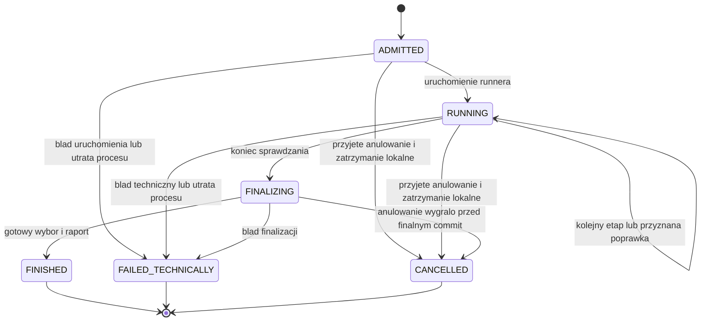

# LLD — maszyna stanów i wykonawca

**Data:** 21 października 2026. **Status:** projekt v0.1, z proponowaną semantyką LP-02–LP-04; szczegóły OD-07 i OD-08 nadal wymagają zatwierdzenia.

[Założenia](README.md) · [Model danych](model_danych.md) · [API](kontrakty_api.md)

## 1. Cykl życia, faza i ocena



`cancel_requested_at` może być ustawione w dowolnym stanie nieterminalnym. Od tego momentu nie przyjmujemy kolejnego kroku. To trwała blokada, a nie obietnica natychmiastowego zakończenia pracy u dostawcy.

`FINISHED` ma `outcome=FULFILLED` albo `UNFULFILLED`. W `FAILED_TECHNICALLY` i `CANCELLED` nie dopisujemy normalnego sukcesu, nawet jeśli w stanie roboczym bieżącego wykonania istnieje użyteczny kandydat. Uzgodnione 14 listopada 2026: wcześniej zapisany użyteczny kandydat i jego raport są dostępne do pobrania bez zmiany tych statusów i bez wznawiania generowania, walidacji lub poprawek (REQ-047, AC-35). Spośród nich zwracamy wyłącznie najnowszego użytecznego kandydata zgodnie z REQ-039 i zamkniętym OD-03.

**Specyfikacja v1.10:** nie przechowujemy archiwum wykonań (REQ-072). Obsługujemy bieżący czat z kolejnymi poleceniami (REQ-073), a maszyna stanów dotyczy pojedynczego wykonania. Powiązanie kolejnej prośby z wykonaniem pozostaje w OD-10 i OD-12. REQ-074 kończy dostęp do rozmowy i plików także po odświeżeniu lub zamknięciu strony. Ostrzeżenie i zachowanie danych po rezygnacji określa REQ-075. Opuszczenie czatu ma anulować trwające wykonanie (REQ-077). Mechanizm wykrycia wyjścia, przekazanie anulowania i moment potwierdzenia zatrzymania wymagają OD-08 i OD-09; fizyczne sprzątanie pozostaje w OD-09.

## 2. Fazy i budżet

**Uzupełnienie do specyfikacji v1.15:** prośba użytkownika o zmianę paczki przekazuje do LLM poprzednie dane i nowe polecenie; zmieniony wynik podlega walidacji jako nowy kandydat (REQ-076). Nie utożsamiamy tej prośby z automatyczną rundą poprawek. Każda nowa prośba ma własny limit, domyślnie 3 automatyczne rundy naprawcze po pierwszym kandydacie (REQ-033–REQ-034, AC-44).

Po wyczerpaniu napraw bez użytecznej poprawionej paczki pokazujemy niepowodzenie oraz poprzednią sprawdzoną paczkę z jej raportem, bez zaliczenia nowej prośby (REQ-078). Ręczna akcja „Podejmij kolejne 3 próby” zleca do 3 dodatkowych rund, bez dodatkowej rundy 0 poza limitem, i jest jednorazowa dla danej prośby (REQ-079). Jeśli dodatkowa seria również nie da użytecznej poprawionej paczki, kończymy naprawy, zachowujemy poprzednią sprawdzoną paczkę z jej raportem i nie pokazujemy ponownie przycisku. Wejściem pierwszej dodatkowej rundy jest ostatni nieudany kandydat i lista wykrytych w nim błędów, nie poprzednia sprawdzona paczka. Potrzebujemy zachować ten kandydat i wynik jego walidacji w stanie roboczym, oddzielnie od chronionego sprawdzonego wyniku. Nie jest to wznowienie po anulowaniu, błędzie technicznym lub utracie procesu.

Po nieudanym pierwszym generowaniu bez użytecznej paczki nie udostępniamy akcji dodatkowych 3 prób; po wyczerpaniu napraw pokazujemy niepowodzenie i nie uruchamiamy dodatkowej serii (REQ-079, AC-47).

Poniższy algorytm opisuje pierwszego kandydata i naprawy jednego wykonania, nie obsługuje jeszcze tej dodatkowej akcji. Techniczne przypisanie prośby i serii do wykonania oraz liczników i kontrakt przekazania kontekstu pozostają w OD-10. Nie zatwierdzamy wyzerowania licznika ani przejścia z końcowego stanu wykonania do pracy.

| Faza | Operacja | Warunek przejścia |
| --- | --- | --- |
| `GENERATING` | `GENERATE`, runda 0. | Zarejestrowany kandydat → `VALIDATING`. |
| `VALIDATING` | `VALIDATE` dla wskazanej rundy. | Raport bez naruszeń i z dowodami → `SELECTING`; naruszenia i budżet → `CORRECTING`; koniec budżetu → `SELECTING`. |
| `CORRECTING` | `CORRECT`, następna globalna runda. | Nowy kandydat → `VALIDATING`. |
| `SELECTING` | Lokalna polityka wyboru. | Zachowany wybór lub jawny brak kwalifikującego kandydata → `EXPORTING`. |
| `EXPORTING` | Lokalna finalizacja raportu i dostępnej paczki. | Gotowe artefakty → finalny commit. |

Brak wykrytych naruszeń nie wystarcza, jeśli wymagane sprawdzenie jest niewykonane. `ValidationDecisionPolicy` rozróżnia:

- `ACCEPT_CURRENT` — kandydat spełnia wszystkie obowiązkowe warunki REQ-027, w tym relacje zatwierdzone poza DDL, i brak dalszych naruszeń obsługiwanych reguł.
- `CORRECT` — rozpoznane naruszenia i dostępny budżet.
- `FINALIZE` — budżet wyczerpany albo inne normalne zakończenie z rzeczywistym stanem dowodów.
- `FAIL_TECHNICALLY` — awaria transportu, silnika sprawdzeń, zapisu wymaganego stanu roboczego lub innego wymaganego mechanizmu.

Nieobsługiwanego obowiązkowego warunku nie „naprawiamy” usuwaniem go z wymagań. Powinien zostać wykryty przed startem; jeśli ujawni się później, zapisujemy brak potwierdzenia i jawną przyczynę zamiast fikcyjnego sukcesu.

`corrections_started` zwiększamy przy przyznaniu nowej operacji poprawki, w tej samej transakcji `PrepareStep`, która ją tworzy. Nie zwiększamy go dla każdego model call ani tabeli. Jeśli operacja poprawki kończy się technicznie, nie przyznajemy kolejnej.

## 3. Admission — przed pierwszym wywołaniem

1. Wyznacz zaufany kontekst właściciela i sprawdź dostęp do zlecenia.
2. Rozpoznaj `Idempotency-Key`; identyczna komenda zwraca to samo wykonanie.
3. Sprawdź wskazaną zatwierdzoną rewizję, zgodność hashów, obsługiwane profile i wariant. Nic nie przestawia się na aktualny DDL w tle.
4. Przygotuj trwałe dokumenty migawki i wariantu. Brak wymaganego profilu lub niezatwierdzonej polityki daje blokadę przed modelem.
5. W `AdmitRun` zablokuj `runtime_guard`, sprawdź gotowość i wolne miejsce, zapisz `Run`, komendę oraz zajęcie zasobu.
6. Po commit uruchom `LocalExecutionRunner`. Nie dispatchuj pracy przed trwałym zapisem.
7. Zwróć `202`. Błąd utworzenia zadania po commit zmienia zapisane wykonanie w przerwane błędem; awaria przed odpowiedzią jest rozpoznawalna przez komendę.

Nie dodajemy trwałej kolejki do późniejszego odtworzenia. `ADMITTED` oznacza zamiar uruchomienia w bieżącym procesie; po utracie procesu nie zostanie automatycznie wykonane.

## 4. `RunCoordinator` — algorytm

Pseudokod, nie implementacja:

```text
execute(run_id):
    transition ADMITTED -> RUNNING
    candidate = run_generation_step(round_no=0)

    loop:
        report = run_validation_step(candidate)
        persist report and eligibility for this exact candidate
        decision = validation_decision_policy(report, run)

        if decision is FAIL_TECHNICALLY:
            terminate technically; stop
        if decision is CORRECT:
            atomically grant next global correction round
            candidate = run_correction_step(candidate, report)
            continue
        break

    transition RUNNING -> FINALIZING
    eligible = stored candidates satisfying all mandatory conditions of REQ-027
    selection = configured_selection_policy(eligible)
    build immutable report and any permitted export
    commit FINISHED with outcome and consistent selection
```

Każdy pomocniczy `run_*_step` wykonuje:

1. Sprawdzenie trwałego stanu, anulowania i terminu, przygotowanie kontekstu/żądania.
2. `PrepareStep`: nowa `Operation`, przypisanie epoki i aktywnego identyfikatora; stara operacja musi być zakończona.
3. Krótki zapis próby dispatch jako `EXECUTING`, następnie jedno HTTP poza transakcją. Stan oznacza rozpoczęcie próby, nie dowód dotarcia do usługi. Brak automatycznego ponawiania.
4. Rejestrację odebranych artefaktów i dowodów.
5. `ApplyStepResult`: blokada runa i operacji, kontrola epoki, tożsamości instancji, terminu, hashów i braku anulowania.
6. Atomowy zapis skutku i zamknięcie operacji. Stary wynik może zostać diagnostyką, nie przejściem.

Wyjątki techniczne i anulowanie przerywają algorytm również pomiędzy tymi punktami. Runner ma jawny rejestr zadań i sprzątanie w cyklu życia aplikacji. Nie trzyma jednej sesji SQLAlchemy ani transakcji przez cały algorytm.

## 5. Zachowanie kandydatów

- Po każdej walidacji wyliczamy kwalifikację na podstawie utrwalonych dowodów kompletności, importowalności i zgodności wszystkich obowiązujących relacji. Udany import bez potwierdzenia relacji zatwierdzonych poza DDL nie wystarcza (REQ-012, REQ-027, AC-34).
- Nowy kandydat nie nadpisuje starszego i nie usuwa go z listy użytecznych.
- Jeżeli późniejsza poprawka jest nieimportowalna, normalne zakończenie może wybrać wcześniejszy użyteczny wynik.
- Uzgodniona polityka wybiera wyłącznie najnowszego użytecznego kandydata według kolejności tworzenia w danym wykonaniu, bez porównywania liczby lub wag dodatkowych naruszeń biznesowych (REQ-039, AC-36). Wstrzykiwanie i wersjonowanie polityki pozostaje propozycją techniczną, nie możliwością zmiany tej zasady przez badanego LLM.
- Brak użytecznego wyniku → `FINISHED/UNFULFILLED`, nie wyjątek LLM tylko dlatego, że dane były błędne.
- Przy użytecznym kandydacie z pozostałymi dodatkowymi naruszeniami biznesowymi po limicie → `FINISHED/FULFILLED` z raportem naruszeń.
- Ostateczny manifest, raport i dowody wskazują tę samą wersję. Nie wybieramy raportu według daty ostatniej modyfikacji pliku.

OD-03 rozstrzygnięto 14 listopada 2026. Testy muszą potwierdzić wybór najnowszego użytecznego kandydata także wtedy, gdy ma więcej dodatkowych naruszeń niż starszy. Nowszy kandydat niespełniający warunków obowiązkowych nie zastępuje tego wyniku.

## 6. Anulowanie i fencing

Propozycja LP-03:

1. Komenda anulowania blokuje run i zapisuje `cancel_requested_at`.
2. W tej samej transakcji zwiększa `execution_epoch` i `version`. Żaden następny wynik starej epoki nie przechodzi `ApplyStepResult`.
3. Po commit backend jednorazowo wysyła sygnał do aktywnej operacji i anuluje/kończy lokalne oczekiwanie w kontrolowany sposób.
4. Generator przestaje rozpoczynać kolejne model calls; walidator zatrzymuje lokalne zapytanie i sprząta obszar próby w dostępnym zakresie.
5. Po potwierdzeniu końca lokalnej pracy zapisujemy `CANCELLED`. Jeśli nie można ustalić końca, nie przyjmujemy kolejnego zadania, a stan blokady i diagnostyka są jawne.
6. Potwierdzony brak aktywnej pracy lokalnych usług pozwala zwolnić `runtime_guard`. Dostawca nadal może kończyć uprzednio przyjęte żądanie; nie obiecujemy cofnięcia jego kosztu.

Gdy finał i anulowanie ścigają się, rozstrzyga serializacja zapisu runa:

- Finalny commit wcześniej: anulowanie odczytuje stan terminalny i niczego nie cofa.
- Żądanie anulowania wcześniej: finał nie spełnia warunku braku anulowania i nie publikuje normalnego zakończenia.

Anulowanie nie jest błędem biznesowym i nie uruchamia poprawki. Uzgodnione REQ-077 wymaga uruchomienia anulowania po opuszczeniu czatu, ale nie po samym otwarciu ostrzeżenia lub pozostaniu na stronie. Utrata połączenia przeglądarki sama nie dowodzi opuszczenia czatu i nie jest komendą anulowania. Mechanizm rozpoznania wyjścia i powiązania go z powyższą procedurą nadal wymaga projektu; nie opieramy go wyłącznie na ostatnim żądaniu strony. Utrata procesu pozostaje osobnym przypadkiem z sekcji 8, bez fikcyjnego potwierdzenia zatrzymania u dostawcy.

## 7. Timeouty i niepewność transportu

Każda operacja ma trwały `deadline_at` i lokalny budżet mierzony monotonicznie. Osobno konfigurujemy limit całego kroku oraz connect/read/write/pool HTTPX; timeout odczytu nie jest sam w sobie całkowitym limitem operacji [N4 w indeksie LLD].

W Pythonie anulowanie taska i timeout wymagają współpracy z kodem asynchronicznym. Nie zakładamy, że anulowanie oczekiwania zatrzymuje dowolny blokujący wątek lub zewnętrzne API [N5 w indeksie LLD].

Przekroczenie terminu:

- Utrwala błąd techniczny, zwiększa epokę i uniemożliwia przyjęcie późnego skutku.
- Nie zleca ponownie tej operacji i nie przełącza modelu.
- Inicjuje jednorazowe lokalne zatrzymanie i sprzątanie.
- Zwolnienie miejsca wymaga rozpoznania stanu lokalnych usług; brak potwierdzenia oznacza blokadę, nie ukryte ponawianie.

Zwykły odczyt statusu gotowości/operacji jest diagnostyką, nie ponowieniem generowania. Częstotliwość, granice oczekiwania i moment przejścia po niepotwierdzonym zatrzymaniu pozostają parametrami OD-07 i OD-08.

## 8. Restart i okna awarii

Poniższy `StartupReconciler` jest propozycją dla wariantu z zachowanym technicznym stanem roboczym. Służy sprzątaniu i zatrzymaniu pozostałej pracy, nie odzyskaniu starego czatu dla użytkownika. Po pełnym zamknięciu aplikacji REQ-074 wymaga nowej rozmowy bez poprzednich plików. Mechanizm fizycznego sprzątania wymaga OD-09; nie wznawiamy modelu ani walidacji.

Proponowany przebieg przed gotowością backendu:

1. Ustawia blokadę recovery.
2. Jeśli pozostał stan roboczy, rozpoznaje nieterminalne wykonania i operacje przygotowania poprzedniego procesu jako `PROCESS_LOST`, a nie zadania do wznowienia. Nie tworzy z nich archiwum prób.
3. Unieważnia stare epoki i uprawnienia do dalszych skutków.
4. Sprawdza instancje i aktywne operacje usług; sygnalizuje zatrzymanie rozpoznanej pozostałej pracy lub blokuje start.
5. Uzgadnia pliki techniczne i metadane bez uruchamiania modelu, walidacji i automatycznej finalizacji eksportu za przerwany proces. Nie publikuje pozostałości jako plików nowego czatu. REQ-047 dotyczy nadal dostępnej rozmowy, a nie odzyskiwania plików po jej porzuceniu zgodnie z REQ-074.
6. Zwalnia miejsce i ogłasza gotowość dopiero, gdy warunki lokalnego wykonawcy są spełnione.

Jeśli już zapisano żądanie anulowania, zachowujemy ten fakt; utrata procesu nie może go nadpisać. Dokładną prezentację zakończenia takiego wyścigu ustalimy w OD-08, bez wznowienia.

| Okno awarii | Zachowanie |
| --- | --- |
| Commit runa, brak uruchomienia runnera | Pozostawiony `ADMITTED` kończy się przerwaniem, nie późniejszym dispatch. |
| Zapis `Operation`, brak HTTP | Pozostaje dowód zamiaru; nie twierdzimy, że model został wywołany. |
| Model odpowiedział, wymagany stan roboczy nie został zapisany | Wynik nieznany/częściowe dane; brak drugiego wywołania w celu „odzyskania” odpowiedzi. |
| Zapis pliku, brak `READY` | Artefakt nie jest publikowany jako wynik. |
| Raport walidacji zapisany, brak decyzji o poprawce | Po utracie procesu nie kontynuujemy pętli. |
| Paczka gotowa, brak finalnego commit | Nie promujemy jej automatycznie po restarcie do sukcesu. |
| Finalny commit, utracona odpowiedź do UI | Odczyt zapisanego `FINISHED` w nadal dostępnym czacie; brak nowego wykonania. Nie przywraca to rozmowy po zdarzeniach z REQ-074. |

## 9. Testy kontraktu wykonania

Każdy test ma kontrolowany zegar, generator identyfikatorów i atrapę modelu liczącą faktyczne żądania. Testy nie wymagają płatnych API.

| ID | Scenariusz | Oczekiwany dowód |
| --- | --- | --- |
| LT-01 | Dwa równoległe starty. | Jeden run przyjęty, drugi jawnie odrzucony jako zajęty. |
| LT-02 | Ten sam klucz i body po utracie odpowiedzi. | Ten sam run; licznik modelu nie rośnie z powodu duplikatu. |
| LT-03 | Ten sam klucz, inne wymagania. | Konflikt, bez pracy. |
| LT-04 | Zmiana DDL/reguł po zatwierdzeniu. | Dawny run zachowuje poprzedni hash i interpretację. |
| LT-05 | Błędna treść modelu, działający transport. | Kandydat diagnostyczny i poprawka w budżecie, nie błąd SDK. |
| LT-06 | Naruszenia do wyczerpania limitu. | Pierwsza runda 0 i najwyżej 3 przyznane poprawki przy domyślnej konfiguracji. |
| LT-07 | Wiele model calls w rundzie. | Osobne metryki wywołań i jeden licznik rund. |
| LT-08 | Timeout modelu. | Dokładnie jedno żądanie tego wywołania, techniczne przerwanie, brak fallbacku. |
| LT-09 | Błąd silnika walidacji. | Przerwanie techniczne, bez prośby o poprawkę danych. |
| LT-10 | Anulowanie przed przyjęciem odpowiedzi. | Zmieniona epoka; późny wynik nie tworzy następnego etapu. |
| LT-11 | Anulowanie równocześnie z finałem. | Jeden spójny wynik zgodny z kolejnością commit. |
| LT-12 | Restart dowolnego procesu w kroku. | Stare zlecenie nie jest wykonywane ponownie. |
| LT-13 | Użyteczny kandydat, później uszkodzona poprawka. | Starszy kandydat zachowany; raport eksportu zgodny z wyborem. |
| LT-14 | Brak obowiązkowego checka albo metryki. | Brak fikcyjnego sukcesu/zera; dostępność jawna. |
| LT-15 | Wskazanie artefaktu innego projektu. | Odmowa bez ujawnienia treści. |
| LT-16 | Błąd commit lub zapisu pliku. | Brak publikacji niegotowego wyniku i brak dodatkowego wywołania LLM. |
| LT-17 | Podwójne dostarczenie pomiaru bieżącej operacji. | Brak podwójnego naliczenia. Dokładny kontrakt uproszczonego przekazywania pomiarów wymaga OD-05; test nie wymaga archiwum wiadomości. |
| LT-18 | Niepotwierdzone zatrzymanie usługi. | Zasób nie jest przydzielany nowemu zadaniu w ukryciu. |
| LT-19 | Użyteczny kandydat i raport zapisane przed anulowaniem lub błędem późniejszej poprawki (AC-35). | Paczka i zgodny raport dostępne do pobrania w obu przypadkach; status pozostaje `CANCELLED` albo `FAILED_TECHNICALLY`, bez nowych wywołań modelu, walidacji i poprawek. |
| LT-20 | Kilku użytecznych kandydatów o różnej liczbie dodatkowych naruszeń; późniejsza niespełniająca warunków poprawka (AC-36). | Zwrócony najnowszy użyteczny kandydat, nie kandydat z najmniejszą liczbą dodatkowych naruszeń ani ostatnia błędna poprawka. Ta sama zasada po przerwaniu; bez wymogu archiwum starszych wersji. |
| LT-21 | Zakres bez archiwum (AC-38). | Brak archiwum dawnych czatów i pełnych wiadomości modeli, przy zachowaniu bieżącej rozmowy, statusu, walidacji, poprawek, wyniku i raportu. Nie sprawdza jeszcze nieuzgodnionego czasu fizycznego usuwania danych roboczych. |
| LT-22 | Nowy czat, wykonane odświeżenie lub zamknięcie strony i pełne zamknięcie aplikacji (AC-40). | Po powrocie nowa rozmowa bez dostępu do starej i plików, także przez zachowane referencje. Zapisane projekty pozostają. |
| LT-23 | Ostrzeżenie przed odświeżeniem i zamknięciem strony (AC-41). | Po interakcji i utworzeniu rozmowy z plikami standardowe okno przeglądarki pozwala pozostać bez utraty danych. Potwierdzone opuszczenie strony kończy dostęp. Samo otwarcie okna nie usuwa danych. Nie wymagamy własnego tekstu ani dialogu przy wymuszonym zamknięciu procesu. |
| LT-24 | Zmiana adresów w otrzymanej paczce klientów na prośbę użytkownika (AC-42). | Kontrolowany generator otrzymuje poprzednią paczkę i nowe polecenie. Zwrócona paczka dotyczy tych samych klientów; jest ponownie walidowana i ma własny raport. Poprzedni pozytywny raport nie zastępuje sprawdzenia nowej wersji. |
| LT-25 | Opuszczenie czatu podczas generowania oraz pozostanie po ostrzeżeniu (AC-43). | „Nowy czat”, wykonane odświeżenie i zamknięcie strony inicjują anulowanie. Po jego przyjęciu nie ma kolejnego etapu ani wywołania LLM; spóźniona odpowiedź nie trafia do nowej rozmowy. Otwarcie ostrzeżenia i pozostanie nie anuluje pracy. Test transportu ma uwzględnić niedostarczenie ostatniego żądania strony po uzgodnieniu mechanizmu OD-08 i OD-09. |
| LT-26 | Nowa prośba zmiany po zużyciu limitu poprzedniej prośby (AC-44). | Po pierwszej zmienionej paczce dostępne ponownie maksymalnie 3 rundy naprawcze przy domyślnym ustawieniu. Automatyczna poprawka, kolejna tabela i kolejne wywołanie modelu nie odnawiają limitu. Po jego wyczerpaniu brak niejawnej czwartej rundy; awaria techniczna nadal kończy proces. |
| LT-27 | Brak użytecznej poprawionej paczki po 3 rundach naprawczych (AC-45). | Jawne niepowodzenie nowej prośby i liczba rund. Poprzednia sprawdzona paczka dostępna z niezmienionym raportem i oznaczeniem poprzedniej wersji; nie potwierdza wykonania nowej prośby. Brak kolejnej naprawy bez akcji użytkownika. |
| LT-28 | Ręczna akcja „Podejmij kolejne 3 próby” po LT-27 (AC-46). | Wyświetlenie nie uruchamia modelu. Kliknięcie zleca jedyną dozwoloną dodatkową serię, do 3 rund dla tych samych wymagań, bez dodatkowego pierwszego kandydata poza limitem. Po jej niepowodzeniu koniec napraw i brak ponownie oferowanego przycisku. Ponowne użycie akcji nie przyznaje drugiej dodatkowej serii. Kontrolowany generator otrzymuje ostatniego nieudanego kandydata z już zmienionymi adresami i jego wykryte błędy, nie poprzednią sprawdzoną paczkę. Ta i jej raport pozostają niezmienione i dostępne. Nowy wynik ma własną walidację i raport. Anulowanie i awaria nadal zatrzymują pracę. Szczegóły wykonania testu zależą od kontraktu OD-10. |
| LT-29 | Pierwsze generowanie bez żadnego użytecznego kandydata po domyślnych 3 rundach naprawczych (AC-47). | Niepowodzenie i rzeczywisty wynik weryfikacji, bez przycisku „Podejmij kolejne 3 próby” i bez dodatkowej serii. Samo istnienie błędnych danych nie daje gotowej paczki. |

To proponowane testy, nie wyniki wykonanych sprawdzeń. Testy adapterów PostgreSQL mają dodatkowo potwierdzać indeksy, klucze złożone, wyścigi i krótkie transakcje. Testy transportu mają sprawdzać zmieniony `service_instance_id`, timeouty i brak automatycznego retry. Dopiero działający prototyp może potwierdzić te własności.
