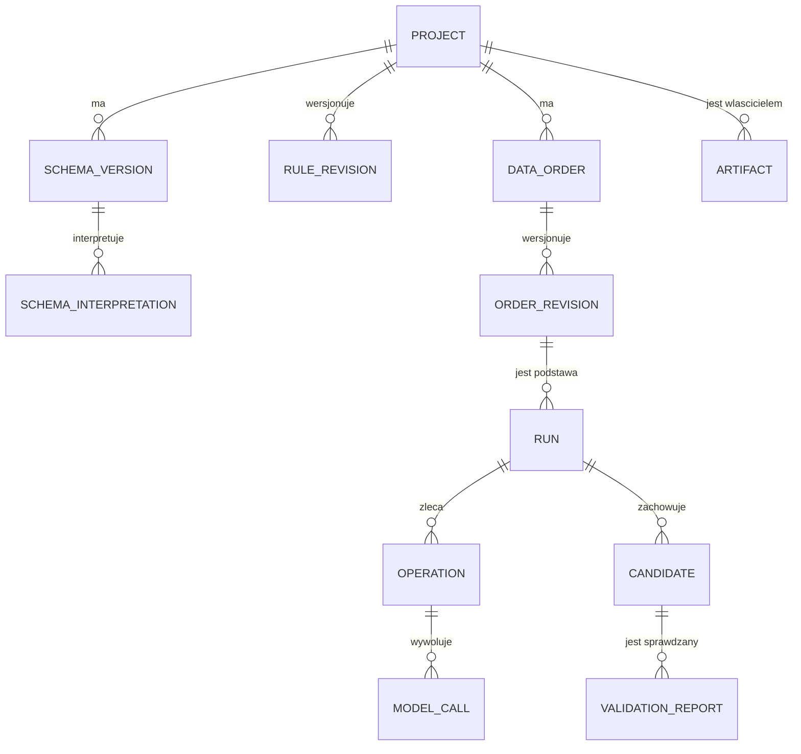

# LLD — model danych i transakcje

**Data:** 21 października 2026. **Status:** projekt v0.1, nie wykonana migracja.

[Założenia LLD](README.md) · [API](kontrakty_api.md) · [Cykl wykonania](cykl_wykonania.md)

**Aktualizacja 14 listopada 2026 — specyfikacja v1.8:** MVP nie przechowuje archiwum wykonań i wiadomości (REQ-072), ale obsługuje kolejne polecenia w bieżącym czacie (REQ-073). Model jest propozycją zapisu projektów i bieżącej pracy; powiązanie czatu z poleceniami, wykonaniami i plikami wymaga OD-10 i OD-12. REQ-074 kończy dostęp do starej rozmowy i plików także po odświeżeniu lub zamknięciu strony. Rezygnacja z wyjścia w ostrzeżeniu zachowuje dane (REQ-075). Mechanizm zakończenia dostępu i fizyczne sprzątanie pozostają w OD-09. Nie implementujemy tabel historii na zapas.

## 1. Konwencje

**Uzupełnienie do specyfikacji v1.13:** przy prośbie o zmianę danych poprzednia paczka jest wejściem dla LLM, a poprawiona — nowym kandydatem z własną walidacją i raportem (REQ-076). Każda nowa prośba ma własny limit napraw, domyślnie 3 rundy po pierwszym kandydacie (REQ-033–REQ-034). Po nieudanej zmianie trzeba zachować dostęp do poprzedniej sprawdzonej paczki z jej raportem i odróżnić go od niepowodzenia nowej prośby (REQ-078). Ręcznie zlecona dodatkowa seria ma do 3 rund i można ją przyznać tylko raz dla danej prośby (REQ-079). Stan roboczy musi umożliwiać egzekwowanie tego ograniczenia, bez zerowania wykorzystanego uprawnienia. Seria nie może zniknąć z liczników i dostępnych pomiarów (REQ-064). Jej wejściem jest ostatni nieudany kandydat i wykryte w nim błędy. Trzeba zachować ten kandydat i wynik jego walidacji oddzielnie od chronionej sprawdzonej paczki, bez archiwum wszystkich prób. Powiązanie prośby i serii ze zleceniem, wykonaniem, licznikami oraz referencjami do tych danych nadal wymaga OD-10. Nie dodajemy bez uzgodnienia nowych tabel ani nie zmieniamy wstecz wymagań i raportu poprzedniej wersji.

- Identyfikatory: UUID nadawane przez aplikację; nie traktujemy ich jako uprawnienia.
- Czas: `timestamptz`, zapis i API w UTC. Czas trwania mierzymy monotonicznie w procesie; po awarii nie fabrykujemy brakującego pomiaru.
- `version bigint` do konkurencyjnych zapisów obiektów zmiennych. Niezmienne rewizje nie są aktualizowane w miejscu.
- Statusy: tekst z jawnymi ograniczeniami `CHECK`, mapowany na własne enumy aplikacji.
- Dokładny duży dokument: artefakt z hashem. `jsonb` służy do opisu i projekcji wyszukiwania, nie do odtworzenia oryginalnych bajtów.
- Hash SHA-256 liczymy po zapisanych bajtach. Dla migawki zapisujemy jeden serializowany dokument i jego hash; nie odtwarzamy hasha z kolejności kluczy `jsonb`.
- Każdy zasób należy do projektu. Relacje złożone i kontrole UoW zapobiegają łączeniu identyfikatorów z różnych projektów i wykonań.
- Bez archiwum wykonań; zasady sprzątania stanu roboczego i usuwania projektów pozostają w OD-09.

## 2. Własność i główne relacje

Wszystkie poniższe tabele należą do `application-api` w `app-db`. Usługi pomocnicze nie dostają poświadczeń tej bazy.



Diagram pomija techniczne klucze złożone i kilka referencji. Nie oznacza, że każdy koncept wymaga osobnego serwisu.

## 3. Projekty i wymagania

| Tabela | Najważniejsze kolumny | Niezmienniki |
| --- | --- | --- |
| `projects` | `id`, `owner_subject text`, `name`, `description`, `version`, `created_at` | Uzgodnione 14 listopada 2026 w S2-T1: nazwa wymagana, 1–100 znaków; opis opcjonalny, do 2000 znaków; bez zamkniętej listy dziedzin. Walidacja i zapis po usunięciu brzegowych białych znaków; pusta nazwa jest błędem, pusty opis oznacza brak opisu; przekroczenie limitu odrzucamy bez obcinania treści. Nazwy są unikalne w instalacji bez rozróżniania wielkości liter; duplikat odrzucamy bez nadpisania projektu. Realizacja ograniczenia w bazie pozostaje otwarta. Pozostały model jest propozycją: lokalny `owner_subject` ze zaufanego adaptera, nie z body żądania; bez tabeli kont w MVP. |
| `schema_versions` | `id`, `project_id`, `revision_no`, `ddl_artifact_id`, `ddl_sha256`, `created_at` | `UNIQUE(project_id, revision_no)`; DDL i hash niezmienne. |
| `schema_interpretations` | `id`, `project_id`, `schema_version_id`, `revision_no`, `model_artifact_id`, `analysis_profile`, `diagnostics jsonb`, `approval_state` | Wiąże dokładne DDL z wersją rozpoznania i zatwierdzonymi uzupełnieniami. Po zatwierdzeniu nowa interpretacja oznacza nowy wiersz. |
| `rule_revisions` | `id`, `project_id`, `rule_key`, `revision_no`, `source_text`, `kind`, `definition jsonb`, `definition_sha256`, `approval_state`, `approved_at` | `UNIQUE(project_id, rule_key, revision_no)`; `kind` odróżnia regułę sprawdzalną, jakościową i nierozstrzygniętą. Zatwierdzona treść nie jest nadpisywana. |
| `data_orders` | `id`, `project_id`, `created_at`, `version` | Tożsamość zlecenia, nie ruchoma definicja wykonania. |
| `order_revisions` | `id`, `project_id`, `order_id`, `revision_no`, `schema_interpretation_id`, `requirements_artifact_id`, `requirements_sha256`, `approval_state`, `approved_at` | Cały plan: polecenie, wyjaśnienia, reguły, liczebności, format i relacje. `UNIQUE(order_id, revision_no)`; aprobata dotyczy dokładnego hasha. |
| `variant_snapshots` | `id`, `project_id`, `config_artifact_id`, `config_sha256`, `created_at` | Faktyczny wariant, prompty i konfiguracja bez sekretów. Niezmienny dokument. |

**Wiele plików DDL — uzgodnienie S2-T2 z 14 listopada 2026:**
MVP dopuszcza także paczki wielu plików DDL, nie tylko pojedynczy plik SQL.
Model musi uwzględnić ten zakres; powyższe proponowane pola artefaktu
i skrótu DDL nie rozstrzygają przechowywania paczki. Użytkownik zaznacza
wiele plików SQL i wysyła je razem w formularzu, bez konieczności tworzenia
archiwum; nie uzgodniono obsługi ZIP. Wszystkie pliki wysłane razem tworzą
jedną pełną wersję schematu, dopuszczaną do użycia tylko w całości.
Błąd analizy w jednym pliku blokuje całą nową wersję; nie zastępujemy
części dotychczasowego schematu. Nieudaną wersję zachowujemy z diagnostyką.
Użytkownik może ustawić kolejność plików przed wysłaniem. Aplikacja
traktuje je w tej kolejności jako jeden skrypt DDL, bez samodzielnego
przestawiania. Zapis wersji musi zachować tę kolejność.
Pliki DDL muszą być w UTF-8; niepoprawne kodowanie powoduje czytelny
błąd, bez automatycznego zgadywania i konwersji. Dopuszczamy BOM na początku
każdego pliku UTF-8. Zachowujemy oryginalny plik bez zmian, a znacznik
pomijamy wyłącznie na potrzeby analizy. Limity i techniczny zapis paczki
są otwarte.

**Odrzucenie kodowania — uzgodnienie S2-T2 z 14 listopada 2026:**
w MVP błędne kodowanie jednego pliku odrzuca całą paczkę przed utworzeniem
wersji schematu i uruchomieniem analizy DDL. Użytkownik ponownie wysyła
pełną poprawioną paczkę. Podmiana pojedynczego pliku pozostaje kierunkiem
rozwoju po MVP, nie wymaganiem obecnego modelu. Szczegóły sprzątania
tymczasowo odebranych plików i kontrakt błędu są nadal otwarte.

**Puste pliki — uzgodnienie S2-T2 z 14 listopada 2026:** pusty plik
lub plik zawierający wyłącznie białe znaki odrzuca całą paczkę przed
utworzeniem wersji schematu. Nie pomijamy takich plików automatycznie.
Dotyczy również przesłania pojedynczego pliku. Tak samo traktujemy plik
zawierający wyłącznie komentarze SQL i ewentualne białe znaki,
bez instrukcji SQL: odrzucamy całą paczkę przed utworzeniem wersji.

**Unikalność nazw plików — uzgodnienie S2-T2 z 14 listopada 2026:**
w jednej paczce nazwy plików są unikalne bez rozróżniania wielkości liter.
Konflikt odrzuca całą paczkę przed utworzeniem wersji schematu,
np. dla pary `schema.sql` i `SCHEMA.sql`. Techniczne porównanie nazw
i zapis tego ograniczenia pozostają do doprecyzowania.

**Zbiorcze błędy wstępnego sprawdzenia — uzgodnienie S2-T2
z 14 listopada 2026:** dla kompletnie odebranej paczki zwracamy razem
wykryte błędy kodowania, pustych plików i konfliktów nazw, zamiast kończyć
sprawdzanie na pierwszym błędzie. Nie tworzymy wersji ani nie uruchamiamy
analizy DDL dla odrzuconej paczki. Nie wymaga to analizy treści pliku,
którego nie można poprawnie odczytać, ani zebrania wszystkich błędów
późniejszej analizy DDL. Kontrakt listy problemów pozostaje otwarty.

**Awaria transferu lub zapisu — uzgodnienie S2-T2 z 14 listopada 2026:**
przerwany transfer lub nieudany zapis paczki nie tworzy nowej wersji
schematu. Dotychczasowy schemat pozostaje bez zmian; wymagane jest ponowne
wysłanie całej paczki. Nie mylimy tego z nieudaną analizą kompletnej,
zapisanej paczki. Techniczny sposób zapewnienia spójnego zapisu
i sprzątania niekompletnych plików pozostaje otwarty. Utrata odpowiedzi
serwera nie dowodzi nieudanego zapisu. Aplikacja najpierw sprawdza wynik
wysłania paczki, zamiast od razu proponować ponowne wysłanie, aby nie
utworzyć duplikatu udanego zapisu.
**Identyfikacja próby — uzgodnienie S2-T2 z 14 listopada 2026:**
frontend tworzy unikalny identyfikator każdej próby przed wysłaniem
plików. Po utracie odpowiedzi odczytuje wynik tej samej próby
z backendu po tym identyfikatorze, bez ponownego przesyłania paczki.
Format i przechowywanie identyfikatora, powiązanie próby z wersją,
kontrakt odczytu są otwarte.

**Nadal nieznany wynik — uzgodnienie S2-T2 z 14 listopada 2026:**
do ustalenia wyniku blokujemy ponowne wysłanie tej paczki i udostępniamy
„Sprawdź ponownie”. Akcja odczytuje wynik tej samej próby, bez przesyłania
plików. Niedostępny odczyt nie upoważnia do uznania zapisu za nieudany.
Zachowanie identyfikatora i blokady po odświeżeniu lub ponownym otwarciu
strony wymaga osobnego uzgodnienia.

**Uzupełnienie dotyczące wyjścia podczas transferu — uzgodnienie
S2-T2/S2-T6 z 14 listopada 2026:** odświeżenie lub zamknięcie
strony/aplikacji podczas przesyłania ma je anulować, po ostrzeżeniu
użytkownika. Rezygnacja z wyjścia nie anuluje transferu. Ograniczenia
ostrzeżenia opisano w sekcji 11.1 specyfikacji.
**Doprecyzowanie 14 listopada 2026:** po wykonanym wyjściu przed
otrzymaniem potwierdzenia przez przeglądarkę nie zachowujemy nowej wersji,
nawet jeśli backend zapisał już całą paczkę. Usuwamy pliki anulowanej
próby bez zmiany wcześniejszych wersji. Mechanizm rozpoznania wyjścia
i odebrania potwierdzenia, anulowania i sprzątania są otwarte.
Zapis plików nie może sam w sobie przesądzać
o zachowaniu nowej wersji w tym scenariuszu.
Nie przyjęto przywracania nierozstrzygniętej próby po ponownym otwarciu.

**Potwierdzenie odbioru — uzgodnienie S2-T2/S2-T6 z 14 listopada 2026:**
zapis paczki jest najpierw roboczy. Backend może uruchomić analizę dopiero
po otrzymaniu dodatkowego potwierdzenia z przeglądarki, że odebrała
komunikat o zapisie. Potwierdzenie jest automatyczne, bez nowej decyzji
użytkownika. Sam zapis i wysłanie odpowiedzi przez serwer nie wystarczają.
Reprezentacja zapisu roboczego, kontrakt potwierdzenia, jego utrata
i ponowienia oraz rozpoznanie i sprzątanie porzuconej paczki są otwarte.

**Analiza w tle — uzgodnienie S2-T2 z 14 listopada 2026:**
odebranie i zapis plików potwierdzamy niezależnie od zakończenia analizy.
Analiza DDL działa w tle, a interfejs pokazuje jej stan. Sam zapis wersji
nie potwierdza jej poprawności ani gotowości do generowania.
**Niezależność od strony — uzgodnienie S2-T2/S2-T6 z 14 listopada 2026:**
po przyjęciu dodatkowego potwierdzenia analiza działa asynchronicznie;
odświeżenie lub zamknięcie strony nie anuluje rozpoczętej analizy
przyjętej paczki ani nie usuwa jej danych. Nadal można świadomie
przerwać analizę osobną akcją. Nie oznacza to działania przy zatrzymanym
backendzie; wtedy obowiązują ustalenia dotyczące awarii.
Po awarii przerywającej analizę aplikacja automatycznie uruchamia
analizę zapisanej paczki ponownie, gdy jest to możliwe, bez ponownego
wgrywania plików i bez ręcznej akcji użytkownika. Nie zmienia oryginalnych
plików ani nie naprawia ich treści. Nie dotyczy to ponawiania generowania.
Limit wynosi maksymalnie trzy automatyczne ponowienia po awarii,
poza pierwszym uruchomieniem analizy. Po wyczerpaniu zatrzymujemy analizę
z czytelnym błędem, bez kolejnego automatycznego ponowienia. Limit ten
jest odrębny od rund naprawczych generowania.
Przy ponowieniu kontynuujemy analizę od zachowanego postępu, jeżeli
jest to technicznie możliwe i zapewnia poprawny, kompletny wynik.
Wykonalność, zakres i techniczny zapis takiego postępu nie zostały
zweryfikowane ani zaprojektowane. Gdy kontynuacja nie jest możliwa,
automatycznie analizujemy zapisaną paczkę od początku, bez ponownego
wgrywania i w ramach tego samego limitu trzech ponowień. Zmiana
sposobu ponowienia nie daje dodatkowego limitu.
**Po wyczerpaniu ponowień — uzgodnienie S2-T2/S2-T6 z 14 listopada 2026:**
nie ma ręcznego ponowienia analizy zapisanej paczki. Dalsza próba wymaga
ponownego wgrania całej paczki, bez podmiany pojedynczego pliku
i bez wznawiania zakończonej analizy.
Dokładne stany, ich zapis, mechanizm uruchamiania, zapis licznika
i odstępy ponowień są otwarte.
Nie uzgodniono procentowego postępu.

**Globalny limit — uzgodnienie S2-T2 z 14 listopada 2026:** w MVP
jednocześnie działa najwyżej jedna analiza DDL w całej aplikacji,
nie jedna na projekt. Zapis wielu projektów pozostaje dopuszczony.
**Blokada wgrywania — uzgodnienie S2-T2/S2-T6 z 14 listopada 2026:**
podczas analizy blokujemy przyjmowanie DDL we wszystkich projektach,
bez kolejki oczekujących paczek.
**Początek blokady — uzgodnienie S2-T2/S2-T6 z 14 listopada 2026:**
blokada działa już od rozpoczęcia wysyłania paczki, dla wszystkich
projektów i kart przeglądarki. Kolejna paczka nie może być wysyłana
równocześnie, także przed uruchomieniem analizy.
**Oczekiwanie na ponowienie — uzgodnienie S2-T2/S2-T6
z 14 listopada 2026:** blokada pozostaje aktywna podczas oczekiwania
na automatyczne ponowienie po awarii, również pomiędzy uruchomieniami
analizy. Techniczne egzekwowanie i zapis blokady pozostają otwarte.

**Zastąpienie analizowanego DDL — uzgodnienie S2-T2 z 14 listopada 2026:**
przed wgraniem kolejnej wersji w tym samym projekcie użytkownik przerywa
bieżącą analizę i czeka na jej zatrzymanie. Nie dopuszczamy równoległej
analizy obu wersji w tym projekcie. Świadome przerwanie nie jest awarią
i nie uruchamia automatycznego ponowienia starej analizy. Rozróżnienie
tych przyczyn musi być uwzględnione w modelu stanu; pola i mechanizm
potwierdzenia zatrzymania pozostają otwarte. Użytkownik odrzucił zachowanie
plików ręcznie przerwanej analizy jako wersji schematu oznaczonej
„przerwana”. Po potwierdzonym ręcznym zatrzymaniu usuwamy pliki wgrane
dla tej analizy i jej częściowy wynik, bez zmiany wcześniejszych wersji.
Ręczne przerwanie wymaga potwierdzenia w interfejsie z ostrzeżeniem
o usunięciu tych plików i częściowego wyniku. Rezygnacja z potwierdzenia
nie przerywa analizy ani nie usuwa danych.
Techniczne usuwanie artefaktów, rozliczenie rekordu roboczej wersji
i obsługa błędu sprzątania pozostają do uzgodnienia. Nie zmienia to zasad
ponowienia po awarii i zachowania wersji po błędzie analizy.

**Nieudana analiza DDL — uzgodnienie S2-T2 z 14 listopada 2026:**
zachowujemy przesłany DDL jako osobną wersję z diagnostyką.
Nieudana analiza nie dopuszcza tej wersji do generowania i nie zastępuje
dotychczasowej używanej wersji schematu. Poprawiony pełny DDL tworzy
kolejną wersję, nie nadpisuje nieudanej. Dokładny zapis stanu analizy
i wskazania używanej wersji nadal wymaga projektu; powyższe nazwy tabel
i pól nie zostały zatwierdzone w całości.

**Lokalizacja diagnostyki — uzgodnienie S2 z 14 listopada 2026:**
jeżeli miejsce błędu analizy można ustalić, wskazujemy nazwę oryginalnego
pliku i numer wiersza w tym pliku, nie tylko pozycję w połączonym skrypcie.
Problem dotyczący całej paczki otrzymuje opis bez sztucznej lokalizacji.
Model diagnostyki i mapowanie pozycji wymagają doprecyzowania; nie wybrano
nazw pól ani formatu zapisu.

**Domyślna wersja DDL — uzgodnienie S2-T2 z 14 listopada 2026:**
nowa wersja po poprawnej analizie, bez blokad uniemożliwiających jej
użycie, automatycznie staje się domyślną dla nowych zleceń.
Nie zmieniamy wersji ani wymagań przypiętych do rozpoczętych wykonań
(REQ-014). Nie zatwierdzono jeszcze technicznego zapisu tego wskazania.

**Ponowne zatwierdzenie po zmianie DDL — uzgodnienie S2-T2
z 14 listopada 2026:** reguły biznesowe i zatwierdzone relacje spoza DDL
z poprzedniej wersji wymagają ponownej weryfikacji i zatwierdzenia
przed użyciem z nową wersją schematu. Nie przenosimy samego zatwierdzenia.
Nie zmieniamy ustaleń przypiętych do rozpoczętych wykonań.
Dotychczasowe reguły i relacje pokazujemy jako propozycje do przeglądu,
bez konieczności wpisywania ich od początku. Nie obowiązują z nową wersją
przed ponowną weryfikacją i zatwierdzeniem. Start generowania na nowym
schemacie jest zablokowany do rozpatrzenia każdej propozycji: zatwierdzenia
po weryfikacji albo świadomego odrzucenia dla nowej wersji. Wskazanie wersji
domyślnej nie jest równoznaczne z gotowością do generowania. Zakończenie
przeglądu nie omija innych blokad. Techniczny zapis powiązań, zatwierdzeń
i wyniku przeglądu pozostaje do wyjaśnienia.

**Unikalność nazw — uzgodnienie S2-T1 z 14 listopada 2026:** nazwy są
unikalne w danej instalacji bez rozróżniania wielkości liter, po usunięciu
brzegowych białych znaków. Próba utworzenia duplikatu zwraca czytelny
błąd i nie nadpisuje projektu. Techniczna realizacja porównania i ograniczenia w bazie pozostaje
do uzgodnienia.

**Uzgodnienie S2-T1 — 14 listopada 2026:** projekt można utworzyć
i trwale zapisać przed dodaniem pierwszej wersji DDL. Brak wersji
schematu nie oznacza utraty projektu ani gotowości do generowania.
Dokładne pola techniczne opisujące gotowość pozostają propozycją
do doprecyzowania.

Znaczenie `approval_state`: `PROPOSED`, `BLOCKED`, `APPROVED`. To propozycja nazw. Zatwierdzenie jest metadanymi niezmiennego dokumentu; zmiana jego znaczenia tworzy nową rewizję i wymaga ponownego zatwierdzenia.

Wymagania w `order_revisions` zawierają odniesienia do reguł oraz ich zatwierdzone definicje. Referencja ułatwia nawigację, a kopia chroni wymagania bieżącego wykonania przed zmianą projektu. Nie służy odtwarzaniu dawnych prób.

`schema_interpretations` ma również `UNIQUE(schema_version_id, revision_no)`. Ograniczenia i referencje obejmują projekt, nie tylko identyfikator interpretacji.

## 4. `runs` — stan procesu

| Kolumna | Typ / rola |
| --- | --- |
| `id`, `project_id` | UUID, identyfikacja wykonania i zakresu. |
| `order_revision_id`, `variant_snapshot_id` | Dokładne wersje wymagań i realizacji. |
| `snapshot_artifact_id`, `snapshot_sha256` | Pełna niezmienna migawka używana także przy ręcznym nowym wykonaniu. |
| `lifecycle` | `ADMITTED`, `RUNNING`, `FINALIZING`, `FINISHED`, `FAILED_TECHNICALLY`, `CANCELLED`. |
| `phase` | Nullable: `GENERATING`, `VALIDATING`, `CORRECTING`, `SELECTING`, `EXPORTING`. |
| `version`, `execution_epoch` | Licznik zapisu i licznik unieważniania uprawnień operacji. |
| `active_operation_id` | Nullable, jedyna operacja mogąca obecnie zmienić przebieg. |
| `correction_limit`, `corrections_started` | Nieujemne liczby, `corrections_started <= correction_limit`. |
| `cancel_requested_at` | Nullable, trwała blokada przejścia do następnych kroków. |
| `selected_candidate_id`, `selected_validation_report_id` | Nullable, zgodna para z tego samego wykonania. |
| `outcome` | `FULFILLED`, `UNFULFILLED` albo NULL. Nie jest statusem biznesowej zgodności. |
| `termination_code` | Np. `ALL_CHECKS_SATISFIED`, `CORRECTION_LIMIT_REACHED`, `MODEL_TIMEOUT`, `PROCESS_LOST`, `USER_CANCELLED`. |
| `created_at`, `started_at`, `finished_at` | Trwałe znaczniki czasu, odpowiednio nullable. |
| `duration_ms` | Nullable, brak pomiaru po awarii nie jest zerem. |

Proponowane ograniczenia:

- `FINISHED` wymaga `outcome IS NOT NULL` i `finished_at`.
- `FULFILLED` wymaga wybranego kandydata i jego raportu; transakcyjna polityka sprawdza dowody kompletności, importowalności oraz zgodności obowiązujących relacji, także zatwierdzonych poza DDL.
- `FAILED_TECHNICALLY` i `CANCELLED` nie deklarują `FULFILLED`, ale pozwalają pobrać wcześniej zapisanego użytecznego kandydata i jego raport (REQ-047, AC-35). Dostępność pobrania nie wynika więc wyłącznie z `lifecycle=FINISHED`; musi uwzględniać dowody kwalifikacji i gotowość artefaktów. Referencje wyboru muszą wskazywać najnowszego użytecznego kandydata zgodnie z REQ-039, nie po prostu najnowszy plik lub raport.
- Stan terminalny wymaga `active_operation_id IS NULL` i `phase IS NULL`.
- Reguł między wieloma wierszami nie udajemy pojedynczym `CHECK`. Realizujemy je kluczami złożonymi i UoW.

`UNIQUE(project_id, id)` umożliwia FK złożone. Dla kandydata i raportu stosujemy klucze obejmujące również `run_id`, tak aby zwykłe podstawienie obcego UUID nie tworzyło poprawnej relacji.

## 5. Operacje i pojedyncze miejsce pracy

### `operations`

Kolumny: `id`, `project_id`, `run_id NULL`, `order_revision_id NULL`, `kind`, `status`, `error_code NULL`, `execution_epoch NULL`, `round_no NULL`, `request_artifact_id`, `request_sha256`, `response_artifact_id NULL`, `response_sha256 NULL`, `deadline_at`, `created_at`, `started_at NULL`, `finished_at NULL`, `service_instance_id NULL`, `access_token_digest`, `token_expires_at`.

- `kind`: `INTERPRET`, `GENERATE`, `CORRECT`, `VALIDATE`.
- `status`: `PREPARED`, `EXECUTING`, `COMPLETED`, `FAILED`, `CANCELLED`, `UNKNOWN`.
- Interpretacja ma rewizję zlecenia bez `run_id`; inne rodzaje mają `run_id`.
- `UNKNOWN` opisuje nierozstrzygniętą próbę po utracie odpowiedzi/procesu. Nie uprawnia do ponownego dispatch ani zwolnienia miejsca bez rozpoznania lokalnej pracy. `error_code` zachowuje np. `PROCESS_LOST` albo `MODEL_TIMEOUT`.
- `round_no=0` to pierwsze generowanie; `1..correction_limit` to rundy poprawek.
- `UNIQUE(run_id, kind, round_no)` dla operacji procesu w prostym wariancie jednego kandydata na rundę. Nie ogranicza liczby `model_calls` wewnątrz operacji.
- Token jest losowym uprawnieniem do konkretnej operacji; w bazie trzymamy jego skrót, nie umieszczamy go w dokumentach i logach.

### `runtime_guard`

Jeden techniczny wiersz instalacji: `id=1`, `boot_id`, `active_run_id NULL`, `active_preparation_id NULL`, `recovery_blocked bool`, `version`.

Co najwyżej jedno z pól aktywnej pracy jest niepuste. Przygotowanie używające LLM zajmuje ten sam zasób co wykonanie; zwykły odczyt statusu i projektu nie zajmuje go.

Rezerwacja blokuje wiersz tylko w krótkiej transakcji. Miejsce pozostaje logicznie zajęte w czasie pracy, ale transakcja nie jest otwarta przez czas odpowiedzi modelu. Blokady wierszy PostgreSQL trwają do końca transakcji; to ograniczenie uzasadnia krótkie UoW [N2 w indeksie LLD].

Dodatkowa osłona danych, do próby migracji:

```sql
CREATE UNIQUE INDEX ux_runs_one_live_run
    ON runs ((1))
    WHERE lifecycle IN ('ADMITTED', 'RUNNING', 'FINALIZING');

CREATE UNIQUE INDEX ux_operations_one_live_per_run
    ON operations (run_id)
    WHERE run_id IS NOT NULL
      AND status IN ('PREPARED', 'EXECUTING');
```

Indeks częściowy może wymuszać unikalność wybranego podzbioru wierszy [N3 w indeksie LLD]. To globalne ograniczenie MVP, nie gotowy model limitów wielu użytkowników. Nie zastępuje wspólnego `runtime_guard` dla przygotowania i wykonań.

## 6. Kandydaci, raporty i kontekst

| Tabela | Kolumny i reguły |
| --- | --- |
| `context_packages` | `id`, `project_id`, `operation_id`, `artifact_id`, `sha256`, `selector_version`, `budget_metadata jsonb`. Pakiet przypięty do operacji; poprawka może zawierać inny raport, nie inne wymagania. |
| `candidates` | `id`, `project_id`, `run_id`, `generation_operation_id`, `round_no`, `manifest_artifact_id`, `manifest_sha256`, `extraction_status`, `created_at`. `UNIQUE(run_id, round_no)` w bazowej strategii; po publikacji niezmienny. |
| `validation_reports` | `id`, `project_id`, `run_id`, `candidate_id`, `operation_id`, `snapshot_sha256`, `candidate_manifest_sha256`, `profile_id`, `validator_version`, `report_artifact_id`, `report_sha256`, `complete`, `importable`, `business_summary jsonb`, `created_at`. |

`complete` i `importable` są trójwartościowe: TRUE, FALSE, NULL dla niepotwierdzenia. Kwalifikacja użytecznego kandydata wymaga obu TRUE oraz pozytywnych dowodów zgodności wszystkich obowiązujących relacji. Relacje zatwierdzone poza DDL mają osobne wyniki w dokumencie raportu; ich naruszenie nie zmienia `importable=true` po udanym imporcie, ale blokuje kwalifikację (REQ-012, REQ-027, AC-34). Dokładna postać podsumowania tych dowodów w modelu danych pozostaje do doprecyzowania. Dodatkowe reguły biznesowe mają pełny stan w dokumencie raportu, nie tylko liczbę błędów.

Raport jest niezmienny. Nie przeliczamy dawnego raportu automatycznie nową wersją walidatora. Ewentualne odrębne ponowne badanie wymagałoby nowej operacji poza bazowym przebiegiem, nie nadpisania dowodu.

Hashe w raporcie muszą zgadzać się z migawką i manifestem. Wybrana para w `runs` ma FK obejmujący `project_id`, `run_id`, `candidate_id` i identyfikator raportu; odpowiednie zestawy mają ograniczenia UNIQUE w tabelach docelowych. Nie tworzymy FK z cyklem wymagającym kandydata przed startem: referencje wyboru są początkowo NULL.

Identyfikatory operacji i pakietu kontekstu można nadać przed zapisem. Bajty kontekstu i żądania przygotowujemy jako artefakty z `operation_id=NULL`; nie są jeszcze udostępnione usłudze. `PrepareStep` zapisuje operację oraz `context_packages` i przypina przygotowane artefakty w jednej transakcji. Dzięki temu nie powstaje cykl wymagający istniejącej operacji do zapisania jej własnego żądania. Dopiero po commit token operacji pozwala odczytać te zasoby.

## 7. Artefakty i pomiary bieżącego wykonania

### `artifacts`

`id`, `project_id`, `operation_id NULL`, `kind`, `state`, `storage_key`, `expected_sha256 NULL`, `sha256 NULL`, `size_bytes NULL`, `media_type`, `created_at`, `ready_at NULL`.

- Stan: `WRITING`, `READY`, `ABANDONED`; nie publikujemy ścieżki systemowej.
- Tylko `READY` może wejść do manifestu lub eksportu. Stan i zgodność projektu sprawdza UoW, nie sam FK.
- `kind` rozróżnia DDL, migawkę, kontekst, dane kandydata, manifest, raport i paczkę; bez archiwum wiadomości.
- Przechowywane bajty nie są zmieniane pod istniejącym kluczem. Nowa treść otrzymuje nowe `artifact_id`.
- Treść deduplikowana po hashach nie daje automatycznie prawa odczytu innego projektu.

### `model_calls`

Wyłącznie proponowane dane operacyjne do pomiarów bieżącego raportu, nie trwałe archiwum wywołań. Referencje do pełnych wiadomości z dawnej propozycji nie są wymaganiem MVP. Minimalny zestaw danych i czas ich życia wymagają OD-05 i OD-09.

`id`, `project_id`, `operation_id`, `call_index`, `role`, `provider`, `requested_model`, `reported_model NULL`, `settings jsonb`, `status`, `provider_request_id NULL`, `finish_reason NULL`, `started_at`, `finished_at NULL`, `metrics jsonb`. Bez kolumn do archiwizacji pełnych treści żądań i odpowiedzi.

Status rozróżnia próbę zgłoszoną przed wysłaniem, potwierdzoną odpowiedź/błąd i wynik nieznany. Zapis przed wysłaniem nie dowodzi dotarcia żądania do dostawcy. Po timeoutcie nie dopisujemy fałszywego `usage=0`.

`UNIQUE(operation_id, call_index)` i PK `id` zapobiegają podwójnemu wliczeniu. `metrics` ma osobną dostępność i pochodzenie każdej wartości. Koszt rozróżnia wartość raportowaną i szacowaną oraz walutę; nie sumujemy różnych walut jako jednej kwoty.

### Archiwum `trace_events` — poza MVP

Dawna propozycja utrzymywania zdarzeń pełnych wiadomości, ich treści i kursora historii nie należy do MVP. Nie tworzymy tej tabeli ani publicznego odczytu historii na zapas. Sposób zebrania dostępnych pomiarów do bieżącego raportu wymaga przeglądu kontraktu; nie jest zgodą na archiwizację.

Pomiary nie sterują kolejnymi etapami i nie pozwalają spóźnionej odpowiedzi wznowić zakończonego procesu. Brak danych po awarii jest jawny, nie zastępowany zerem.

### `commands`

`id`, `actor_subject`, `scope_id`, `command_kind`, `idempotency_key`, `request_sha256`, `resource_id`, `result_status`, `created_at`.

`UNIQUE(actor_subject, scope_id, command_kind, idempotency_key)`. Zapis komendy i utworzenie wykonania są w jednej transakcji. Ten sam klucz z inną treścią jest konfliktem. Deduplikacja dostarczonej ponownie komendy nie oznacza automatycznego retry modelu.

## 8. Transakcje

| Nazwa | Co jest atomowe | Co dzieje się poza transakcją |
| --- | --- | --- |
| `ApprovePlan` | Sprawdzenie hasha/rewizji i zatwierdzenie niezmiennej definicji. | Brak wywołań modelu w czasie zatwierdzania. |
| `AdmitRun` | Dostęp, deduplikacja, blokada `runtime_guard`, sprawdzenie zatwierdzenia, zapis migawki/referencji, `Run` i komendy. | Zapis dużego dokumentu przygotowany wcześniej przez protokół artefaktów; uruchomienie zadania po commit. |
| `PrepareStep` | Blokada runa, brak anulowania, budżet, nowa operacja, kontekst i uprawnione artefakty, przypięcie `active_operation_id`, zwiększenie `version`; dla poprawki również `corrections_started`. | Przygotowanie dużych dokumentów przed UoW, HTTP do usługi po commit, nigdy przed. |
| `ApplyStepResult` | Weryfikacja fencing i hashów, publikacja kandydata/raportu, zakończenie operacji, przejście fazy. | Transfer dużych plików przed publikacją. |
| `RequestCancel` | Zapis żądania, zwiększenie epoki i wersji. | Jednorazowy sygnał zatrzymania i kontrola lokalnych zadań. |
| `FinalizeRun` | Zgodna para wyboru, referencje gotowego eksportu, terminalny wynik i powód zakończenia. | Budowanie paczki i pliku raportu przed finalnym commit. |

Wszystkie ścieżki blokują obiekty w tej samej kolejności: `runtime_guard`, jeśli potrzebny → `run` → `operation`. Transakcje tylko odczytujące status nie muszą blokować wiersza.

Przykład warunkowego przyjęcia wyniku, nie kompletna migracja:

```sql
UPDATE runs
SET version = version + 1
WHERE id = :run_id
  AND project_id = :project_id
  AND version = :expected_version
  AND lifecycle = 'RUNNING'
  AND cancel_requested_at IS NULL
  AND execution_epoch = :operation_epoch
  AND active_operation_id = :operation_id;
```

Zero zmienionych wierszy oznacza ponowne rozpoznanie stanu, nie ponowne uruchomienie HTTP. Kontrola terminu operacji i atomowy zapis jej rezultatu są częścią tej samej UoW.

Do odczytów bieżącej pracy proponujemy indeks `artifacts(project_id, id)` i indeksy FK niewynikające z istniejących PK/UNIQUE. Część, np. `(project_id, id)`, może już wynikać z potrzebnego ograniczenia złożonego; nie tworzymy jej drugi raz. Indeksy listy dawnych wykonań i kursora historii nie należą do MVP. Dokładny plan indeksów zweryfikujemy z rzeczywistymi zapytaniami.

## 9. Mapa błędów trwałości

- Sukces commit z utraconą odpowiedzią: odczyt po `idempotency_key`/`run_id`, bez nowego modelu.
- Brak commit po odpowiedzi modelu: możliwa luka dowodu. Zatrzymanie techniczne, nie ponowienie wywołania.
- Plik gotowy, metadane niegotowe: plik nie jest dostępny; uzgodnienie techniczne po odzyskaniu dostępu.
- Metadane gotowe, plik utracony: `ARTIFACT_INTEGRITY_FAILED`, nie eksport pustego pliku.
- Konkurencyjny zapis/deadlock: nie dodajemy automatycznego retry transakcji wykonującej krok. Trwały status i klasyfikacja błędu muszą pozostać jawne.
