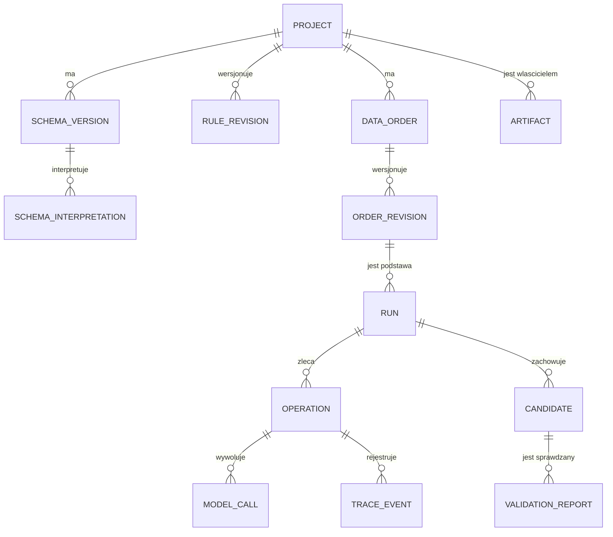

# LLD — model danych i transakcje

**Data:** 21 października 2026. **Status:** projekt v0.1, nie wykonana migracja.

[Założenia LLD](README.md) · [API](kontrakty_api.md) · [Cykl wykonania](cykl_wykonania.md)

## 1. Konwencje

- Identyfikatory: UUID nadawane przez aplikację; nie traktujemy ich jako uprawnienia.
- Czas: `timestamptz`, zapis i API w UTC. Czas trwania mierzymy monotonicznie w procesie; po awarii nie fabrykujemy brakującego pomiaru.
- `version bigint` do konkurencyjnych zapisów obiektów zmiennych. Niezmienne rewizje nie są aktualizowane w miejscu.
- Statusy: tekst z jawnymi ograniczeniami `CHECK`, mapowany na własne enumy aplikacji.
- Dokładny duży dokument: artefakt z hashem. `jsonb` służy do opisu i projekcji wyszukiwania, nie do odtworzenia oryginalnych bajtów.
- Hash SHA-256 liczymy po zapisanych bajtach. Dla migawki zapisujemy jeden serializowany dokument i jego hash; nie odtwarzamy hasha z kolejności kluczy `jsonb`.
- Każdy zasób należy do projektu. Relacje złożone i kontrole UoW zapobiegają łączeniu identyfikatorów z różnych projektów i wykonań.
- Brak kaskadowego usuwania historii; polityka retencji pozostaje OD-09.

## 2. Własność i główne relacje

Wszystkie poniższe tabele należą do `application-api` w `app-db`. Usługi pomocnicze nie dostają poświadczeń tej bazy.



Diagram pomija techniczne klucze złożone i kilka referencji. Nie oznacza, że każdy koncept wymaga osobnego serwisu.

## 3. Projekty i wymagania

| Tabela | Najważniejsze kolumny | Niezmienniki |
| --- | --- | --- |
| `projects` | `id`, `owner_subject text`, `name`, `version`, `created_at` | Lokalny `owner_subject` ze zaufanego adaptera, nie z body żądania. Bez tabeli kont w MVP. |
| `schema_versions` | `id`, `project_id`, `revision_no`, `ddl_artifact_id`, `ddl_sha256`, `created_at` | `UNIQUE(project_id, revision_no)`; DDL i hash niezmienne. |
| `schema_interpretations` | `id`, `project_id`, `schema_version_id`, `revision_no`, `model_artifact_id`, `analysis_profile`, `diagnostics jsonb`, `approval_state` | Wiąże dokładne DDL z wersją rozpoznania i zatwierdzonymi uzupełnieniami. Po zatwierdzeniu nowa interpretacja oznacza nowy wiersz. |
| `rule_revisions` | `id`, `project_id`, `rule_key`, `revision_no`, `source_text`, `kind`, `definition jsonb`, `definition_sha256`, `approval_state`, `approved_at` | `UNIQUE(project_id, rule_key, revision_no)`; `kind` odróżnia regułę sprawdzalną, jakościową i nierozstrzygniętą. Zatwierdzona treść nie jest nadpisywana. |
| `data_orders` | `id`, `project_id`, `created_at`, `version` | Tożsamość zlecenia, nie ruchoma definicja wykonania. |
| `order_revisions` | `id`, `project_id`, `order_id`, `revision_no`, `schema_interpretation_id`, `requirements_artifact_id`, `requirements_sha256`, `approval_state`, `approved_at` | Cały plan: polecenie, wyjaśnienia, reguły, liczebności, format i relacje. `UNIQUE(order_id, revision_no)`; aprobata dotyczy dokładnego hasha. |
| `variant_snapshots` | `id`, `project_id`, `config_artifact_id`, `config_sha256`, `created_at` | Faktyczny wariant, prompty i konfiguracja bez sekretów. Niezmienny dokument. |

Znaczenie `approval_state`: `PROPOSED`, `BLOCKED`, `APPROVED`. To propozycja nazw. Zatwierdzenie jest metadanymi niezmiennego dokumentu; zmiana jego znaczenia tworzy nową rewizję i wymaga ponownego zatwierdzenia.

Wymagania w `order_revisions` zawierają odniesienia do reguł oraz ich zatwierdzone definicje. Referencja ułatwia nawigację, kopia w niezmiennym dokumencie chroni historię i ponowienie.

`schema_interpretations` ma również `UNIQUE(schema_version_id, revision_no)`. Ograniczenia i referencje obejmują projekt, nie tylko identyfikator interpretacji.

## 4. `runs` — stan procesu

| Kolumna | Typ / rola |
| --- | --- |
| `id`, `project_id` | UUID, identyfikacja wykonania i zakresu. |
| `order_revision_id`, `variant_snapshot_id` | Dokładne wersje wymagań i realizacji. |
| `snapshot_artifact_id`, `snapshot_sha256` | Pełna niezmienna migawka używana także przy ręcznym nowym wykonaniu. |
| `source_run_id` | Nullable, wskazanie dawnego wykonania przy ponowieniu. |
| `lifecycle` | `ADMITTED`, `RUNNING`, `FINALIZING`, `FINISHED`, `FAILED_TECHNICALLY`, `CANCELLED`. |
| `phase` | Nullable: `GENERATING`, `VALIDATING`, `CORRECTING`, `SELECTING`, `EXPORTING`. |
| `version`, `execution_epoch` | Licznik zapisu i licznik unieważniania uprawnień operacji. |
| `active_operation_id` | Nullable, jedyna operacja mogąca obecnie zmienić przebieg. |
| `correction_limit`, `corrections_started` | Nieujemne liczby, `corrections_started <= correction_limit`. |
| `cancel_requested_at` | Nullable, trwała blokada przejścia do następnych kroków. |
| `selected_candidate_id`, `selected_validation_report_id` | Nullable, zgodna para z tego samego wykonania. |
| `outcome` | `FULFILLED`, `UNFULFILLED` albo NULL. Nie jest statusem biznesowej zgodności. |
| `termination_code` | Np. `ALL_CHECKS_SATISFIED`, `CORRECTION_LIMIT_REACHED`, `MODEL_TIMEOUT`, `PROCESS_LOST`, `USER_CANCELLED`. |
| `created_at`, `started_at`, `finished_at` | Trwałe znaczniki czasu, odpowiednio nullable. |
| `duration_ms` | Nullable, brak pomiaru po awarii nie jest zerem. |

Proponowane ograniczenia:

- `FINISHED` wymaga `outcome IS NOT NULL` i `finished_at`.
- `FULFILLED` wymaga wybranego kandydata i jego raportu; transakcyjna polityka sprawdza dowody kompletności/importowalności.
- `FAILED_TECHNICALLY` i `CANCELLED` nie deklarują `FULFILLED`; mogą zachować historycznego użytecznego kandydata bez rozstrzygania jego udostępnienia.
- Stan terminalny wymaga `active_operation_id IS NULL` i `phase IS NULL`.
- Reguł między wieloma wierszami nie udajemy pojedynczym `CHECK`. Realizujemy je kluczami złożonymi i UoW.

`UNIQUE(project_id, id)` umożliwia FK złożone. Dla kandydata i raportu stosujemy klucze obejmujące również `run_id`, tak aby zwykłe podstawienie obcego UUID nie tworzyło poprawnej relacji.

## 5. Operacje i pojedyncze miejsce pracy

### `operations`

Kolumny: `id`, `project_id`, `run_id NULL`, `order_revision_id NULL`, `kind`, `status`, `error_code NULL`, `execution_epoch NULL`, `round_no NULL`, `request_artifact_id`, `request_sha256`, `response_artifact_id NULL`, `response_sha256 NULL`, `deadline_at`, `created_at`, `started_at NULL`, `finished_at NULL`, `service_instance_id NULL`, `access_token_digest`, `token_expires_at`.

- `kind`: `INTERPRET`, `GENERATE`, `CORRECT`, `VALIDATE`.
- `status`: `PREPARED`, `EXECUTING`, `COMPLETED`, `FAILED`, `CANCELLED`, `UNKNOWN`.
- Interpretacja ma rewizję zlecenia bez `run_id`; inne rodzaje mają `run_id`.
- `UNKNOWN` opisuje nierozstrzygniętą próbę po utracie odpowiedzi/procesu. Nie uprawnia do ponownego dispatch ani zwolnienia miejsca bez rozpoznania lokalnej pracy. `error_code` zachowuje np. `PROCESS_LOST` albo `MODEL_TIMEOUT`.
- `round_no=0` to pierwsze generowanie; `1..correction_limit` to rundy poprawek.
- `UNIQUE(run_id, kind, round_no)` dla operacji procesu w prostym wariancie jednego kandydata na rundę. Nie ogranicza liczby `model_calls` wewnątrz operacji.
- Token jest losowym uprawnieniem do konkretnej operacji; w bazie trzymamy jego skrót, nie umieszczamy go w dokumentach i logach.

### `runtime_guard`

Jeden techniczny wiersz instalacji: `id=1`, `boot_id`, `active_run_id NULL`, `active_preparation_id NULL`, `recovery_blocked bool`, `version`.

Co najwyżej jedno z pól aktywnej pracy jest niepuste. Przygotowanie używające LLM zajmuje ten sam zasób co wykonanie; zwykły odczyt statusu i projektu nie zajmuje go.

Rezerwacja blokuje wiersz tylko w krótkiej transakcji. Miejsce pozostaje logicznie zajęte w czasie pracy, ale transakcja nie jest otwarta przez czas odpowiedzi modelu. Blokady wierszy PostgreSQL trwają do końca transakcji; to ograniczenie uzasadnia krótkie UoW [N2 w indeksie LLD].

Dodatkowa osłona danych, do próby migracji:

```sql
CREATE UNIQUE INDEX ux_runs_one_live_run
    ON runs ((1))
    WHERE lifecycle IN ('ADMITTED', 'RUNNING', 'FINALIZING');

CREATE UNIQUE INDEX ux_operations_one_live_per_run
    ON operations (run_id)
    WHERE run_id IS NOT NULL
      AND status IN ('PREPARED', 'EXECUTING');
```

Indeks częściowy może wymuszać unikalność wybranego podzbioru wierszy [N3 w indeksie LLD]. To globalne ograniczenie MVP, nie gotowy model limitów wielu użytkowników. Nie zastępuje wspólnego `runtime_guard` dla przygotowania i wykonań.

## 6. Kandydaci, raporty i kontekst

| Tabela | Kolumny i reguły |
| --- | --- |
| `context_packages` | `id`, `project_id`, `operation_id`, `artifact_id`, `sha256`, `selector_version`, `budget_metadata jsonb`. Pakiet przypięty do operacji; poprawka może zawierać inny raport, nie inne wymagania. |
| `candidates` | `id`, `project_id`, `run_id`, `generation_operation_id`, `round_no`, `manifest_artifact_id`, `manifest_sha256`, `extraction_status`, `created_at`. `UNIQUE(run_id, round_no)` w bazowej strategii; po publikacji niezmienny. |
| `validation_reports` | `id`, `project_id`, `run_id`, `candidate_id`, `operation_id`, `snapshot_sha256`, `candidate_manifest_sha256`, `profile_id`, `validator_version`, `report_artifact_id`, `report_sha256`, `complete`, `importable`, `business_summary jsonb`, `created_at`. |

`complete` i `importable` są trójwartościowe: TRUE, FALSE, NULL dla niepotwierdzenia. Kwalifikacja użytecznego kandydata wymaga obu TRUE. Dodatkowe sprawdzenia mają pełny stan w dokumencie raportu, nie tylko liczbę błędów.

Raport jest niezmienny. Nie przeliczamy dawnego raportu automatycznie nową wersją walidatora. Ewentualne odrębne ponowne badanie wymagałoby nowej operacji poza bazowym przebiegiem, nie nadpisania dowodu.

Hashe w raporcie muszą zgadzać się z migawką i manifestem. Wybrana para w `runs` ma FK obejmujący `project_id`, `run_id`, `candidate_id` i identyfikator raportu; odpowiednie zestawy mają ograniczenia UNIQUE w tabelach docelowych. Nie tworzymy FK z cyklem wymagającym kandydata przed startem: referencje wyboru są początkowo NULL.

Identyfikatory operacji i pakietu kontekstu można nadać przed zapisem. Bajty kontekstu i żądania przygotowujemy jako artefakty z `operation_id=NULL`; nie są jeszcze udostępnione usłudze. `PrepareStep` zapisuje operację oraz `context_packages` i przypina przygotowane artefakty w jednej transakcji. Dzięki temu nie powstaje cykl wymagający istniejącej operacji do zapisania jej własnego żądania. Dopiero po commit token operacji pozwala odczytać te zasoby.

## 7. Artefakty i historia

### `artifacts`

`id`, `project_id`, `operation_id NULL`, `kind`, `state`, `storage_key`, `expected_sha256 NULL`, `sha256 NULL`, `size_bytes NULL`, `media_type`, `created_at`, `ready_at NULL`.

- Stan: `WRITING`, `READY`, `ABANDONED`; nie publikujemy ścieżki systemowej.
- Tylko `READY` może wejść do manifestu lub eksportu. Stan i zgodność projektu sprawdza UoW, nie sam FK.
- `kind` rozróżnia DDL, migawkę, kontekst, wiadomość, dane kandydata, manifest, raport i paczkę.
- Przechowywane bajty nie są zmieniane pod istniejącym kluczem. Nowa treść otrzymuje nowe `artifact_id`.
- Treść deduplikowana po hashach nie daje automatycznie prawa odczytu innego projektu.

### `model_calls`

`id`, `project_id`, `operation_id`, `call_index`, `role`, `provider`, `requested_model`, `reported_model NULL`, `settings jsonb`, `request_artifact_id NULL`, `response_artifact_id NULL`, `status`, `provider_request_id NULL`, `finish_reason NULL`, `started_at`, `finished_at NULL`, `metrics jsonb`.

Status rozróżnia próbę zgłoszoną przed wysłaniem, potwierdzoną odpowiedź/błąd i wynik nieznany. Zapis przed wysłaniem nie dowodzi dotarcia żądania do dostawcy. Po timeoutcie nie dopisujemy fałszywego `usage=0`.

`UNIQUE(operation_id, call_index)` i PK `id` zapobiegają podwójnemu wliczeniu. `metrics` ma osobną dostępność i pochodzenie każdej wartości. Koszt rozróżnia wartość raportowaną i szacowaną oraz walutę; nie sumujemy różnych walut jako jednej kwoty.

### `trace_events`

`id`, `project_id`, `operation_id`, `call_id NULL`, `event_kind`, `payload_sha256`, `payload_artifact_id NULL`, `received_at`, `cursor bigint`, `late bool`.

`id` jest identyfikatorem zdarzenia nadanym przed wysyłką. Powtórzenie tego samego ID i treści nie dodaje ponownie pomiaru. Inna treść przy tym samym ID to konflikt. `cursor` służy odczytowi historii; luki w numeracji nie oznaczają utraty wywołania.

Nie odtwarzamy z tej tabeli całego stanu aplikacji: to historia/diagnostyka, nie event sourcing. Luki po awarii mają jawny opis.

Dopisanie śladu ani dostępnych metryk nie zwiększa `runs.version` i nie przełącza fazy. Ten licznik chroni sterowanie, nie każdą techniczną aktualizację historii. Potwierdzenie nowego wywołania nadal sprawdza epokę, termin i anulowanie; późne dowody mogą trafić wyłącznie do historii.

### `commands`

`id`, `actor_subject`, `scope_id`, `command_kind`, `idempotency_key`, `request_sha256`, `resource_id`, `result_status`, `created_at`.

`UNIQUE(actor_subject, scope_id, command_kind, idempotency_key)`. Zapis komendy i utworzenie wykonania są w jednej transakcji. Ten sam klucz z inną treścią jest konfliktem. Deduplikacja dostarczonej ponownie komendy nie oznacza automatycznego retry modelu.

## 8. Transakcje

| Nazwa | Co jest atomowe | Co dzieje się poza transakcją |
| --- | --- | --- |
| `ApprovePlan` | Sprawdzenie hasha/rewizji i zatwierdzenie niezmiennej definicji. | Brak wywołań modelu w czasie zatwierdzania. |
| `AdmitRun` | Dostęp, deduplikacja, blokada `runtime_guard`, sprawdzenie zatwierdzenia, zapis migawki/referencji, `Run` i komendy. | Zapis dużego dokumentu przygotowany wcześniej przez protokół artefaktów; uruchomienie zadania po commit. |
| `PrepareStep` | Blokada runa, brak anulowania, budżet, nowa operacja, kontekst i uprawnione artefakty, przypięcie `active_operation_id`, zwiększenie `version`; dla poprawki również `corrections_started`. | Przygotowanie dużych dokumentów przed UoW, HTTP do usługi po commit, nigdy przed. |
| `ApplyStepResult` | Weryfikacja fencing i hashów, publikacja kandydata/raportu, zakończenie operacji, przejście fazy. | Transfer dużych plików przed publikacją. |
| `RequestCancel` | Zapis żądania, zwiększenie epoki i wersji. | Jednorazowy sygnał zatrzymania i kontrola lokalnych zadań. |
| `FinalizeRun` | Zgodna para wyboru, referencje gotowego eksportu, terminalny wynik i powód zakończenia. | Budowanie paczki i pliku raportu przed finalnym commit. |

Wszystkie ścieżki blokują obiekty w tej samej kolejności: `runtime_guard`, jeśli potrzebny → `run` → `operation`. Transakcje tylko odczytujące status nie muszą blokować wiersza.

Przykład warunkowego przyjęcia wyniku, nie kompletna migracja:

```sql
UPDATE runs
SET version = version + 1
WHERE id = :run_id
  AND project_id = :project_id
  AND version = :expected_version
  AND lifecycle = 'RUNNING'
  AND cancel_requested_at IS NULL
  AND execution_epoch = :operation_epoch
  AND active_operation_id = :operation_id;
```

Zero zmienionych wierszy oznacza ponowne rozpoznanie stanu, nie ponowne uruchomienie HTTP. Kontrola terminu operacji i atomowy zapis jej rezultatu są częścią tej samej UoW.

Do odczytów proponujemy indeksy `runs(project_id, created_at, id)`, `artifacts(project_id, id)`, `trace_events(operation_id, cursor)` oraz indeksy FK niewynikające z istniejących PK/UNIQUE. Część, np. `(project_id, id)`, może już wynikać z potrzebnego ograniczenia złożonego; nie tworzymy jej drugi raz. Dokładny plan indeksów zweryfikujemy z rzeczywistymi zapytaniami.

## 9. Mapa błędów trwałości

- Sukces commit z utraconą odpowiedzią: odczyt po `idempotency_key`/`run_id`, bez nowego modelu.
- Brak commit po odpowiedzi modelu: możliwa luka dowodu. Zatrzymanie techniczne, nie ponowienie wywołania.
- Plik gotowy, metadane niegotowe: plik nie jest dostępny; uzgodnienie techniczne po odzyskaniu dostępu.
- Metadane gotowe, plik utracony: `ARTIFACT_INTEGRITY_FAILED`, nie eksport pustego pliku.
- Konkurencyjny zapis/deadlock: nie dodajemy automatycznego retry transakcji wykonującej krok. Trwały status i klasyfikacja błędu muszą pozostać jawne.
