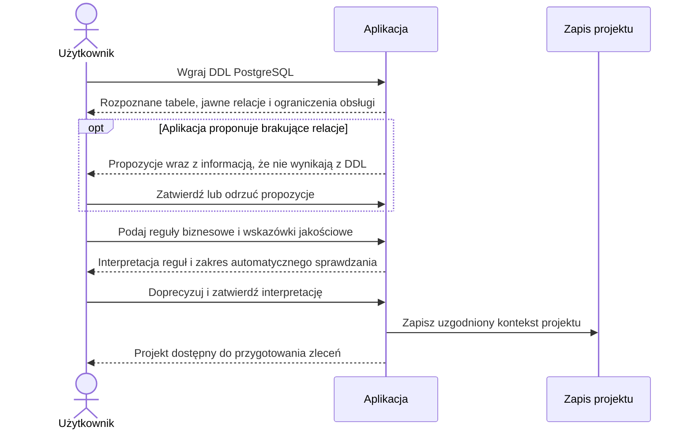
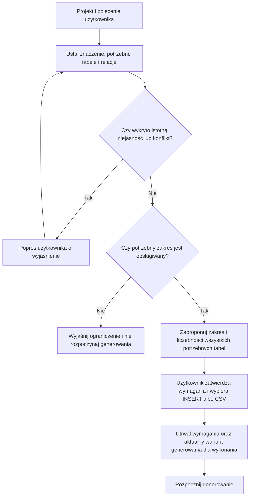
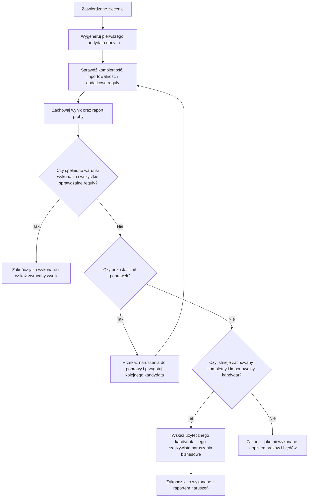
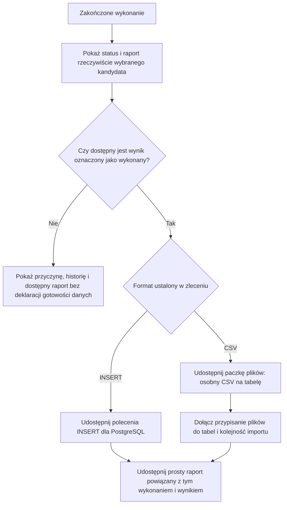

# Przepływy funkcjonalne MVP

**Podstawa:** [specyfikacja MVP](specyfikacja_mvp.md).

**Status:** objaśnienie uzgodnionych wymagań, bez rozszerzania ich zakresu.

Dokument opisuje zachowanie widoczne dla użytkownika i logiczny przebieg wykonania. Uczestnicy i etapy diagramów **nie oznaczają wybranych mikroserwisów, bibliotek ani technologii**. Układ ekranów pozostaje otwarty.

## 1. Przygotowanie projektu

Zapis projektu nie jest obietnicą obsługi każdego elementu wgranego DDL. Jeśli zlecenie zależy od nieobsługiwanej funkcji lub obowiązkowej zależności kołowej, aplikacja zgłasza blokadę przed generowaniem.

Aktualizacja polega na wgraniu nowego DDL. Nie zmienia schematów i reguł przypisanych do wcześniejszych wykonań.

**Powiązanie:** REQ-009–REQ-019; kryteria AC-01–AC-08.

## 2. Od polecenia do zatwierdzonego zlecenia

Wyjaśnianie niejasności dotyczy wymagań, nie każdej wartości, którą model ma wygenerować. Aplikacja może samodzielnie dobierać szczegóły nieograniczone przez zlecenie.

Dla polecenia „200 zakupów” zatwierdza się również liczby klientów, produktów i pozycji, jeśli są częścią potrzebnej paczki. Aplikacja nie może zmniejszyć ich w trakcie wykonania, aby uzyskać pozytywny wynik.

Dokładny początek pomiarów i rozliczanie etapu przygotowania zlecenia wymagają doprecyzowania w planie badań; diagram nie ustanawia nowej definicji czasu.

**Powiązanie:** REQ-020–REQ-026; kryteria AC-09–AC-10.

## 3. Generowanie, walidacja i poprawki

### Zasady interpretacji

- Pierwsze wygenerowanie nie zużywa jednej z domyślnych 3 rund poprawek.
- Limit dotyczy całego zlecenia, nie każdej tabeli osobno.
- Liczba wywołań modeli może być inna niż liczba rund, szczególnie w wariancie wieloagentowym.
- Warunki wykonania to **kompletność i importowalność**. Dodatkowe reguły mogą po zakończeniu pozostać naruszone.
- Jeśli reguła jest też ograniczeniem schematu blokującym import, jej naruszenie wpływa na wykonanie zadania.
- Niewykonane obowiązkowe sprawdzenie nie oznacza pozytywnej weryfikacji.
- Wskazówki jakościowe nie są testami automatycznymi i nie uruchamiają same przez się pętli mającej zagwarantować realizm.
- Kandydat kompletny i importowalny pozostaje dostępny, nawet gdy kolejna poprawka go uszkodzi.
- Raport zwracanego wyniku dotyczy dokładnie tej wersji danych, a historia pokazuje również pozostałe próby.

**Otwarte:** wybór pomiędzy kilkoma użytecznymi kandydatami o różnej zgodności biznesowej opisuje OD-03. Diagram nie narzuca rankingu ani punktacji.

**Powiązanie:** REQ-027–REQ-040; kryteria AC-11–AC-18.

## 4. Anulowanie i błąd operacyjny

Podczas wykonania użytkownik może zlecić przerwanie procesu. Aplikacja zachowuje dotychczasową historię oraz dostępne pomiary, a wykonanie oznacza jako **anulowane przez użytkownika**.

Niedostępność modelu lub inny błąd uniemożliwiający kontynuację nie jest tym samym co poprawnie przeprowadzony proces, który wygenerował niekompletne lub nieimportowalne dane.

| Zdarzenie | Oczekiwana interpretacja |
| --- | --- |
| Wyjściowe dane nadal nie spełniają warunków wykonania po wyczerpaniu limitu | Zakończone — niewykonane. |
| Dane spełniają warunki wykonania, ale pozostają dodatkowe naruszenia biznesowe | Zakończone — wykonane, z jawnym raportem naruszeń. |
| Użytkownik przerywa próbę | Anulowane przez użytkownika. |
| Błąd operacyjny uniemożliwia kontynuację | Przerwane błędem, ze wskazaniem przyczyny. |

Nie zakłada się natychmiastowego przerwania już obsługiwanego żądania zewnętrznego. Dostępność częściowych danych lub wcześniej użytecznego kandydata po anulowaniu albo błędzie pozostaje otwarta w OD-08. Timeouty i ponowienia komunikacji opisuje OD-07.

**Powiązanie:** REQ-041–REQ-042, REQ-052; kryterium AC-19.

## 5. Odbiór wyniku

Raport przedstawia osobno kompletność, importowalność i sprawdzalne reguły. Nie zawiera jednej zbiorczej oceny realizmu. Szczegóły profilu CSV i prostego raportu pozostają otwarte w OD-04 i OD-05.

To diagram odbioru gotowej paczki. Nie rozstrzyga dostępności surowych artefaktów nieudanych lub przerwanych prób do diagnostyki.

**Powiązanie:** REQ-043–REQ-051; kryteria AC-20–AC-22 oraz AC-25.

## 6. Historia i ręczne ponowienie

1. Użytkownik wskazuje historyczne zlecenie.
2. Aplikacja korzysta z zapisanych dla niego wymagań, nie zastępuje ich aktualnym DDL ani regułami projektu.
3. Autor może wcześniej ręcznie zmienić podłączone modele, prompty wewnętrzne lub organizację procesu poza obowiązkowym interfejsem generatora.
4. Ponowienie tworzy osobne wykonanie z dawnymi wymaganiami zadania i aktualnym wariantem generowania.
5. Historia zachowuje faktyczne wiadomości, wyniki prób, raporty i dostępne pomiary, bez danych uwierzytelniających.
6. Użytkownik może pobrać wynik oraz prosty raport do późniejszej oceny zewnętrznej.

Nie powstaje automatyczna seria eksperymentów ani ranking. Ocena realizmu, również wsparta LLM, pozostaje poza generatorem.

**Powiązanie:** REQ-052–REQ-065; kryteria AC-23–AC-27.

## 7. Zachowane propozycje UX — nie są wymaganiami MVP

Z dawnej specyfikacji zachowano do późniejszego rozpatrzenia:

- podgląd fragmentu wygenerowanych danych zamiast pokazywania całej paczki;
- możliwość kopiowania poleceń `INSERT`;
- dodatkową prośbę o zmianę już zakończonego wyniku.

Nie zatwierdzono limitu podglądu, kolorowania składni, liczby zakładek ani sposobu ręcznej korekty zakończonej paczki. W szczególności ostatni pomysł wymaga rozstrzygnięcia, czy oznacza nowe zlecenie, czy nową wersję wyniku; nie jest ukrytą czwartą rundą automatycznych poprawek.
