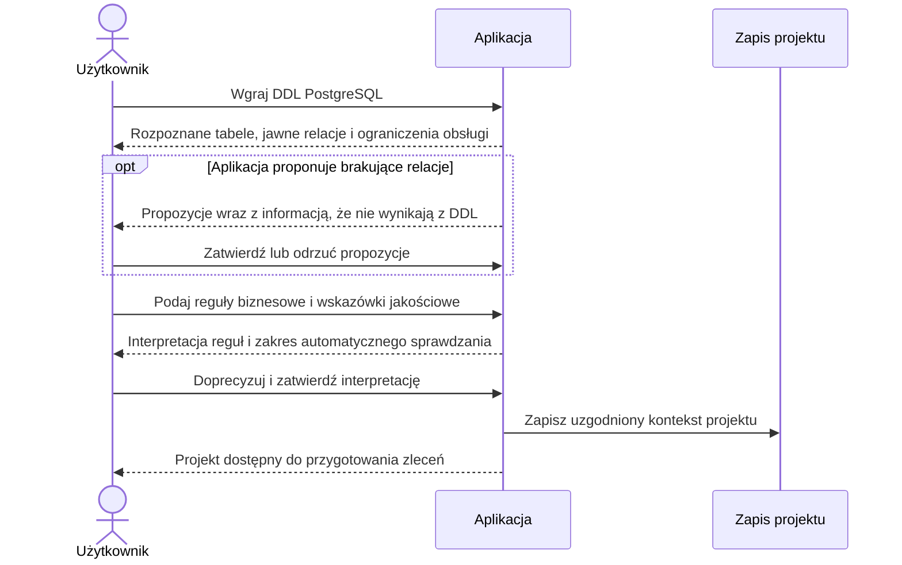
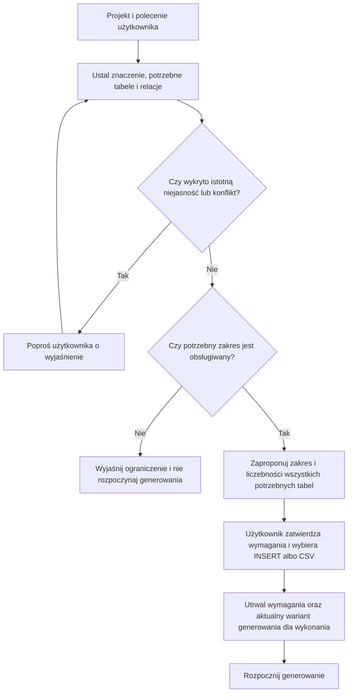
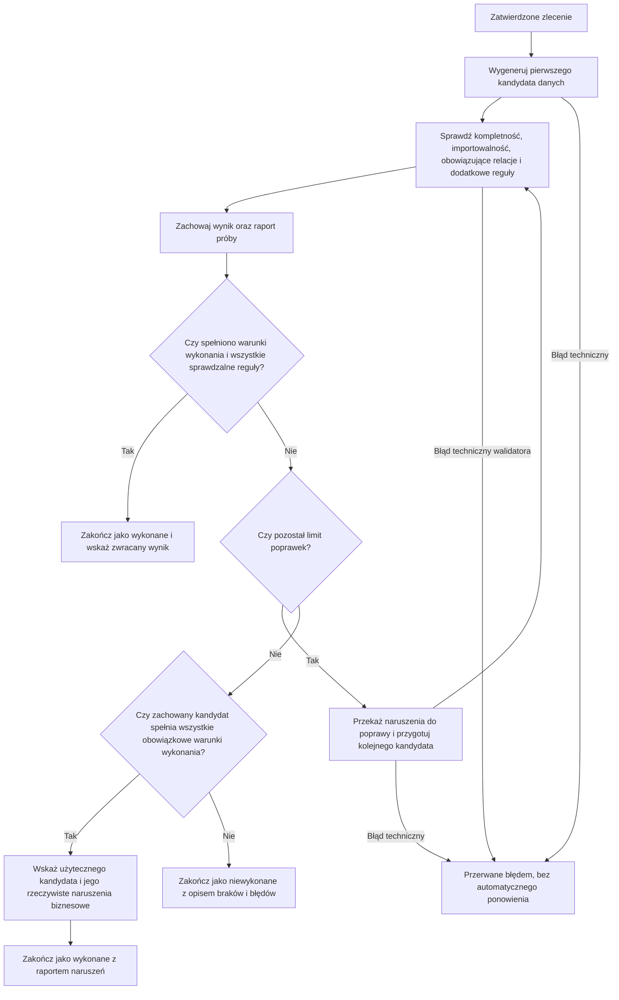
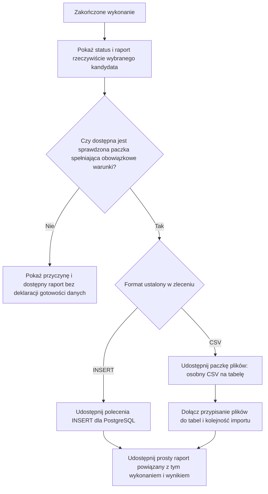

# Przepływy funkcjonalne MVP

**Podstawa:** [specyfikacja MVP](specyfikacja_mvp.md).

**Status:** objaśnienie uzgodnionych wymagań, bez rozszerzania ich zakresu.

Dokument opisuje zachowanie widoczne dla użytkownika i logiczny przebieg wykonania. Uczestnicy i etapy diagramów **nie oznaczają wybranych mikroserwisów, bibliotek ani technologii**. Głównym widokiem jest czat z wyborem projektu, poleceniem i odpowiedziami; szczegółowy układ pozostaje otwarty.

Uzupełnienie z projektowania architektury: interfejs jest lokalną aplikacją webową, model przygotowuje gotowy SQL/CSV, a przerwanego wykonania nie wznawia się. Szczegóły pokazuje [architektura ogólna](architektura.md). Naruszenia danych uruchamiają ograniczone poprawki; błędy techniczne kończą wykonanie bez automatycznego retry (REQ-032–REQ-037, REQ-069–REQ-070).

## 1. Przygotowanie projektu

Zapis projektu nie jest obietnicą obsługi każdego elementu wgranego DDL. Jeśli zlecenie zależy od nieobsługiwanej funkcji lub obowiązkowej zależności kołowej, aplikacja zgłasza blokadę przed generowaniem.

Aktualizacja polega na wgraniu nowego DDL. Nie zmienia wymagań rozpoczętego wcześniej, nadal obsługiwanego wykonania.

Po zatwierdzeniu relacja nieobecna w DDL staje się obowiązkowym warunkiem wykonania zadania. Aplikacja sprawdza ją osobno po imporcie, bez dopisywania do oryginalnego DDL.

**Powiązanie:** REQ-009–REQ-019; kryteria AC-01–AC-08 i AC-34.

## 2. Od polecenia do zatwierdzonego zlecenia

Wyjaśnianie niejasności dotyczy wymagań, nie każdej wartości, którą model ma wygenerować. Aplikacja może samodzielnie dobierać szczegóły nieograniczone przez zlecenie.

Dla polecenia „200 zakupów” zatwierdza się również liczby klientów, produktów i pozycji, jeśli są częścią potrzebnej paczki. Aplikacja nie może zmniejszyć ich w trakcie wykonania, aby uzyskać pozytywny wynik.

Dokładny początek pomiarów i rozliczanie etapu przygotowania zlecenia wymagają doprecyzowania w planie badań; diagram nie ustanawia nowej definicji czasu.

**Powiązanie:** REQ-020–REQ-026; kryteria AC-09–AC-10.

## 3. Generowanie, walidacja i poprawki

### Zasady interpretacji

- Walidacja ma potwierdzoną kolejność: składnia/format → wstępna zgodność ze schematem i typami → rzeczywisty próbny import do pustego, odizolowanego PostgreSQL, obowiązujące relacje i kompletność → dodatkowe reguły biznesowe. Wstępna kontrola nie zastępuje importu; niewykonalne dalsze sprawdzenia mają jawną przyczynę.
- Pierwsze wygenerowanie nie zużywa jednej z domyślnych 3 rund poprawek.
- Limit dotyczy całego zlecenia, nie każdej tabeli osobno.
- Liczba wywołań modeli może być inna niż liczba rund, szczególnie w wariancie wieloagentowym.
- Warunki wykonania to **kompletność, importowalność i zgodność wszystkich obowiązujących relacji**, także zatwierdzonych poza DDL. Udany import bez poprawnych relacji nie wystarcza. Dodatkowe reguły mogą po zakończeniu pozostać naruszone.
- Jeśli reguła jest też ograniczeniem schematu blokującym import, jej naruszenie wpływa na wykonanie zadania.
- Niewykonane obowiązkowe sprawdzenie nie oznacza pozytywnej weryfikacji.
- Wskazówki jakościowe nie są testami automatycznymi i nie uruchamiają same przez się pętli mającej zagwarantować realizm.
- Użyteczny kandydat spełniający wszystkie warunki REQ-027 pozostaje dostępny, nawet gdy kolejna poprawka go uszkodzi.
- Raport zwracanego wyniku dotyczy dokładnie tej wersji danych. Nie powstaje historia pozostałych prób.

**Uzgodnione:** zwracamy wyłącznie najnowszego użytecznego kandydata, nawet jeśli wcześniejszy miał mniej dodatkowych naruszeń biznesowych. Jeśli ostatnia poprawka nie spełnia obowiązkowych warunków, wracamy do najnowszego wcześniejszego użytecznego wyniku. To ochrona wyniku bieżącego wykonania, nie archiwum kandydatów. Nie tworzymy rankingu jakości (REQ-039, AC-36; OD-03 zamknięte).

**Powiązanie:** REQ-012, REQ-027–REQ-040; kryteria AC-11–AC-18, AC-34 i AC-36.

## 4. Anulowanie i błąd operacyjny

Podczas wykonania użytkownik może zlecić przerwanie procesu. Bieżący status oznacza wykonanie jako **anulowane przez użytkownika**, a dostępny raport zawiera rzeczywiste pomiary. Nie wymaga to archiwum przebiegu.

Niedostępność modelu lub inny błąd uniemożliwiający kontynuację nie jest tym samym co poprawnie przeprowadzony proces, który wygenerował niekompletne lub nieimportowalne dane.

| Zdarzenie | Oczekiwana interpretacja |
| --- | --- |
| Wyjściowe dane nadal nie spełniają warunków wykonania po wyczerpaniu limitu | Zakończone — niewykonane. |
| Dane spełniają warunki wykonania, ale pozostają dodatkowe naruszenia biznesowe | Zakończone — wykonane, z jawnym raportem naruszeń. |
| Użytkownik przerywa próbę | Anulowane przez użytkownika. |
| Błąd operacyjny uniemożliwia kontynuację | Przerwane błędem, ze wskazaniem przyczyny. |

Nie zakłada się natychmiastowego przerwania już obsługiwanego żądania zewnętrznego. Wcześniej zapisany użyteczny kandydat i jego raport pozostają dostępne do pobrania po anulowaniu lub błędzie (REQ-047, AC-35). Status i przyczyna przerwania są nadal widoczne; pobranie nie oznacza sukcesu całego wykonania. Dostępność częściowych lub niesprawdzonych artefaktów i dokładny moment zatrzymania pozostają otwarte w OD-08. Konkretne timeouty i raportowanie niepełnych danych wywołania opisuje OD-07. Błąd techniczny kończy wykonanie bez automatycznego retry, zmiany wariantu i rundy naprawczej (REQ-070).

Nie ma wznawiania anulowanej, zakończonej błędem lub utraconej próby. Ręczna kolejna próba po takim przerwaniu zaczyna nowe wykonanie od początku na podstawie przygotowanego zlecenia, nie zapisu w historii (REQ-059, REQ-069). To inna akcja niż dodatkowa seria napraw po wyczerpaniu limitu z REQ-079, opisana w sekcji 6.

**Powiązanie:** REQ-040–REQ-042, REQ-047, REQ-072; kryteria AC-19 i AC-35.

## 5. Odbiór wyniku

Raport przedstawia osobno kompletność, importowalność, obowiązujące relacje i dodatkowe sprawdzalne reguły. Nie zawiera jednej zbiorczej oceny realizmu. Szczegóły profilu CSV i prostego raportu pozostają otwarte w OD-04 i OD-05.

To diagram odbioru gotowej paczki, także wcześniej sprawdzonej przed anulowaniem lub błędem. W tym drugim przypadku pobranie nie zmienia statusu całego wykonania. Zwracamy najnowszego użytecznego kandydata zgodnie z REQ-039. Diagram nie rozstrzyga dostępności surowych artefaktów nieudanych lub przerwanych prób do diagnostyki.

**Powiązanie:** REQ-043–REQ-051; kryteria AC-20–AC-22, AC-25 i AC-35.

## 6. Rozmowa w bieżącym czacie i nowy czat

Użytkownik wybiera projekt w głównym oknie czatu, wpisuje polecenie i otrzymuje odpowiedź oraz dostępny wynik. Po odpowiedzi może wysyłać kolejne polecenia i kontynuować tę samą rozmowę. Nie wymaga to archiwum dawnych wykonań ani wyboru historycznego zlecenia.

Gdy prosi o zmianę danych, aplikacja przekazuje dotychczasową paczkę jako kontekst do LLM wraz z nowym poleceniem. Model ma zmienić w niej wskazane dane, nie wygenerować niezależnego zestawu. Poprawiona paczka jest nowym kandydatem i przechodzi walidację; raport musi dotyczyć tej wersji. Na przykład zmiana adresów 100 klientów na polskie dotyczy tych samych klientów. Konflikty z obowiązującymi wymaganiami wyjaśniamy przed zmianą.

„Nowy czat”, wykonane odświeżenie i zamknięcie strony kończą dostęp do starej konwersacji i jej plików. Po powrocie, także po pełnym zamknięciu aplikacji, widzimy nowy czat. Zapisane projekty pozostają dostępne.

Przed odświeżeniem lub zamknięciem strony z rozmową lub danymi wymagane jest ostrzeżenie o ich utracie i możliwość pozostania. Rezygnacja nie resetuje czatu; potwierdzone i wykonane opuszczenie strony kończy dostęp. Jest to standardowe okno przeglądarki, z ograniczeniami opisanymi w sekcji 11.1 specyfikacji, nie gwarancja własnego tekstu ani działania przy awarii.

W nadal dostępnym czacie wynik i raport można pobrać zgodnie z REQ-047, także po anulowaniu lub błędzie. Nie pozwala to wrócić do nich po zdarzeniach z REQ-074. Historia czatów i plików jest kandydatem na dalszy rozwój poza MVP. Organizacja badań i gromadzenie materiałów pozostają poza generatorem.

Opuszczenie czatu ma także anulować trwające wykonanie (REQ-077). Samo wyświetlenie ostrzeżenia i pozostanie na stronie go nie anuluje. Po przyjęciu anulowania nie rozpoczynamy dalszych etapów ani wywołań LLM; spóźniona odpowiedź nie trafia do nowej rozmowy. Nie obiecujemy natychmiastowego przerwania żądania u dostawcy.

Każda nowa prośba użytkownika o zmianę danych ma własny limit, domyślnie 3 automatyczne rundy naprawcze po pierwszej zmienionej paczce (REQ-033–REQ-034, AC-44). Zużycie limitu poprzedniej prośby go nie pomniejsza, a automatyczne poprawki go nie odnawiają. Ręczna prośba nie jest automatyczną czwartą rundą poprzedniej prośby ani wznowieniem zakończonego procesu.

Jeśli mimo 3 rund nie uzyskano użytecznej poprawionej paczki, użytkownik widzi komunikat o nieudanej zmianie. Poprzednia sprawdzona wersja i jej raport nadal są dostępne w tym czacie, ale nie jako wynik spełniający nową prośbę (REQ-078). Przycisku „Podejmij kolejne 3 próby” można użyć tylko raz dla danej prośby, zlecając do 3 dodatkowych rund naprawczych (REQ-079). Po kliknięciu LLM otrzymuje ostatnią nieudaną wersję i listę wykrytych w niej błędów. Naprawia ją, zamiast zaczynać od poprzedniej sprawdzonej paczki; ta i jej raport pozostają bezpieczne. Bez kliknięcia nic nie rusza. Nie dodajemy poza limitem nowego pierwszego kandydata. Jeśli dodatkowa seria również nie da użytecznej poprawionej paczki, kończymy naprawy tej prośby, informujemy o niepowodzeniu i nie pokazujemy ponownie przycisku. Poprzednia sprawdzona paczka i jej raport pozostają dostępne. Nadal obowiązuje wcześniejsze zakończenie po naprawie, anulowaniu lub błędzie technicznym.

Po nieudanym pierwszym generowaniu, gdy ani pierwszy kandydat, ani domyślne 3 rundy naprawcze nie dały użytecznej paczki, pokazujemy niepowodzenie bez przycisku „Podejmij kolejne 3 próby” i bez dodatkowej serii (REQ-079, AC-47).

Nadal otwarte: techniczne wykrycie wyjścia, przekazanie anulowania i moment potwierdzenia zatrzymania (OD-08 i OD-09), mechanizm zakończenia dostępu i fizyczne sprzątanie (OD-09), przypisanie prośby i dodatkowej serii do wykonania oraz liczników i szczegóły przekazania kontekstu (OD-10). Pozostała prezentacja kolejnych wyników pozostaje w OD-12.

**Powiązanie:** REQ-033–REQ-034, REQ-047, REQ-057, REQ-059–REQ-065, REQ-072–REQ-079; kryteria AC-23, AC-25–AC-27 i AC-38–AC-47. AC-24 jest poza MVP.

## 7. Zachowane propozycje UX — nie są wymaganiami MVP

Z dawnej specyfikacji zachowano do późniejszego rozpatrzenia:

- podgląd fragmentu wygenerowanych danych zamiast pokazywania całej paczki;
- możliwość kopiowania poleceń `INSERT`.

Nie zatwierdzono limitu podglądu, kolorowania składni ani liczby zakładek. Kolejne polecenia i zmiana poprzedniej paczki przez LLM należą do MVP (REQ-073, REQ-076); pozostałe szczegóły opisano w sekcji 6.
