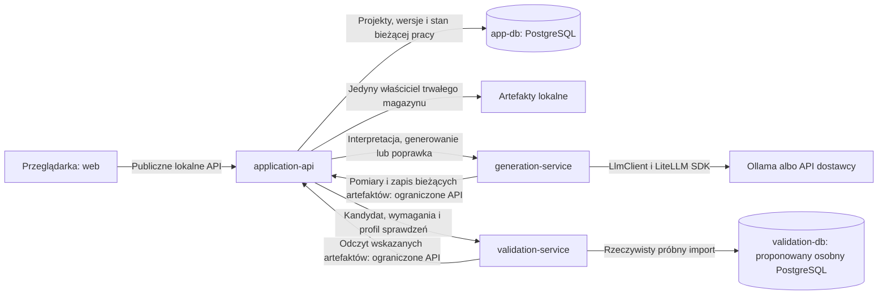

# Serwisy, funkcje, kontrakty i technologie

**Data:** 21 października 2026.

**Status:** szczegółowa propozycja realizacji wariantu Python/FastAPI + React. Kierunki LLM i przechowywania kontekstu zapisano w [rejestrze ustaleń](ustalenia_architektoniczne.md); nowe nazwy operacji, endpointów, modeli danych i procesów są propozycjami, nie gotowym kodem.

**Decyzja z 14 listopada 2026 — planowanie S1:** Python/FastAPI
i React/TypeScript zatwierdzono do implementacji MVP. W osobnej odpowiedzi
użytkownik zatwierdził także trzy osobno uruchamiane serwisy backendowe:
zarządzanie, generowanie i walidację, a następnie Docker Compose jako
podstawowy sposób lokalnego uruchamiania backendów i potrzebnych baz.
Zatwierdzono także komunikację między serwisami przez HTTP z danymi JSON
i opisem API w OpenAPI; nie obejmuje to sposobu przesyłania plików.
Podczas dopracowania S1-T1 zatwierdzono Vite oraz npm dla frontendu
React/TypeScript.
Zatwierdzono także uv do zarządzania zależnościami i środowiskami backendów
Python oraz osobny projekt uv dla każdego z trzech serwisów, z własnymi
deklaracjami zależności, plikiem blokady wersji i środowiskiem wirtualnym.
Nie stosujemy wspólnego obszaru roboczego uv.
Bazową linią Pythona dla wszystkich backendów jest zatwierdzone 3.14;
wydanie poprawkowe przypniemy po przeglądzie i próbie zgodności zależności.
Zatwierdzono Uvicorn jako serwer każdej z trzech aplikacji FastAPI;
wersja, wariant instalacji i parametry uruchomienia pozostają otwarte.
Zatwierdzono pytest do testów automatycznych wszystkich trzech backendów.
Wersja, dodatkowe biblioteki i wtyczki pozostają otwarte; nie wykonano
instalacji ani testów aplikacji.
Zatwierdzono też `GET /health/live` w każdym backendzie: HTTP 200
i JSON `{"status":"ok"}`, bez wywołań LLM, kontroli baz i magazynów
oraz ujawniania konfiguracji. Sprawdzenie potwierdza działanie procesu,
nie gotowość do generowania lub walidacji. Dokładny zakres opisano
w [kontraktach API](lld/kontrakty_api.md).
W S1-T1 zatwierdzono niezależny start szkieletów bez działających baz,
magazynu plików, Ollamy i kluczy dostawców LLM. Health pozostaje dostępny,
ale nie oznacza gotowości funkcji biznesowych. Nie wprowadzamy atrap
odpowiedzi biznesowych; wymagania rzeczywistych integracji ustalamy
w ich zadaniach. Nie wykonano sprawdzenia uruchomienia.
Bazową linią środowiska narzędziowego frontendu jest zatwierdzone
Node.js 26 LTS. Dokładne wersje Node.js, npm i bibliotek wymagają
przypięcia i sprawdzenia zgodności.
Zatwierdzono dobór i przypięcie dokładnych wersji zaakceptowanych narzędzi
oraz ich wymaganych zależności przez dewelopera w pierwszym kroku S1-T1,
po sprawdzeniu oficjalnej dokumentacji oraz zgodności przez instalację
i testy. Bez zmiany stosu, Pythona 3.14 i Node.js 26 LTS; konflikt
wymagający zmiany ustaleń wraca do użytkownika przed zmianą.
Nie obejmuje to nowych opcjonalnych narzędzi. Wersji jeszcze nie wybrano.
Pozostałe biblioteki, szczegóły konfiguracji i kontrakty nadal
wymagają uzgodnienia.

**Decyzja z 14 listopada 2026 — S1-T4:** SQLAlchemy i Psycopg
zatwierdzono do obsługi PostgreSQL aplikacji w `application-api`,
a Alembic do migracji tej bazy. Nie obejmuje to schematów DDL użytkownika
ani zatwierdzenia proponowanych tabel. Dokładnych wersji i zgodności
z Pythonem 3.14 jeszcze nie sprawdzono. Migracje mają być uruchamiane
automatycznie przy starcie `application-api`, jako osobny etap
uruchomienia, nie przez health checki ani monitor. Stosujemy przygotowane
migracje, nie projektujemy zmian struktury automatycznie.
Migracje mogą być wykonywane tylko w fazie uruchamiania serwisu,
także po restarcie, nigdy podczas dalszego działania procesu.
Po błędzie migracji serwis pozostaje w trybie diagnostycznym,
udostępnia przyczynę bez wartości sekretów i blokuje funkcje wymagające
bazy. Kolejna próba po błędzie następuje dopiero po restarcie,
bez samoczynnego ponawiania podczas działania.
Ochrona przed równoczesnym wykonaniem
oraz tryb połączeń i transakcji pozostają do ustalenia.
Nie wykonano instalacji, migracji ani testów.

**Podstawa:** [specyfikacja MVP](specyfikacja_mvp.md), [architektura ogólna](architektura.md), [analiza technologii](analiza_technologii.md) i [granice przyszłego hostowania](przygotowanie_do_hostowania.md).

Nie zmieniamy wymagań przez szczegółowy projekt. Próbny import i cztery etapy walidacji potwierdzono w rozmowie 21 października 2026 i zapisano w specyfikacji v1.4. Szczegóły środowiska, parser, profil eksportu i sposób wykonywania reguł nadal podlegają otwartym decyzjom. Wybór kandydata rozstrzygnięto 14 listopada 2026: zwracamy wyłącznie najnowszego użytecznego kandydata zgodnie z REQ-039.

**Aktualizacja do specyfikacji v1.8:** nie przechowujemy archiwum wykonań ani wiadomości. Główny widok to bieżący czat z wyborem projektu i kolejnymi poleceniami (REQ-073). Nowy czat, odświeżenie lub zamknięcie strony i pełne zamknięcie aplikacji kończą dostęp do rozmowy i plików; projekty pozostają. Ostrzeżenie przed odświeżeniem lub zamknięciem strony podlega ograniczeniom przeglądarki (REQ-074–REQ-075 i sekcja 11.1 specyfikacji). Modele i transakcje wymagają uzupełnienia o granicę czatu. Mechanizm zakończenia dostępu i fizyczne sprzątanie pozostają w OD-09.

**Rozwinięcie implementacyjne:** [architektura niskopoziomowa v0.1](lld/README.md) opisuje moduły, interfejsy, pola danych, transakcje, dokładniejsze kontrakty i cykl wykonania. Nazwy stanów z wcześniejszej rozpiski są tam doprecyzowane jako propozycja.

## 1. Docelowy podział lokalnego MVP

| Element | Rodzaj | Co implementujemy | Czego używamy |
| --- | --- | --- | --- |
| `web` | Aplikacja w przeglądarce, nie serwis domenowy. | Główny widok czatu z wyborem projektu i kolejnymi poleceniami, zatwierdzanie, status i wynik; bez archiwum rozmów. | TypeScript, React, Vite, Mantine; proponowany TanStack Query. |
| `application-api` | Własny serwis zarządzający. | Projekty, schematy, reguły, plan danych, bieżące wykonanie, kontekst, raport i eksport, bez archiwum. | Python, FastAPI, Pydantic, SQLAlchemy, Alembic, Psycopg, HTTPX. |
| `generation-service` | Własny serwis modelowy. | Interpretacja wymagań, wariant generowania, prompty, przygotowanie gotowych artefaktów i reakcja na zleconą poprawkę. | Python, FastAPI, Pydantic; LiteLLM SDK za adapterem. |
| `validation-service` | Własny serwis sprawdzeń. | Walidacja gotowych artefaktów, zgodność z planem, raport naruszeń i obsługa środowiska próbnego. | Proponowane Python, FastAPI, Pydantic, parser SQL, `csv` i Psycopg. |
| `app-db` | Gotowa baza aplikacji. | Nasz model trwałych danych i migracje. | PostgreSQL; opcjonalnie pgvector po osobnej decyzji. |
| `validation-db` | Gotowe środowisko rzeczywistego próbnego importu. | Przydział i sprzątanie odizolowanego obszaru próby, bez własnego silnika bazy. | Proponowana osobna instancja PostgreSQL, ograniczone role i zasoby. |
| `ollama` | Gotowe, opcjonalne środowisko modeli lokalnych. | Konfiguracja połączenia, identyfikacja modelu i pomiary. | Ollama; bez własnej inferencji i obsługi GPU. |
| Magazyn plików | Zależność backendu, nie dodatkowy mikroserwis. | Adapter, identyfikatory, kontrola dostępu, integralność i metadane. | Lokalny katalog/wolumen; standardowe operacje plikowe i `zipfile`. |

Są **trzy własne serwisy backendowe**, nie siedem mikroserwisów domenowych. Modele, parser, LiteLLM, dobór kontekstu, raportowanie i eksport nie otrzymują automatycznie osobnych procesów.

Usługi wewnętrzne nie korzystają z tabel `app-db`. Diagram pokazuje kierunki wywołań; każda operacja ma odpowiedź i identyfikatory korelacyjne.

## 2. `web` — interfejs użytkownika

### 2.1. Funkcje

**Zakres początkowego szkieletu S1-T1 — zatwierdzony 14 listopada 2026:**
prosty ekran techniczny z nazwą aplikacji i informacją „Szkielet aplikacji”,
bez czatu, formularzy i logiki biznesowej. Sprawdzenie połączenia z API
należy do S1-T8. Poniższa lista dotyczy docelowych funkcji MVP,
nie zakresu szkieletu; docelowy wygląd pozostaje w OD-12.

1. Lista i utworzenie projektu.
2. Wgranie pełnego DDL oraz podgląd rozpoznanych tabel, relacji i nieobsługiwanych elementów.
3. Wprowadzenie reguł i wskazówek jakościowych; odczyt proponowanej interpretacji.
4. Główne okno czatu: wybór projektu, polecenie w języku naturalnym, pytania doprecyzowujące i kolejne polecenia w tej samej rozmowie.
5. Podgląd i zatwierdzenie zakresu, liczebności dla wszystkich potrzebnych tabel, reguł i formatu.
6. Start, anulowanie i odczyt bieżącego etapu wykonania.
7. Wynik i raport: kompletność, importowalność, obowiązujące relacje, dodatkowe reguły biznesowe oraz pomiary jako odrębne informacje.
8. Pobranie dostępnej paczki i raportu w bieżącym czacie; bez archiwum dawnych rozmów.
9. Nowe wykonanie przygotowanego zlecenia od początku po anulowaniu lub awarii; bez wyboru dawnej próby z archiwum.
10. Nowy czat, odświeżenie lub zamknięcie strony i pełne zamknięcie aplikacji: koniec dostępu do rozmowy i plików; po powrocie nowy czat, zapisane projekty pozostają.
11. Ostrzeżenie przed odświeżeniem lub zamknięciem strony z danymi, z możliwością pozostania bez utraty rozmowy. Nie wybieramy własnego tekstu standardowego okna ani nie gwarantujemy go przy wymuszonym zamknięciu (sekcja 11.1 specyfikacji).
12. Po nieudanej zmianie i wyczerpaniu napraw: komunikat, poprzednia sprawdzona paczka z jej raportem i ręczna akcja „Podejmij kolejne 3 próby”, jednorazowa dla danej prośby (REQ-078–REQ-079). Jeśli dodatkowa seria również nie da użytecznej poprawionej paczki, kończymy naprawy i nie pokazujemy ponownie przycisku; poprzednia sprawdzona paczka z jej raportem pozostaje dostępna. Po nieudanym pierwszym generowaniu bez użytecznej paczki ta akcja nie jest dostępna (AC-47).

Czat jako główny widok jest uzgodniony. Dokładny układ formularzy, zarządzanie projektami i pozostała prezentacja kolejnych wyników pozostają w OD-12. Przy prośbie o zmianę danych LLM otrzymuje poprzednią paczkę jako kontekst i nowe polecenie, a poprawiona paczka podlega nowej walidacji (REQ-076). Każda nowa prośba ma własny limit napraw zgodnie z REQ-033–REQ-034. Dodatkowa seria z REQ-079 ma do 3 rund, bez dodatkowego pierwszego kandydata poza limitem. LLM otrzymuje ostatniego nieudanego kandydata i wykryte w nim błędy, nie poprzednią sprawdzoną paczkę. Techniczne przypisanie prośby i serii do wykonania oraz liczników i kontrakt kontekstu pozostają w OD-10; nie jest to wznowienie zakończonego procesu ani automatyczne retry po awarii.

### 2.2. Narzędzia i własny kod

- **React + TypeScript + Vite** — zatwierdzony zestaw frontendu; React służy do budowy interfejsu, Vite do uruchamiania podczas developmentu i budowania zasobów. Konkretne wersje wymagają ustalenia i sprawdzenia.
- **npm** — zatwierdzone zarządzanie pakietami frontendu i uruchamianie poleceń projektu; nie zastępuje Reacta ani Vite.
- **Mantine** — gotowe kontrolki formularzy, okien i list zamiast budowania biblioteki UI [T1].
- **TanStack Query** — proponowany odczyt danych serwera i odpytywanie o status. Wyłączamy automatyczne retry; błąd odczytu nie uruchamia ani nie kończy wykonania [T2].
- **Klient API na podstawie OpenAPI** — kierunek, konkretnego generatora jeszcze nie wybieramy.
- **Playwright** — testy krytycznych ścieżek w przeglądarce; szczegóły narzędzi w analizie technologii.

Nasze są ekrany, reguły widoczności, interakcje i prezentacja. Backend nadal weryfikuje wszystkie warunki; zablokowany przycisk nie jest kontrolą dostępu.

### 2.3. Granice

- UI rozmawia wyłącznie z `application-api`, nie z bazą, Ollamą i walidatorem.
- Nie przechowuje kluczy dostawców LLM ani ścieżek plików hosta jako źródła prawdy.
- Odświeżenie strony nie ponawia generowania i nie odtwarza starego czatu ani plików. Rezygnacja z odświeżenia w ostrzeżeniu zachowuje dane. Techniczny mechanizm zakończenia dostępu wymaga OD-09; nie wystarczy założyć niezawodnego żądania sieciowego przy zamykaniu.
- Nowy czat nie odzyskuje odpowiedzi i plików starej rozmowy przez zachowane identyfikatory lub pamięć podręczną. Powiązanie rozmowy z komendami i plikami wymaga uzupełnienia projektu API; nie wybrano jeszcze technicznego mechanizmu.
- Identyfikator komendy pozwala rozpoznać ponowne dostarczenie tej samej akcji startu. Świadome ręczne nowe wykonanie ma nowy identyfikator.

## 3. `application-api` — zarządzanie i sterowanie

### 3.1. Odpowiedzialność

To właściciel danych projektu i stanu bieżącego wykonania. Zawiera odrębne moduły, ale nie osobne mikroserwisy raportów i plików. Historia wykonań jest poza MVP (REQ-072).

| Moduł | Funkcje i proponowane operacje |
| --- | --- |
| Projekty | `create_project`, `get_project`, `list_projects`; własność i kontrola dostępu. Usuwanie i retencja dopiero po OD-09. |
| Wersje schematów | `register_schema_version`, `analyze_schema`, `get_schema_version`; oryginalny DDL, wynik analizy, diagnostyka i wersja parsera. |
| Reguły | `propose_rule_interpretation`, `approve_rule_interpretation`; rozróżnienie reguł sprawdzalnych, nierozstrzygnięć i wskazówek jakościowych. |
| Zlecenia | `prepare_order`, `answer_clarification`, `approve_data_plan`; wymagane tabele i liczebności, format, konflikty i blokady. |
| Kontekst | `build_context`; dokładne definicje potrzebnych tabel, relacje i reguły z przypiętych wersji, kontrola budżetu. |
| Wykonania | `start_run`, `get_run`, `cancel_run`; migawka, wariant, operacje i przejścia bieżącego stanu. Odtwarzanie z historii jest poza MVP. |
| Sterowanie | `execute_run`, `request_correction`, `finalize_run`; kolejność etapów i jeden wspólny budżet poprawek dla danej prośby. Nowa prośba użytkownika o zmianę danych ma własny limit (REQ-034); powiązanie z wykonaniem nadal wymaga OD-10. |
| Kandydaci | `register_candidate`, `record_validation`, `select_candidate`; niezmienne wersje, powiązanie z raportem i ochrona wcześniejszego użytecznego wyniku. |
| Pomiary | Dostępne liczniki, ustawienia i błędy do raportu bieżącego wykonania, bez archiwum wiadomości. Uproszczony kontrakt wymaga OD-05 i OD-07. |
| Artefakty | `store_artifact`, `open_authorized_artifact`, `build_export`; integralność, pakowanie bez modyfikowania SQL/CSV. |
| Raport | `build_run_report`; wynik procesu i naruszenia, bez jednej zbiorczej oceny jakości. |

Jeśli przygotowanie planu lub interpretacji reguł wymaga modelu, backend zleca operację `generation-service`. Nie utrzymuje drugiego zestawu integracji dostawców LLM.

### 3.2. Technologie i wzorce

- **Python + FastAPI + Pydantic** — API i kontrakty; OpenAPI oraz wstrzykiwanie zależności są udokumentowane przez FastAPI [T3].
- **SQLAlchemy + Psycopg** — zatwierdzone dla bazy aplikacji w `application-api`. ORM dotyczy naszych tabel, nie dynamicznych schematów danych użytkownika; szczegółowe granice repozytoriów pozostają propozycją [T4].
- **Alembic** — zatwierdzone migracje tylko schematu aplikacji, uruchamiane automatycznie wyłącznie w fazie startu `application-api`, poza health checkami i monitoringiem. Błąd pozostawia serwis w trybie diagnostycznym z blokadą funkcji wymagających bazy; ponowienie wymaga restartu. Ochrona przed równoczesnym uruchomieniem pozostaje do uzgodnienia [T5].
- **HTTPX** — klient do generatora i walidatora, z jawnymi timeoutami i bez automatycznych ponowień [T6].
- **Repository + Unit of Work** — proponowane granice operacji zapisu i transakcji; nie uniwersalna warstwa CRUD.
- **Ports & Adapters** — logika przypadków użycia nie importuje klas SQLAlchemy, LiteLLM ani parsera.

Pydantic sprawdza kontrakty aplikacji. Nie stanowi dowodu zgodności danych z PostgreSQL i nie służy do cichej konwersji kandydata.

### 3.3. Lokalny wykonawca długich operacji

Proponujemy port `ExecutionRunner` z pojedynczym, ograniczonym wykonawcą na MVP, bez kolejki i brokera.

1. `start_run` sprawdza zatwierdzenie planu, dostęp i dostępność miejsca na wykonanie.
2. W transakcji zapisuje migawkę, faktyczny wariant, identyfikator komendy i wykonania.
3. Zleca pracę wykonawcy i zwraca `202` z `run_id`, bez oczekiwania przeglądarki na wynik modelu.
4. Błąd uruchomienia po zapisie daje bieżący status błędu; nie jest zaliczoną generacją. Nie wymaga to wpisu w archiwum.
5. Runner wywołuje generowanie i walidację, zapisuje wyniki, decyduje o poprawkach i zakończeniu.

Do prototypu proponujemy zadania `asyncio` zarządzane cyklem życia aplikacji, z rejestrem aktywnych operacji, limitami i jawnym sprzątaniem [T7]. Nie traktujemy pojedynczego `create_task()` ani FastAPI `BackgroundTasks` jako kompletnego systemu zadań [T8]. Blokujące operacje nie mogą blokować obsługi statusu i anulowania.

Bazowe ograniczenie wdrożeniowe to **jeden proces wykonawczy zarządzania i najwyżej jedno aktywne wykonanie**. Przy zajętości proponujemy jawną odmowę startu, a nie niewidoczną kolejkę. Nie uruchamiamy wielu replik z niezależnymi runnerami. Gotowy runner, np. omawiany w analizie Procrastinate, pozostaje alternatywą do próby, nie dodatkową zależnością tego projektu.

Utrata procesu runnera kończy możliwość kontynuacji. Proponowane uzgodnienie pozostawionego stanu po restarcie służy porządkowaniu pracy, nie przywracaniu poprzedniej rozmowy i plików po pełnym zamknięciu aplikacji. Nie odtwarzamy kolejnych kroków. Przed nowym zadaniem sprawdzamy także brak pozostawionej aktywnej operacji usług pomocniczych; anulujemy ją lub blokujemy nowy start.

### 3.4. Własność danych

Proponowane logiczne encje, nie gotowy schemat migracji:

| Encja | Co zachowuje |
| --- | --- |
| `Project` | Nazwa i lokalny właściciel; bez bazy kont w MVP. |
| `SchemaVersion` | Odniesienie do oryginalnego DDL, jego hash, opis strukturalny i diagnostyka. |
| `RuleRevision` | Tekst, interpretacja, stan zatwierdzenia, wersja i ewentualna definicja sprawdzenia. |
| `Order` / `ApprovedPlan` | Polecenie, doprecyzowania, zakres, liczebności i wybrany profil formatu. |
| `Run` / `RunSnapshot` | Niezmienne wymagania, wariant, status, faza, limit rund, przyczyna zakończenia i pomiary. |
| `Operation` | Konkretne zlecenie generatora lub walidatora, jego termin i uprawniony zakres. Przygotowanie ma referencję do projektu/rewizji zlecenia, a generowanie i walidacja również do wykonania. |
| `Candidate` | Manifest artefaktów, runda, wersja i hashe; bez nadpisywania poprzednika. |
| `ValidationReport` | Metoda, profil możliwości, sprawdzenia i identyfikacja dokładnego kandydata. |
| Pomiary wywołań | Dostępne parametry i pomiary do bieżącego raportu. Archiwum pełnych wiadomości i `TraceEvent` jest poza MVP. |
| `Artifact` | Typ, właściciel wynikający z projektu, rozmiar, hash i logiczny klucz magazynu. |

Proponujemy rozdzielić **cykl życia** (`ACTIVE`, `FINISHED`, `FAILED_TECHNICALLY`, `CANCELLED`) od **fazy** (`GENERATING`, `VALIDATING`, `CORRECTING`) i **oceny wyniku**. Nazwy są robocze. Samo `FINISHED` nie znaczy, że dane są kompletne i importowalne. Żądanie anulowania jest osobną trwałą informacją, zanim zostanie rozstrzygnięte zakończenie.

### 3.5. Najważniejsze testy

- Zmiana projektu nie modyfikuje wymagań rozpoczętego wcześniej, nadal obsługiwanego wykonania.
- Dwukrotne dostarczenie tej samej komendy nie wywołuje modelu dwukrotnie.
- Limit poprawek jest globalny; wiele wywołań w rundzie go nie resetuje.
- Błąd techniczny nie uruchamia rundy poprawki ani innego modelu.
- Kandydat użyteczny przed nieudaną poprawką pozostaje zachowany.
- Anulowanie ścigające się z odpowiedzią nie pozwala wznowić wykonania.
- Raport i pliki mają ten sam `candidate_id` oraz zgodne hashe.
- Sztuczne dwa konteksty właścicieli nie dają dostępu do cudzych zasobów; nie oznacza to wdrożenia wielu kont.

## 4. `generation-service` — modele i gotowe kandydaty

### 4.1. Funkcje

| Operacja | Wejście | Wynik |
| --- | --- | --- |
| `interpret_requirements` | Wersjonowany kontekst schematu, polecenie, reguły i doprecyzowania. | Propozycja interpretacji, pytań i planu; nigdy automatyczne zatwierdzenie. |
| `generate_candidate` | Niezmienna migawka, kontekst, profil SQL/CSV, wersja wariantu i identyfikator operacji. | Gotowe treści SQL/CSV od modelu, surowa odpowiedź, manifest i ślad wywołań. |
| `correct_candidate` | Te same wymagania, konkretny kandydat, raport naruszeń i numer rundy przyznany przez backend. | Nowy kandydat; bez zmiany schematu i liczebności. |
| `cancel_operation` | Identyfikator uprawnionej aktywnej operacji. | Potwierdzenie przyjęcia lokalnego zatrzymania; nie gwarancja cofnięcia obliczeń u dostawcy. |
| `get_capabilities` | Wybrana konfiguracja wariantu. | Jawne możliwości i ograniczenia, bez sekretów. |

**Uzupełnienie do specyfikacji v1.9:** powyższe `correct_candidate` oznacza automatyczną poprawkę naruszeń przy niezmiennych wymaganiach. Prośba użytkownika o zmianę danych (REQ-076) wymaga przekazania poprzedniej paczki i nowego polecenia; nie utożsamiamy jej z tą operacją. Dopasowanie kontraktu i strategii, w tym obsługa pojemności kontekstu, pozostaje do zaprojektowania w OD-10.

### 4.2. Narzędzia i własny kod

- **Python + FastAPI + Pydantic** — granica HTTP i kontrakty [T3].
- **LiteLLM Python SDK** wewnątrz `LiteLlmAdapter` — gotowa komunikacja z dostawcami i wspólny format odpowiedzi; bez osobnego Proxy [T9].
- **Ollama** — preferowane środowisko modeli lokalnych. Płatne modele pozostają za tym samym portem; lista modeli nie jest wybrana.
- **GenerationStrategy** — nasza strategia organizacji pracy: pierwszy wariant możliwie prosty, inne warianty dopiero do badań.
- **LangGraph** — wyłącznie opcjonalny komponent konkretnej strategii, nie domyślny silnik całej aplikacji.
- **HTTPX** — ograniczony dostęp do API artefaktów i pomiarów bieżącej pracy [T6].

Nasze są prompty, podział kontekstu i ról, wyodrębnienie zadeklarowanych plików, mapowanie możliwości i błędów oraz powiązanie wywołań z rundą. Nie piszemy inferencji ani klientów każdego API od zera.

### 4.3. `LlmClient` i odpowiedzialność adaptera

Żądanie obejmuje: jawne wiadomości, model, wymagane możliwości, ustawienia, limit czasu i identyfikatory wywołania. Wynik obejmuje: odpowiedź, przyczynę zakończenia oraz dostępne informacje o rzeczywiście użytym modelu, parametrach, tokenach, czasach i koszcie. Nieznane wartości są jawne; nie zakładamy dostępu do ukrytych parametrów dostawcy.

Warunki:

1. Wyłączone retry wszystkich warstw, fallbacki, cache odpowiedzi i ciche skracanie kontekstu.
2. Brak cichego usuwania nieobsługiwanych parametrów.
3. Dostępne pomiary muszą odpowiadać rzeczywistym wywołaniom. Callbacki są mechanizmem do oceny [T10]; nie wdrażamy archiwum pełnych wiadomości.
4. Klucze i nagłówki uwierzytelniające nie trafiają do artefaktów ani śladu.
5. Zakończenie przez limit odpowiedzi nie jest traktowane jako dowód kompletności.
6. Ustawienia i dane wykonania nie są zmiennymi globalnymi „aktualnej rozmowy”.
7. Przegląd konkretnej wersji LiteLLM i jej zależności przed instalacją; patrz ryzyko łańcucha dostaw w rejestrze i analizie [T11].

Nie deklarujemy, że dowolnego dostawcę podłączymy wyłącznie zmianą nazwy modelu. Potrzebne są testy zgodności możliwości i śladu.

### 4.4. Dane robocze, pomiary i ograniczenia

- Serwis nie posiada trwałej bazy projektów ani historii.
- Operacje interpretacji poprzedzają `run_id`; ich ślad przypisujemy do projektu i rewizji zlecenia. Zatwierdzona migawka może wskazywać użyte przygotowanie, bez liczenia jednego wywołania jako nowego kosztu w każdym ręcznym ponowieniu.
- Rejestr aktywnych operacji służy anulowaniu i ochronie przed duplikatem, nie odtwarzaniu pracy po restarcie.
- Dostarcza dostępne pomiary i błędy do bieżącego raportu. Dawny `TraceSink` z archiwum wiadomości nie należy do MVP; uproszczony kontrakt wymaga OD-05 i OD-07.
- Brak pomiarów po awarii pozostaje jawny; nie dopisujemy fikcyjnego kompletnego logu.
- Awaria mechanizmu wymaganego do obsługi bieżącego wykonania kończy pracę, ale nie wymagamy zapisu archiwum jako warunku każdego wywołania.
- Gotowe pliki trafiają do backendu przez `ArtifactWriter`, z identyfikacją operacji i kontrolą rozmiaru. Generator nie montuje trwałego katalogu historii.
- Jeśli treść poprawnie odebranej odpowiedzi modelu nie pozwala wyodrębnić wymaganych plików, zachowujemy ją i zgłaszamy naruszenie formatu kandydata. Nie nazywamy takiej treści awarią SDK i nie naprawiamy jej po cichu.
- Nie podejmuje decyzji o globalnym limicie, sukcesie zadania ani wyborze ostatecznego kandydata.
- Nie konwertuje pośrednich rekordów na własny SQL/CSV. Dozwolone wyodrębnienie plików nie obejmuje naprawy treści.

Pierwsze testy wykorzystują kontrolowany endpoint modelowy, bez płatnych wywołań. Obejmują błąd sieci, timeout, ucięty wynik, nieobsługiwany parametr, brak metryk, wieloetapowe wywołania i brak ponowienia.

## 5. `validation-service` — sprawdzenie konkretnego wyniku

### 5.1. Funkcje

| Etap | Co sprawdza | Proponowany mechanizm |
| --- | --- | --- |
| Przyjęcie kandydata | Manifest, format, rozmiary, przypisanie do tabel, hashe i zgodność referencji. | Własny kontrakt i ograniczony `ArtifactReader`. |
| 1. Składnia / format | Dozwolone SQL `INSERT` albo poprawny profil CSV; bez zmiany treści. | Parser SQL oraz standardowy moduł `csv` [T12]. |
| 2. Wstępna zgodność ze schematem i typami | Istnienie tabel/kolumn, liczba pól i wiarygodnie rozpoznawalne niezgodności wartości. | Parser i własne sprawdzenia wstępne, bez odtwarzania pełnego systemu typów ani zmiany danych. |
| 3. Próbny import | Ostateczne potwierdzenie typów, obsługiwanych `NOT NULL`, PK, FK, `UNIQUE`, `CHECK`, wartości domyślnych i relacji w całej paczce. | Uzgodniony rzeczywisty import do PostgreSQL; proponowany adapter Psycopg [T13, T14]. |
| 3. Kompletność | Rzeczywisty zakres i liczebności wobec planu, także brakujące i nieuzgodnione tabele. | Własne porównanie po imporcie; liczenie na pełnej paczce, nie samych liniach pliku. |
| 4. Reguły biznesowe | Zatwierdzone dodatkowe sprawdzenia, zakres, liczba, jednostka i przykłady naruszeń. | `BusinessRuleEvaluator`; ograniczony mechanizm do ustalenia, nie dowolny kod modelu. |
| Zakończenie | Raport oraz sprzątanie środowiska. | Własna orkiestracja sprawdzeń i adapter środowiska. |

Etap drugi jest kontrolą wstępną, nie dowodem udanego importu. Jeśli wcześniejszy etap uniemożliwia następny, oznaczamy go jako niewykonany z przyczyną. Nie zwracamy pozytywnej oceny domyślnie. Pełny zapis potwierdzeń i propozycji zawiera [projekt walidacji](lld/walidacja.md).

### 5.2. Narzędzia

- **Python + FastAPI + Pydantic** — kontrakty serwisu.
- **`SqlParser`** — port. SQLGlot jako pierwszy kandydat do próby, nie zatwierdzona zgodność całego dialektu. pglast pozostaje alternatywą po ocenie licencji i wersji.
- **`csv`** — odczyt i sprawdzanie formatu bez zapisu poprawionego CSV. Proponujemy jawny dialekt, tryb ścisły, kontrolę nagłówków i liczby pól; bez zgadywania profilu i konwersji wartości do liczb przez parser [T12].
- **Psycopg** — proponowany sterownik, transakcje i transfer CSV przez `COPY FROM STDIN` w wybranej metodzie próbnego importu [T14].
- **Osobny PostgreSQL** — środowisko prób, nie `app-db`. Nie generujemy z DDL użytkownika modeli SQLAlchemy.

### 5.3. Próbny import — metoda uzgodniona, organizacja nadal OD-02

Wybrano rzeczywisty import po wstępnej kontroli schematu i typów. Poniższe szczegóły provisioningu i izolacji pozostają projektem do weryfikacji, nie potwierdzeniem gotowego środowiska.

1. Sprawdzamy DDL i gotowy artefakt względem jawnie dozwolonego podzbioru, także wyrażeń i funkcji.
2. Przydzielamy pusty obszar w osobnej instancji walidacyjnej i ograniczoną rolę bez dostępu do innych prób.
3. Przygotowujemy schemat zgodny z zatwierdzoną wersją i profilem, bez usuwania ograniczeń.
4. Importujemy dokładny SQL albo oryginalne bajty CSV według profilu eksportu. Dla CSV używamy transferu blokowego, a nie parsowania do rekordów i ponownej serializacji.
5. Sprawdzamy całą paczkę, w tym ograniczenia odroczone w momencie wymaganym przez profil transakcji.
6. Oddzielnie porównujemy liczebności i zakres, a następnie wykonujemy obsługiwane reguły.
7. Zapisujemy metodę, wersję silnika, profile i raport; sprzątamy środowisko także po błędzie.

`COPY` obsługuje różne profile i może mieć zachowanie pomijania błędów. Nie dopuszczamy takiego trybu jako sposobu uzyskania pozytywnego wyniku. Nie korzystamy z `COPY PROGRAM` ani odczytu dowolnych plików hosta [T15].

Zwykły błąd danych, np. naruszenie FK, jest negatywnym sprawdzeniem. Niedostępna baza lub awaria mechanizmu sprawdzeń jest błędem technicznym i kończy wykonanie, nie uruchamia poprawki modelu.

Ograniczenie roli, lista dozwolonych instrukcji i wyrażeń, limity zapytań, zasobów i sieci są warstwami ochrony. Sam kontener lub osobny schemat nie są gwarancją bezpiecznego uruchomienia niezaufanego SQL. Walidator nie otrzymuje gniazda Docker ani poświadczeń `app-db`; provisioning i uprawnienia muszą być ograniczone do środowiska prób.

### 5.4. Kontrakt raportu i testy

Każde sprawdzenie zwraca roboczo: `check_id`, `stage`, `status`, `code`, zakres, jednostkę, liczbę i przykłady naruszeń oraz przyczynę niewykonania. Statusy proponujemy rozróżnić jako `PASS`, `VIOLATION`, `NOT_RUN`, `UNSUPPORTED`, `UNDETERMINED`; awaria infrastruktury jest odrębnym błędem operacji.

Raport ma `run_id`, `operation_id`, `candidate_id`, hashe, wersję walidatora i profil możliwości. Validator nie zwraca tylko jednego `valid: true`.

Uzgodnione 14 listopada 2026: relacje zatwierdzone poza DDL są obowiązkowym warunkiem wykonania zadania i wymagają osobnego sprawdzenia po imporcie. Naruszenie lub brak dowodu blokuje kwalifikację kandydata mimo udanego importu; nie zmieniamy przy tym oryginalnego DDL ani wyniku importu (REQ-012, REQ-027, AC-34).

Testy obejmują osobno: błędną składnię, typ, klucz, brak referencji, niekompletność, naruszenie dodatkowej reguły, niewykonane sprawdzenie, timeout i awarię. Sprawdzamy, że identyczny kandydat nie został zmodyfikowany podczas walidacji.

## 6. Moduł kontekstu — bez dodatkowego serwisu RAG

**Miejsce:** `application-api`, ponieważ ten serwis jest właścicielem schematów i kontroli dostępu. Generator dostaje już wybrany i wersjonowany pakiet kontekstu.

| Funkcja | Bazowe MVP | Możliwe rozszerzenie |
| --- | --- | --- |
| Odczyt schematu | Oryginalny DDL i struktura z konkretnej wersji. | Bez zmiany źródła prawdy. |
| Wybór tabel | Z planu i rozpoznanych wymagań; potrzebne definicje w budżecie kontekstu. | Ranking semantyczny jako wsparcie doboru. |
| Relacje i reguły | Jawne zależności DDL oraz zatwierdzone uzupełnienia. | Nadal obowiązkowe, nie zastępowane embeddingiem. |
| Pakiet kontekstu | Dokładne fragmenty, identyfikatory, hashe i wersja sposobu selekcji. | Dodatkowo model embeddingowy i konfiguracja wyszukiwania. |
| Budżet | Uwzględnia wiadomości, instrukcje i miejsce na odpowiedź; bez cichego obcinania. | Kontrolowany podział operacji w wybranym wariancie. |

Port `ContextProvider` ma początkowo implementację opartą na modelu schematu i zależnościach. Jeśli konieczna definicja nie mieści się w budżecie, zwracamy jawną blokadę albo korzystamy z ustalonego podziału operacji; nie usuwamy wymagań.

Opcjonalny wariant to pgvector w `app-db` oraz oddzielny `EmbeddingClient`. pgvector jest rozszerzeniem PostgreSQL, nie wymusza nowego serwera; model embeddingowy i przebudowa indeksu pozostają dodatkowymi obowiązkami [T16]. Wyniki zawsze ograniczamy do właściwego projektu i wersji, z przygotowaniem do przyszłej kontroli właściciela.

Wybór tabel do kontekstu nie jest automatycznym zatwierdzeniem generowania dla nowych tabel. Rozszerzenie planu wymaga zatwierdzenia przed startem. Przy porównaniach zapisujemy rzeczywiście użyty kontekst; zmiana selekcji jest zmianą wariantu.

## 7. Dane, pliki i gotowe zależności

### 7.1. `app-db`

Przechowuje projekty i schematy. Techniczny zapis wymagań i stanu bieżącej pracy pozostaje propozycją do doprecyzowania z OD-09, nie archiwum zakończonych wykonań. Duże treści mogą być roboczymi artefaktami o jednoznacznych referencjach.

Jedyny serwis z poświadczeniami aplikacyjnej bazy to `application-api`; osobna rola migracji może działać wyłącznie przy przygotowaniu i aktualizacji środowiska. Generator i walidator korzystają z kontraktów backendu, nie współdzielonego ORM.

### 7.2. Magazyn artefaktów

Port `ArtifactStore` ukrywa katalog hosta. W bazowym wariancie proponujemy `LocalArtifactStore`.

- Przechowuje DDL oraz potrzebne bieżącej pracy pliki kandydatów, raport i paczkę. Nie jest archiwum dawnych wyników i pełnych wiadomości.
- Backend wyznacza klucze plików; nazwy od modelu nie są zaufanymi ścieżkami.
- Metadane obejmują hash, rozmiar i stan rejestracji. Zapis do pliku i transakcja bazy nie są jedną transakcją.
- Proponujemy zapis tymczasowy, ukończenie pliku i dopiero publikację metadanych; uszkodzony zapis nie staje się artefaktem gotowym do pobrania.
- Osierocone pliki techniczne są uzgadniane; czas życia danych roboczych i usuwanie projektów nadal podlegają OD-09.
- `zipfile` służy do opakowania wyników, nie przepisania ich treści [T17].
- Nie eksportujemy danych przez ponowny odczyt tabel walidacyjnych i serializację: użytkownik otrzymuje sprawdzone artefakty modelu.
- W nadal dostępnym czacie wcześniej zapisany użyteczny kandydat i jego raport są dostępne do pobrania po anulowaniu i awarii bez zmiany statusu wykonania (REQ-047, AC-35). Po zdarzeniach z REQ-074 stary czat i jego pliki nie są dostępne. Dla częściowych lub niesprawdzonych artefaktów dostępność pozostaje OD-08; samo przechowanie pliku nie jest dowodem poprawności.

### 7.3. `validation-db`

Środowisko wybranego próbnego importu. Proponowana osobna instancja, konta, sieć, limity i dane tymczasowe. Nie przechowuje historii badań. Sprzątanie pozostałości po awarii nie oznacza wznowienia walidacji.

### 7.4. Ollama i API zewnętrzne

Gotowe środowisko, nie własny mikroserwis biznesowy. Na macOS preferujemy natywną Ollamę obok Compose, ze względu na udokumentowany brak akceleracji GPU Ollamy w Docker Desktop na macOS [T18].

Wariant tylko z zewnętrznym API nie wymaga działającej Ollamy. Nie uruchamiamy automatycznego pobierania modeli ani płatnych wywołań podczas startu infrastruktury. Dopuszczenie konkretnego modelu wymaga testów sprzętu, długości odpowiedzi, możliwości i warunków użycia.

## 8. Komunikacja, endpointy i wspólne kontrakty

### 8.1. Reguły

- Zatwierdzono HTTP + JSON i opis API w OpenAPI między serwisami. Wersjonowanie kontraktów i binarne przesyłanie plików z osobnym manifestem pozostają propozycją.
- Przeglądarka korzysta z krótkich komend i odczytu statusu; nie utrzymuje połączenia przez cały czas generowania.
- W proponowanym prostym wariancie wewnętrzna operacja generowania lub walidacji może być długim żądaniem HTTP runnera. Wymaga osobnych timeoutów oraz równolegle dostępnego anulowania.
- Nie tworzymy trzech niezależnych trwałych kolejek i nie ukrywamy awarii automatycznym redelivery.
- Każda operacja ma `contract_version`, `project_id`, `operation_id`, termin i identyfikację wariantu. Przygotowanie wskazuje rewizję zlecenia, a generowanie i walidacja dodatkowo `run_id`; kandydat i raport mają własne identyfikatory i hashe.
- Serwisy nie przyjmują dowolnych adresów plików lub callbacków z promptu. Adres backendu i uprawnienia transferu pochodzą z zaufanej konfiguracji.

### 8.2. Proponowane API użytkownika

**Wyjątek — zakres zatwierdzony w S2-T1, 14 listopada 2026:**
`POST /api/v1/projects` z `name` i opcjonalnym `description` zwraca `201`,
`GET /api/v1/projects` i `GET /api/v1/projects/{project_id}` zwracają `200`.
Zatwierdzono `422` dla niepoprawnych pól, `409` dla zajętej nazwy
i `404` dla nieistniejącego projektu. Dokładne odpowiedzi nadal wymagają
uzgodnienia w [kontraktach API](lld/kontrakty_api.md).
Pozostałe operacje poniżej pozostają propozycjami.

| Metoda i ścieżka | Funkcja |
| --- | --- |
| `POST /api/v1/projects`, `GET /api/v1/projects` | Utworzenie i lista projektów. |
| `POST /api/v1/projects/{id}/schema-versions` | Wgranie nowego pełnego DDL. |
| `GET /api/v1/schema-versions/{id}` | Rozpoznana struktura, diagnostyka i wersja. |
| `POST /api/v1/projects/{id}/rules` | Wprowadzenie reguły do interpretacji. |
| `POST /api/v1/rules/{id}/approve` | Zatwierdzenie konkretnej interpretacji. |
| `POST /api/v1/projects/{id}/orders` | Przygotowanie zlecenia z polecenia. |
| `POST /api/v1/orders/{id}/clarifications` | Odpowiedź na pytanie doprecyzowujące. |
| `POST /api/v1/orders/{id}/approve` | Zatwierdzenie konkretnej rewizji planu. |
| `POST /api/v1/orders/{id}/runs` | Nowe wykonanie zatwierdzonego zlecenia. |
| `GET /api/v1/runs/{id}` | Bieżący status, faza i dostępny wynik; bez gwarancji archiwum. |
| `POST /api/v1/runs/{id}/cancel` | Żądanie zatrzymania. |
| `GET /api/v1/runs/{id}/report` | Dostępny raport wykonania. |
| `GET /api/v1/runs/{id}/export` | Dostępna paczka przypisana do wybranego kandydata. |

Interpretacja wymagająca LLM także otrzymuje identyfikator operacji; nie musi blokować żądania przeglądarki. Dokładny kontrakt odpytywania o jej wynik ustalimy z API, bez wprowadzania kontynuowalnych workflow.

### 8.3. Proponowane API wewnętrzne

| Właściciel | Operacje |
| --- | --- |
| Generator | `POST /internal/v1/interpret`, `POST /internal/v1/generate`, `POST /internal/v1/correct`, `POST /internal/v1/operations/{id}/cancel`; odczyt aktywnych operacji tylko dla zarządzania. |
| Walidator | `POST /internal/v1/validate`, `POST /internal/v1/operations/{id}/cancel`; odczyt aktywnych operacji tylko dla zarządzania. |
| Backend | Dopisanie zdarzenia do wskazanej operacji; wgranie i odczyt artefaktu w jej zakresie. Osobne kontrakty od publicznego API. |

Generator i walidator uwierzytelniają się jako usługi przez zaufaną lokalną konfigurację. Operacje są ograniczone do zasobów przyznanych przez backend; nie ufamy dowolnemu `user_id` z żądania. Nie projektujemy w MVP pełnego systemu tożsamości usług, ale sam brak publikacji portu nie zastępuje sprawdzenia uprawnienia.

### 8.4. Najważniejsze porty

| Port | Gdzie używany | Co pozwala wymienić |
| --- | --- | --- |
| `ProjectRepository`, `RunRepository`, `UnitOfWork` | Backend. | Zapis i transakcje danych aplikacji. |
| `ArtifactStore` | Backend. | Lokalne pliki na przyszły magazyn współdzielony. |
| `SchemaParser` / `SqlParser` | Moduł analizy i walidator. | Bibliotekę parsera bez ujawnienia AST poza adapterem. |
| `ContextProvider`, opcjonalny `EmbeddingClient` | Backend. | Strategię selekcji i dostawcę embeddingów. |
| `GenerationClient`, `ValidationClient` | Backend. | Implementację i transport operacji usług. |
| `ExecutionRunner` | Backend. | Sposób wykonywania pracy i późniejszy przydział zadań. |
| `GenerationStrategy`, `LlmClient` | Generator. | Organizację wariantu i komunikację z dostawcami. |
| Pomiary, `ArtifactReader`, `ArtifactWriter` | Usługi pomocnicze. | Przekazanie bieżących pomiarów i plików bez połączenia z `app-db`. Dawny `TraceSink` z pełnym archiwum jest poza MVP. |
| `ValidationEngine`, `BusinessRuleEvaluator`, `ValidationEnvironment` | Walidator. | Mechanizm sprawdzeń, reguł i przygotowania środowiska. |
| `ActorContextProvider`, `AccessPolicy` | Backend. | Lokalnego właściciela na przyszłe uwierzytelnianie i autoryzację. |

Nie wprowadzamy wszystkich portów jako rozbudowanych frameworków. To małe interfejsy wynikające z konkretnych wymiennych granic. Wymiana implementacji nadal wymaga testów kontraktowych i integracyjnych, a zmiana bazy także migracji danych.

Nie współdzielimy modeli ORM ani pełnego modelu domenowego jako obowiązkowej biblioteki trzech serwisów. Wspólna jest wersjonowana specyfikacja komunikacji i zestaw testów zgodności; ewentualnie generowane DTO nie dają dostępu do wewnętrznych repozytoriów.

## 9. Jeden pełny przepływ

1. UI wysyła DDL do backendu; backend zapisuje oryginał i wersję, analizuje obsługiwany zakres i zwraca diagnostykę.
2. Backend zapisuje reguły i polecenie; w razie potrzeby zleca generatorowi interpretację oraz rejestruje ślad.
3. Model proponuje znaczenie i zakres. Backend weryfikuje propozycję względem schematu, pokazuje niejasności i uzyskuje zatwierdzenie użytkownika.
4. Start tworzy niezmienną migawkę planu oraz wersję wariantu. Runner działa poza czasem życia żądania przeglądarki.
5. Backend dobiera i zapisuje kontekst, tworzy operację oraz wywołuje generator.
6. Generator rejestruje wywołania i gotowe treści przez ograniczone API backendu. Powstaje niezmienny kandydat.
7. Backend zleca walidatorowi sprawdzenie tego kandydata; walidator odczytuje tylko wskazane pliki.
8. Backend zapisuje raport. Jeśli wykryto naruszenia i pozostał globalny budżet, zleca poprawkę jako następną rundę.
9. Po zakończeniu wybiera wyłącznie najnowszego użytecznego kandydata spełniającego REQ-027, niezależnie od liczby lub wag dodatkowych naruszeń biznesowych (REQ-039, AC-36; OD-03 rozstrzygnięte).
10. Eksport opakowuje dokładnie sprawdzone pliki i raport. Ostateczny stan nie jest deklaracją realizmu.

Każdy techniczny błąd kończy przebieg bez ponawiania kroku. Wcześniej zapisany użyteczny kandydat z raportem pozostaje dostępny zgodnie z REQ-047, ale jego pobranie nie zmienia statusu przerwanego wykonania. Nie wystarcza sama obecność pliku bez dowodów kwalifikacji. Dostępność pozostałych artefaktów nadal wymaga OD-08.

## 10. Awarie, anulowanie i późniejsze skalowanie

| Sytuacja | Zachowanie |
| --- | --- |
| Błędny SQL/CSV od działającego modelu | Kandydat z naruszeniami; walidacja i poprawka w budżecie. |
| Timeout lub awaria modelu | Błąd techniczny; bez retry i innego modelu. Dostępne informacje o błędzie trafiają do bieżącego raportu, bez archiwum prób. |
| Timeout lub awaria walidatora | Błąd techniczny, nie negatywna ocena danych. |
| Błąd zapisu wymaganego stanu roboczego/artefaktu | Nie kontynuujemy w ukryciu; brak danych po awarii jest jawny. Błąd niedostępnego magazynu może uniemożliwić natychmiastowe zapisanie statusu i wymaga uzgodnienia po odzyskaniu dostępu. |
| Żądanie anulowania | Backend trwale blokuje przejście do kolejnych etapów i sygnalizuje aktywnej operacji zatrzymanie. Dokładny moment zakończenia pozostaje OD-08. |
| Odpowiedź po timeoutcie/anulowaniu | Może uzupełnić ślad diagnostyczny, ale nie uruchamia następnego etapu i nie zmienia wybranego wyniku. |
| Utrata procesu usługi | Pozostawione wykonanie zostaje rozpoznane jako przerwane; bez odtwarzania operacji i automatycznego wznowienia. |
| Niepewny wynik komendy HTTP | Identyfikatory i odczyt statusu służą rozpoznaniu sytuacji; nie zakładamy „exactly once” i nie wysyłamy automatycznie drugiej generacji. |

Proponujemy warunkowe aktualizacje statusu i identyfikator aktualnie uprawnionej operacji, żeby stara odpowiedź nie nadpisała zakończenia. Deduplikacja pomiaru lub komendy bieżącej pracy nie jest ponownym wywołaniem modelu.

Późniejsze skalowanie wymieni runner i politykę przydziału, doda rzeczywistą tożsamość, limity i testy współbieżności. Nie obiecujemy, że wystarczy zwiększyć liczbę replik obecnego lokalnego procesu.

## 11. Lokalne uruchomienie i granice bezpieczeństwa

Docker Compose zatwierdzono jako podstawowy sposób lokalnego uruchamiania backendów i potrzebnych baz. Proponowana konfiguracja opisuje `application-api`, `generation-service`, `validation-service`, `app-db` i warunkowy `validation-db`; jej szczegóły nadal wymagają uzgodnienia, w tym OD-02. Compose służy do złożenia zależności, a nie zastępuje systemu zadań i bezpieczeństwa SQL [T19].

**Zatwierdzone 14 listopada 2026 — bezpośrednie uruchomienie deweloperskie
poza Compose:** wszystkie serwery na `127.0.0.1`, z domyślnymi portami
8000 dla `application-api`, 8001 dla `generation-service`, 8002 dla
`validation-service` i 5173 dla Vite. Nie określa to sieci ani publikacji
portów kontenerów oraz konfiguracji przekazywania żądań przez Vite.
Uruchomienia nie sprawdzono.

- Zatwierdzono 14 listopada 2026: podczas zwykłego lokalnego korzystania `application-api` udostępnia zbudowane zasoby `web` i API pod jednym adresem. Frontend od `/`, publiczne operacje biznesowe pod `/api/v1`, osobna trasa techniczna `/health/live`. Osobny serwer Vite służy tylko do pracy deweloperskiej; nie dodajemy osobnego serwera frontendu do podstawowego sposobu korzystania z aplikacji. Docelowa nawigacja i konfiguracja Compose pozostają do ustalenia; minimalny routing szkieletu opisano poniżej; adresy bezpośredniego uruchomienia deweloperskiego opisano powyżej, a uzgodnione proxy Vite poniżej.
- Publiczny lokalny punkt wejścia wiążemy z loopbackiem. Generator, walidator i bazy nie mają domyślnie portów dostępnych z zewnątrz.
- Sieć aplikacji i środowiska walidacji rozdzielamy: walidator ma dostęp do własnej bazy i ograniczonego API plików, nie `app-db`.
- Tylko generator potrzebuje połączenia do dopuszczonych API LLM. Adresy i sekrety pochodzą z konfiguracji, nie z treści od modelu.
- Walidacyjny PostgreSQL nie ma dostępu do bazy aplikacji, danych hosta ani zewnętrznych usług. Dokładne ograniczenia sieci i zasobów wymagają testu wdrożenia.
- Magazyn projektów i artefaktów jest przypisany backendowi. Nie tworzymy wolumenu archiwum wykonań. Zdarzenia z REQ-074, także odświeżenie i zamknięcie strony, kończą dostęp do rozmowy i plików. Mechanizm zakończenia dostępu i fizyczne sprzątanie wymagają OD-09; brak dostępnego pliku nie może być maskowany pustym wynikiem.
- Natywna Ollama na macOS jest zależnością poza Compose; adres dostępu z kontenera ustalimy i sprawdzimy w konfiguracji danego środowiska.
- Wersje przypinamy po próbie zgodności; bez ruchomych obrazów `latest`.

Wariant bez logowania nie jest konfiguracją gotową do publicznego hostowania.

**Zatwierdzone połączenie podczas developmentu:** frontend korzysta
z adresów względnych, a proxy Vite przekazuje `/api/v1` i `/health/live`
do `application-api` na `http://127.0.0.1:8000`, bez zmiany ścieżek.
Nie przekazuje wewnętrznego API; przeglądarka nie wywołuje bezpośrednio
generatora ani walidatora. W zwykłym lokalnym użyciu gotowy frontend
i API udostępnia `application-api`, bez udziału Vite.
Nie wykonano konfiguracji ani sprawdzenia połączenia.

**Zatwierdzona granica API:** nieznany adres pod `/api/v1` zwraca
HTTP 404 z odpowiedzią JSON, nie stronę HTML frontendu. Format błędów
pozostaje do uzgodnienia. W początkowym szkielecie ekran startowy
jest dostępny pod `/`, a nieznane adresy stron i brakujące pliki zwracają
HTTP 404 zamiast strony startowej. Nie jest to projekt docelowej nawigacji.
Nie wykonano implementacji ani sprawdzenia tego zachowania.

## 12. Co pozostaje do potwierdzenia przed kodowaniem

**Pliki konfiguracji — zatwierdzone w S1-T2:** każdy z trzech backendów
ma własny lokalny `.env`, nieprzechowywany w Git, oraz wersjonowany
`.env.example` z opisem wymaganych zmiennych bez prawdziwych sekretów.
Pliki są do utworzenia w katalogach serwisów. Zmienne środowiskowe
przekazane przy uruchomieniu procesu lub kontenera mają pierwszeństwo
przed wartościami z `.env`. Zatwierdzono Pydantic Settings do odczytu
i walidacji konfiguracji we wszystkich trzech backendach. Konfiguracja
jest wczytywana przy starcie, a zastosowanie zmian wymaga restartu
danego serwisu. Nie przeładowujemy automatycznie `.env` podczas działania;
diagnostyka ocenia konfigurację faktycznie używaną przez proces.
Pełny zestaw zmiennych pozostaje do uzgodnienia.
Nie wybrano ani nie sprawdzono dokładnej wersji biblioteki.
Jej integracja musi zachować tryb diagnostyczny przy błędnej konfiguracji,
bez nieobsłużonego zatrzymania procesu i bez fikcyjnych sekretów.
Ustalenie nie obejmuje konfiguracji frontendu ani monitora.
Nie utworzono plików ani nie sprawdzono odczytu konfiguracji.

**Konfiguracja — zatwierdzone w S1-T2:** brak lub błędna wartość
wymaganej konfiguracji powoduje uruchomienie trybu diagnostycznego.
Health check wskazuje przyczyny i ograniczenia bez wartości sekretów,
a operacje wymagające tej konfiguracji są zablokowane.
Dotyczy konfiguracji wymaganej dla uruchamianego zakresu, nie kluczy
niewykorzystywanych dostawców. Decyzja zastępuje wcześniejszą zasadę
blokowania startu procesu przy takich brakach. Nie gwarantuje uruchomienia
samego serwera diagnostyki przy błędzie uniemożliwiającym jego działanie;
sposób zgłaszania takich błędów pozostaje otwarty.

**Diagnostyka startu i regularny monitoring — częściowo uzgodnione:**
health check obejmuje poprawność uruchomienia serwisu, wymagane zmienne
środowiskowe i sekrety, połączenia z wykorzystywanymi zewnętrznymi API,
istnienie i dostęp do wymaganych zasobów wewnętrznych.
Każdy backend sprawdza własne bezpośrednie zależności,
a `application-api` zbiera statusy serwisów i własne wyniki
w obraz całości. Bez sprawdzania wszystkich przez wszystkich
i rekurencyjnego pobierania zbiorczego statusu.
Raport rozróżnia zdolność do działania, częściową zdolność
i całkowity brak zdolności; podaje przyczyny i ograniczenia bez sekretów.
Jeden wspólny mechanizm regularnie wywołuje health checki i zbiera
wyniki: przy uruchamianiu, a następnie co 30 minut.
Zatwierdzono osobny proces monitora,
niezależny od trzech backendów, sprawdzający również `application-api`.
Monitor nie polega wyłącznie na agregacji w `application-api`, dzięki
czemu ma wykrywać również zatrzymanie tego procesu. Narzędzie, technologia,
sposób uruchomienia i szczegóły interfejsu monitora pozostają otwarte.
Zatwierdzono osobny panel wyników w przeglądarce, dostępny również
przy niedziałającej głównej aplikacji. Udostępnianie panelu i odczyt
wyników nie mogą zależeć od działania `application-api`.
Wygląd, adres i zabezpieczenia panelu pozostają do uzgodnienia.
Panel ma udostępniać przycisk „Sprawdź teraz”, uruchamiający nową,
bezpłatną i niedestrukcyjną diagnostykę bez czekania na kontrolę okresową.
Nie jest to samo odświeżenie wyniku ani uruchomienie płatnej próby LLM.
Ręczna kontrola nie zmienia harmonogramu automatycznego: nie przesuwa
następnej kontroli i nie zeruje odstępu 30 minut.
Obsługa jednoczesnych kontroli pozostaje otwarta.
Przy poprawnej konfiguracji niedostępna
zależność nie kończy procesu, ale blokuje wymagające jej operacje
i jest widoczna w diagnostyce. Nie ponawiamy przez to operacji biznesowych.
Szczegółowy katalog prób, kontrakt i ochrona raportu, szczegóły prezentacji,
limity czasu, świeżość wyników i obsługa awarii samego
monitora pozostają otwarte.
Pozostaje do wyjaśnienia wpływ na niezależny start szkieletów S1-T1;
nie zmieniono kontraktu `/health/live`.
Automatyczne health checki mają wykonywać wyłącznie bezpłatne,
niedestrukcyjne próby. Sprawdzenia wymagające płatnego wywołania LLM
pozostają do ręcznego uruchomienia za zgodą użytkownika na daną próbę.
Nie wybrano mechanizmu ręcznego uruchomienia i potwierdzania kosztu.
Nie wykonano implementacji, testów ani płatnych prób.

| Decyzja / próba | Dlaczego blokuje odpowiedni fragment implementacji |
| --- | --- |
| Macierz DDL i parser — OD-01 | Nie można obiecać dowolnej składni ani wybrać parsera na podstawie samej nazwy. |
| Szczegóły próbnego importu — pozostała część OD-02 | Metodę już wybrano; trzeba zweryfikować wersję silnika, transakcje, provisioning, role i izolację. |
| Wykonywalne reguły — OD-06 | Potrzebny ograniczony zakres i sposób zatwierdzania; nie uruchamiamy dowolnego SQL lub Pythona od modelu. |
| Profile plików — OD-04 i OD-10 | Ten sam profil musi obowiązywać model, walidator i pobierany wynik. |
| Wybór kandydata — OD-03 rozstrzygnięte | Nie blokuje już implementacji: zwracamy najnowszego użytecznego kandydata, bez rankingu jakości (REQ-039, AC-36). |
| Timeouty, anulowanie i cykl życia danych — OD-07–OD-09 | Nie można dopisać gwarancji przerwania u dostawcy ani dostępności niesprawdzonych artefaktów. Pobranie po przerwaniu dotyczy nadal dostępnego czatu. REQ-074–REQ-075 określają utratę dostępu także po odświeżeniu lub zamknięciu strony i ostrzeżenie. Opuszczenie czatu ma anulować trwające wykonanie, a pozostanie po ostrzeżeniu go nie anuluje (REQ-077). Techniczne wykrycie wyjścia i przekazanie anulowania, moment potwierdzenia zatrzymania, mechanizm zakończenia dostępu i fizyczne sprzątanie pozostają otwarte. |
| Prototyp runnera | Potwierdzenie statusu, anulowania, restartu i braku drugiego wywołania. |
| Prototyp LiteLLM i przegląd wersji | Dowód wymaganego śladu, możliwości, metryk i braku ukrytych ponowień. |
| Szczegóły lokalnego uruchomienia | Python/FastAPI, React/TypeScript, trzy osobne serwisy backendowe i Docker Compose dla backendów oraz potrzebnych baz zatwierdzono 14 listopada 2026. Wersje obrazów, konfiguracja sieci i wolumenów oraz sposób uruchamiania frontendu nadal wymagają uzgodnienia. |

Można rozpocząć projektowanie kontraktów i testów rdzenia na atrapach bez rozstrzygnięcia wszystkich szczegółów. Nie należy jednak nazywać gotową walidacją fragmentu, którego zakres pozostaje otwarty.

## 13. Kolejność implementacji

1. Kontrakty i testy zachowania: migawka, kandydat, raport, globalny limit, anulowanie i błędy.
2. Backend z jednym adapterem trwałego zapisu oraz atrapami generatora i walidatora; lokalny runner.
3. Minimalny UI: projekt, zatwierdzenie, start, status i raport.
4. Analiza uzgodnionego podzbioru DDL i rzeczywista walidacja jednego formatu.
5. Jeden wariant generatora z kontrolowanym endpointem, potem rzeczywista integracja modelu.
6. Poprawki, zachowanie wcześniejszego wyniku, eksport i pełne testy ścieżki.
7. Drugi rzeczywiście potrzebny dostawca jako test wymienności. Inne warianty agentowe dopiero w ramach badań.
8. Embeddingi i pgvector tylko po wykazaniu problemu selekcji kontekstu.

Nie instalujemy teraz pakietów ani nie wykonujemy płatnych prób. Dokument nie jest raportem z działającego wdrożenia.

## 14. Źródła mechanizmów

Dokumentacja pierwotna sprawdzona 21 października 2026; dokładne wersje zależności nie zostały wybrane. Pozostałe źródła porównania języków, Pydantic, parserów, narzędzi testowych i LangGraph znajdują się w [analizie technologii](analiza_technologii.md).

| ID | Źródło |
| --- | --- |
| T1 | Mantine: `https://mantine.dev/getting-started/` |
| T2 | TanStack Query, retry: `https://tanstack.com/query/latest/docs/framework/react/guides/query-retries` |
| T3 | FastAPI Features: `https://fastapi.tiangolo.com/features/` |
| T4 | SQLAlchemy Overview: `https://docs.sqlalchemy.org/en/20/intro.html` |
| T5 | Alembic: `https://alembic.sqlalchemy.org/en/latest/` |
| T6 | HTTPX Async: `https://www.python-httpx.org/async/` |
| T7 | Python asyncio, zadania i anulowanie: `https://docs.python.org/3/library/asyncio-task.html` |
| T8 | FastAPI Background Tasks: `https://fastapi.tiangolo.com/tutorial/background-tasks/` |
| T9 | LiteLLM: `https://docs.litellm.ai/docs/` |
| T10 | LiteLLM Custom Callbacks: `https://docs.litellm.ai/docs/observability/custom_callback` |
| T11 | LiteLLM Security Update: `https://docs.litellm.ai/blog/security-update-march-2026` |
| T12 | Python csv: `https://docs.python.org/3/library/csv.html` |
| T13 | PostgreSQL Constraints: `https://www.postgresql.org/docs/18/ddl-constraints.html` |
| T14 | Psycopg, COPY i transfer blokowy: `https://www.psycopg.org/psycopg3/docs/basic/copy.html` |
| T15 | PostgreSQL COPY: `https://www.postgresql.org/docs/18/sql-copy.html` |
| T16 | pgvector: `https://github.com/pgvector/pgvector` |
| T17 | Python zipfile: `https://docs.python.org/3/library/zipfile.html` |
| T18 | Ollama FAQ: `https://docs.ollama.com/faq` |
| T19 | Docker Compose: `https://docs.docker.com/compose/intro/features-uses/` |
