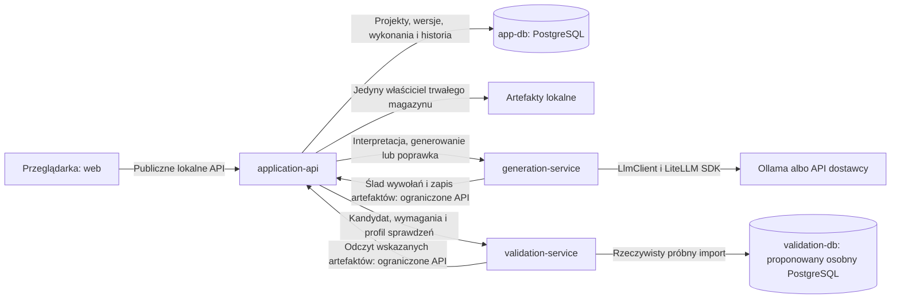

# Serwisy, funkcje, kontrakty i technologie

**Data:** 21 października 2026.

**Status:** szczegółowa propozycja realizacji wariantu Python/FastAPI + React. Kierunki LLM i przechowywania kontekstu zapisano w [rejestrze ustaleń](ustalenia_architektoniczne.md); nowe nazwy operacji, endpointów, modeli danych i procesów są propozycjami, nie gotowym kodem.

**Podstawa:** [specyfikacja MVP](specyfikacja_mvp.md), [architektura ogólna](architektura.md), [analiza technologii](analiza_technologii.md) i [granice przyszłego hostowania](przygotowanie_do_hostowania.md).

Nie zmieniamy wymagań przez szczegółowy projekt. Próbny import i cztery etapy walidacji potwierdzono w rozmowie 21 października 2026 i zapisano w specyfikacji v1.4. Szczegóły środowiska, parser, profil eksportu, sposób wykonywania reguł i wybór kandydata nadal podlegają otwartym decyzjom.

**Rozwinięcie implementacyjne:** [architektura niskopoziomowa v0.1](lld/README.md) opisuje moduły, interfejsy, pola danych, transakcje, dokładniejsze kontrakty i cykl wykonania. Nazwy stanów z wcześniejszej rozpiski są tam doprecyzowane jako propozycja.

## 1. Docelowy podział lokalnego MVP

| Element | Rodzaj | Co implementujemy | Czego używamy |
| --- | --- | --- | --- |
| `web` | Aplikacja w przeglądarce, nie serwis domenowy. | Interakcje, formularze, zatwierdzanie, status, historia i odbiór wyniku. | TypeScript, React, Vite, Mantine; proponowany TanStack Query. |
| `application-api` | Własny serwis zarządzający. | Projekty, schematy, reguły, plan danych, wykonania, kontekst, historia, raport i eksport. | Python, FastAPI, Pydantic, SQLAlchemy, Alembic, Psycopg, HTTPX. |
| `generation-service` | Własny serwis modelowy. | Interpretacja wymagań, wariant generowania, prompty, przygotowanie gotowych artefaktów i reakcja na zleconą poprawkę. | Python, FastAPI, Pydantic; LiteLLM SDK za adapterem. |
| `validation-service` | Własny serwis sprawdzeń. | Walidacja gotowych artefaktów, zgodność z planem, raport naruszeń i obsługa środowiska próbnego. | Proponowane Python, FastAPI, Pydantic, parser SQL, `csv` i Psycopg. |
| `app-db` | Gotowa baza aplikacji. | Nasz model trwałych danych i migracje. | PostgreSQL; opcjonalnie pgvector po osobnej decyzji. |
| `validation-db` | Gotowe środowisko rzeczywistego próbnego importu. | Przydział i sprzątanie odizolowanego obszaru próby, bez własnego silnika bazy. | Proponowana osobna instancja PostgreSQL, ograniczone role i zasoby. |
| `ollama` | Gotowe, opcjonalne środowisko modeli lokalnych. | Konfiguracja połączenia, identyfikacja modelu i pomiary. | Ollama; bez własnej inferencji i obsługi GPU. |
| Magazyn plików | Zależność backendu, nie dodatkowy mikroserwis. | Adapter, identyfikatory, kontrola dostępu, integralność i metadane. | Lokalny katalog/wolumen; standardowe operacje plikowe i `zipfile`. |

Są **trzy własne serwisy backendowe**, nie siedem mikroserwisów domenowych. Modele, parser, LiteLLM, dobór kontekstu, raportowanie i eksport nie otrzymują automatycznie osobnych procesów.

Usługi wewnętrzne nie korzystają z tabel `app-db`. Diagram pokazuje kierunki wywołań; każda operacja ma odpowiedź i identyfikatory korelacyjne.

## 2. `web` — interfejs użytkownika

### 2.1. Funkcje

1. Lista i utworzenie projektu.
2. Wgranie pełnego DDL oraz podgląd rozpoznanych tabel, relacji i nieobsługiwanych elementów.
3. Wprowadzenie reguł i wskazówek jakościowych; odczyt proponowanej interpretacji.
4. Polecenie w języku naturalnym, odpowiedzi na pytania doprecyzowujące.
5. Podgląd i zatwierdzenie zakresu, liczebności dla wszystkich potrzebnych tabel, reguł i formatu.
6. Start, anulowanie i odczyt bieżącego etapu wykonania.
7. Wynik i raport: kompletność, importowalność, reguły biznesowe oraz pomiary jako odrębne informacje.
8. Historia kandydatów i wiadomości, pobranie dostępnej paczki i raportu.
9. Ręczne nowe wykonanie dawnych wymagań; nie przycisk wznowienia starego procesu.

Liczba ekranów i układ formularzy pozostają w OD-12. Powyżej opisano funkcje, nie zatwierdzony projekt UI.

### 2.2. Narzędzia i własny kod

- **React + TypeScript + Vite** — proponowany interfejs przeglądarkowy i budowanie zasobów; uzasadnienie w analizie technologii.
- **Mantine** — gotowe kontrolki formularzy, okien i list zamiast budowania biblioteki UI [T1].
- **TanStack Query** — proponowany odczyt danych serwera i odpytywanie o status. Wyłączamy automatyczne retry; błąd odczytu nie uruchamia ani nie kończy wykonania [T2].
- **Klient API na podstawie OpenAPI** — kierunek, konkretnego generatora jeszcze nie wybieramy.
- **Playwright** — testy krytycznych ścieżek w przeglądarce; szczegóły narzędzi w analizie technologii.

Nasze są ekrany, reguły widoczności, interakcje i prezentacja. Backend nadal weryfikuje wszystkie warunki; zablokowany przycisk nie jest kontrolą dostępu.

### 2.3. Granice

- UI rozmawia wyłącznie z `application-api`, nie z bazą, Ollamą i walidatorem.
- Nie przechowuje kluczy dostawców LLM ani ścieżek plików hosta jako źródła prawdy.
- Odświeżenie strony odtwarza widok z trwałego statusu. Nie ponawia generowania.
- Identyfikator komendy pozwala rozpoznać ponowne dostarczenie tej samej akcji startu. Świadome ręczne nowe wykonanie ma nowy identyfikator.

## 3. `application-api` — zarządzanie i sterowanie

### 3.1. Odpowiedzialność

To właściciel trwałej prawdy o projekcie i wykonaniu. Zawiera odrębne moduły, ale nie osobne mikroserwisy projektów, historii, raportów i plików.

| Moduł | Funkcje i proponowane operacje |
| --- | --- |
| Projekty | `create_project`, `get_project`, `list_projects`; własność i kontrola dostępu. Usuwanie i retencja dopiero po OD-09. |
| Wersje schematów | `register_schema_version`, `analyze_schema`, `get_schema_version`; oryginalny DDL, wynik analizy, diagnostyka i wersja parsera. |
| Reguły | `propose_rule_interpretation`, `approve_rule_interpretation`; rozróżnienie reguł sprawdzalnych, nierozstrzygnięć i wskazówek jakościowych. |
| Zlecenia | `prepare_order`, `answer_clarification`, `approve_data_plan`; wymagane tabele i liczebności, format, konflikty i blokady. |
| Kontekst | `build_context`; dokładne definicje potrzebnych tabel, relacje i reguły z przypiętych wersji, kontrola budżetu. |
| Wykonania | `start_run`, `get_run`, `cancel_run`, `create_new_run_from_history`; migawka, wariant, operacje i trwałe przejścia stanu. |
| Sterowanie | `execute_run`, `request_correction`, `finalize_run`; kolejność etapów i jeden globalny budżet poprawek. |
| Kandydaci | `register_candidate`, `record_validation`, `select_candidate`; niezmienne wersje, powiązanie z raportem i ochrona wcześniejszego użytecznego wyniku. |
| Historia | `append_trace`, `get_run_history`; faktyczne wywołania, role, ustawienia, dostępne pomiary i jawne luki po awarii. |
| Artefakty | `store_artifact`, `open_authorized_artifact`, `build_export`; integralność, pakowanie bez modyfikowania SQL/CSV. |
| Raport | `build_run_report`; wynik procesu i naruszenia, bez jednej zbiorczej oceny jakości. |

Jeśli przygotowanie planu lub interpretacji reguł wymaga modelu, backend zleca operację `generation-service`. Nie utrzymuje drugiego zestawu integracji dostawców LLM.

### 3.2. Technologie i wzorce

- **Python + FastAPI + Pydantic** — API i kontrakty; OpenAPI oraz wstrzykiwanie zależności są udokumentowane przez FastAPI [T3].
- **SQLAlchemy + Psycopg** — adapter repozytoriów PostgreSQL. ORM dotyczy naszych tabel, nie dynamicznych schematów danych użytkownika [T4].
- **Alembic** — migracje tylko schematu aplikacji [T5].
- **HTTPX** — klient do generatora i walidatora, z jawnymi timeoutami i bez automatycznych ponowień [T6].
- **Repository + Unit of Work** — proponowane granice operacji zapisu i transakcji; nie uniwersalna warstwa CRUD.
- **Ports & Adapters** — logika przypadków użycia nie importuje klas SQLAlchemy, LiteLLM ani parsera.

Pydantic sprawdza kontrakty aplikacji. Nie stanowi dowodu zgodności danych z PostgreSQL i nie służy do cichej konwersji kandydata.

### 3.3. Lokalny wykonawca długich operacji

Proponujemy port `ExecutionRunner` z pojedynczym, ograniczonym wykonawcą na MVP, bez kolejki i brokera.

1. `start_run` sprawdza zatwierdzenie planu, dostęp i dostępność miejsca na wykonanie.
2. W transakcji zapisuje migawkę, faktyczny wariant, identyfikator komendy i wykonania.
3. Zleca pracę wykonawcy i zwraca `202` z `run_id`, bez oczekiwania przeglądarki na wynik modelu.
4. Błąd uruchomienia po zapisie zostawia historię zakończoną błędem; nie znika jako niedoszłe zadanie.
5. Runner wywołuje generowanie i walidację, zapisuje wyniki, decyduje o poprawkach i zakończeniu.

Do prototypu proponujemy zadania `asyncio` zarządzane cyklem życia aplikacji, z rejestrem aktywnych operacji, limitami i jawnym sprzątaniem [T7]. Nie traktujemy pojedynczego `create_task()` ani FastAPI `BackgroundTasks` jako kompletnego systemu zadań [T8]. Blokujące operacje nie mogą blokować obsługi statusu i anulowania.

Bazowe ograniczenie wdrożeniowe to **jeden proces wykonawczy zarządzania i najwyżej jedno aktywne wykonanie**. Przy zajętości proponujemy jawną odmowę startu, a nie niewidoczną kolejkę. Nie uruchamiamy wielu replik z niezależnymi runnerami. Gotowy runner, np. omawiany w analizie Procrastinate, pozostaje alternatywą do próby, nie dodatkową zależnością tego projektu.

Utrata procesu runnera kończy możliwość kontynuacji. Przy restarcie uzgadniamy pozostawiony status i oznaczamy przerwanie, ale nie odtwarzamy kolejnych kroków. Przed nowym zadaniem sprawdzamy także brak pozostawionej aktywnej operacji usług pomocniczych; anulujemy ją lub blokujemy nowy start.

### 3.4. Własność danych

Proponowane logiczne encje, nie gotowy schemat migracji:

| Encja | Co zachowuje |
| --- | --- |
| `Project` | Nazwa i lokalny właściciel; bez bazy kont w MVP. |
| `SchemaVersion` | Odniesienie do oryginalnego DDL, jego hash, opis strukturalny i diagnostyka. |
| `RuleRevision` | Tekst, interpretacja, stan zatwierdzenia, wersja i ewentualna definicja sprawdzenia. |
| `Order` / `ApprovedPlan` | Polecenie, doprecyzowania, zakres, liczebności i wybrany profil formatu. |
| `Run` / `RunSnapshot` | Niezmienne wymagania, wariant, status, faza, limit rund, przyczyna zakończenia i pomiary. |
| `Operation` | Konkretne zlecenie generatora lub walidatora, jego termin i uprawniony zakres. Przygotowanie ma referencję do projektu/rewizji zlecenia, a generowanie i walidacja również do wykonania. |
| `Candidate` | Manifest artefaktów, runda, wersja i hashe; bez nadpisywania poprzednika. |
| `ValidationReport` | Metoda, profil możliwości, sprawdzenia i identyfikacja dokładnego kandydata. |
| `ModelCall` / `TraceEvent` | Wiadomości, role, faktyczne parametry, wynik albo błąd i dostępne pomiary. |
| `Artifact` | Typ, właściciel wynikający z projektu, rozmiar, hash i logiczny klucz magazynu. |

Proponujemy rozdzielić **cykl życia** (`ACTIVE`, `FINISHED`, `FAILED_TECHNICALLY`, `CANCELLED`) od **fazy** (`GENERATING`, `VALIDATING`, `CORRECTING`) i **oceny wyniku**. Nazwy są robocze. Samo `FINISHED` nie znaczy, że dane są kompletne i importowalne. Żądanie anulowania jest osobną trwałą informacją, zanim zostanie rozstrzygnięte zakończenie.

### 3.5. Najważniejsze testy

- Zmiana projektu nie modyfikuje migawki dawnego wykonania.
- Dwukrotne dostarczenie tej samej komendy nie wywołuje modelu dwukrotnie.
- Limit poprawek jest globalny; wiele wywołań w rundzie go nie resetuje.
- Błąd techniczny nie uruchamia rundy poprawki ani innego modelu.
- Kandydat użyteczny przed nieudaną poprawką pozostaje zachowany.
- Anulowanie ścigające się z odpowiedzią nie pozwala wznowić wykonania.
- Raport i pliki mają ten sam `candidate_id` oraz zgodne hashe.
- Sztuczne dwa konteksty właścicieli nie dają dostępu do cudzych zasobów; nie oznacza to wdrożenia wielu kont.

## 4. `generation-service` — modele i gotowe kandydaty

### 4.1. Funkcje

| Operacja | Wejście | Wynik |
| --- | --- | --- |
| `interpret_requirements` | Wersjonowany kontekst schematu, polecenie, reguły i doprecyzowania. | Propozycja interpretacji, pytań i planu; nigdy automatyczne zatwierdzenie. |
| `generate_candidate` | Niezmienna migawka, kontekst, profil SQL/CSV, wersja wariantu i identyfikator operacji. | Gotowe treści SQL/CSV od modelu, surowa odpowiedź, manifest i ślad wywołań. |
| `correct_candidate` | Te same wymagania, konkretny kandydat, raport naruszeń i numer rundy przyznany przez backend. | Nowy kandydat; bez zmiany schematu i liczebności. |
| `cancel_operation` | Identyfikator uprawnionej aktywnej operacji. | Potwierdzenie przyjęcia lokalnego zatrzymania; nie gwarancja cofnięcia obliczeń u dostawcy. |
| `get_capabilities` | Wybrana konfiguracja wariantu. | Jawne możliwości i ograniczenia, bez sekretów. |

### 4.2. Narzędzia i własny kod

- **Python + FastAPI + Pydantic** — granica HTTP i kontrakty [T3].
- **LiteLLM Python SDK** wewnątrz `LiteLlmAdapter` — gotowa komunikacja z dostawcami i wspólny format odpowiedzi; bez osobnego Proxy [T9].
- **Ollama** — preferowane środowisko modeli lokalnych. Płatne modele pozostają za tym samym portem; lista modeli nie jest wybrana.
- **GenerationStrategy** — nasza strategia organizacji pracy: pierwszy wariant możliwie prosty, inne warianty dopiero do badań.
- **LangGraph** — wyłącznie opcjonalny komponent konkretnej strategii, nie domyślny silnik całej aplikacji.
- **HTTPX** — ograniczony dostęp do API artefaktów i historii backendu [T6].

Nasze są prompty, podział kontekstu i ról, wyodrębnienie zadeklarowanych plików, mapowanie możliwości i błędów oraz powiązanie wywołań z rundą. Nie piszemy inferencji ani klientów każdego API od zera.

### 4.3. `LlmClient` i odpowiedzialność adaptera

Żądanie obejmuje: jawne wiadomości, model, wymagane możliwości, ustawienia, limit czasu i identyfikatory wywołania. Wynik obejmuje: odpowiedź, przyczynę zakończenia oraz dostępne informacje o rzeczywiście użytym modelu, parametrach, tokenach, czasach i koszcie. Nieznane wartości są jawne; nie zakładamy dostępu do ukrytych parametrów dostawcy.

Warunki:

1. Wyłączone retry wszystkich warstw, fallbacki, cache odpowiedzi i ciche skracanie kontekstu.
2. Brak cichego usuwania nieobsługiwanych parametrów.
3. Rejestr wiadomości po rzeczywistym mapowaniu do dostawcy, nie tylko przed wywołaniem LiteLLM. Callbacki są mechanizmem do oceny, nie dowodem kompletności historii [T10].
4. Klucze i nagłówki uwierzytelniające nie trafiają do artefaktów ani śladu.
5. Zakończenie przez limit odpowiedzi nie jest traktowane jako dowód kompletności.
6. Ustawienia i dane wykonania nie są zmiennymi globalnymi „aktualnej rozmowy”.
7. Przegląd konkretnej wersji LiteLLM i jej zależności przed instalacją; patrz ryzyko łańcucha dostaw w rejestrze i analizie [T11].

Nie deklarujemy, że dowolnego dostawcę podłączymy wyłącznie zmianą nazwy modelu. Potrzebne są testy zgodności możliwości i śladu.

### 4.4. Dane, historia i ograniczenia

- Serwis nie posiada trwałej bazy projektów ani historii.
- Operacje interpretacji poprzedzają `run_id`; ich ślad przypisujemy do projektu i rewizji zlecenia. Zatwierdzona migawka może wskazywać użyte przygotowanie, bez liczenia jednego wywołania jako nowego kosztu w każdym ręcznym ponowieniu.
- Rejestr aktywnych operacji służy anulowaniu i ochronie przed duplikatem, nie odtwarzaniu pracy po restarcie.
- Przed wywołaniem zgłasza próbę przez port `TraceSink`, po nim zapisuje dostępny wynik lub błąd. Proponowana implementacja to ograniczone wewnętrzne API backendu.
- Ślad jest utrwalany przy kolejnych wywołaniach, nie dopiero po całej rundzie. Awaria między odpowiedzią dostawcy a trwałym zapisem pozostaje jawną luką, nie fikcyjnym kompletnym logiem.
- Jeśli nie można utrwalić wymaganego śladu, operacja nie kontynuuje kolejnych wywołań w ukryciu.
- Gotowe pliki trafiają do backendu przez `ArtifactWriter`, z identyfikacją operacji i kontrolą rozmiaru. Generator nie montuje trwałego katalogu historii.
- Jeśli treść poprawnie odebranej odpowiedzi modelu nie pozwala wyodrębnić wymaganych plików, zachowujemy ją i zgłaszamy naruszenie formatu kandydata. Nie nazywamy takiej treści awarią SDK i nie naprawiamy jej po cichu.
- Nie podejmuje decyzji o globalnym limicie, sukcesie zadania ani wyborze ostatecznego kandydata.
- Nie konwertuje pośrednich rekordów na własny SQL/CSV. Dozwolone wyodrębnienie plików nie obejmuje naprawy treści.

Pierwsze testy wykorzystują kontrolowany endpoint modelowy, bez płatnych wywołań. Obejmują błąd sieci, timeout, ucięty wynik, nieobsługiwany parametr, brak metryk, wieloetapowe wywołania i brak ponowienia.

## 5. `validation-service` — sprawdzenie konkretnego wyniku

### 5.1. Funkcje

| Etap | Co sprawdza | Proponowany mechanizm |
| --- | --- | --- |
| Przyjęcie kandydata | Manifest, format, rozmiary, przypisanie do tabel, hashe i zgodność referencji. | Własny kontrakt i ograniczony `ArtifactReader`. |
| 1. Składnia / format | Dozwolone SQL `INSERT` albo poprawny profil CSV; bez zmiany treści. | Parser SQL oraz standardowy moduł `csv` [T12]. |
| 2. Wstępna zgodność ze schematem i typami | Istnienie tabel/kolumn, liczba pól i wiarygodnie rozpoznawalne niezgodności wartości. | Parser i własne sprawdzenia wstępne, bez odtwarzania pełnego systemu typów ani zmiany danych. |
| 3. Próbny import | Ostateczne potwierdzenie typów, obsługiwanych `NOT NULL`, PK, FK, `UNIQUE`, `CHECK`, wartości domyślnych i relacji w całej paczce. | Uzgodniony rzeczywisty import do PostgreSQL; proponowany adapter Psycopg [T13, T14]. |
| 3. Kompletność | Rzeczywisty zakres i liczebności wobec planu, także brakujące i nieuzgodnione tabele. | Własne porównanie po imporcie; liczenie na pełnej paczce, nie samych liniach pliku. |
| 4. Reguły biznesowe | Zatwierdzone dodatkowe sprawdzenia, zakres, liczba, jednostka i przykłady naruszeń. | `BusinessRuleEvaluator`; ograniczony mechanizm do ustalenia, nie dowolny kod modelu. |
| Zakończenie | Raport oraz sprzątanie środowiska. | Własna orkiestracja sprawdzeń i adapter środowiska. |

Etap drugi jest kontrolą wstępną, nie dowodem udanego importu. Jeśli wcześniejszy etap uniemożliwia następny, oznaczamy go jako niewykonany z przyczyną. Nie zwracamy pozytywnej oceny domyślnie. Pełny zapis potwierdzeń i propozycji zawiera [projekt walidacji](lld/walidacja.md).

### 5.2. Narzędzia

- **Python + FastAPI + Pydantic** — kontrakty serwisu.
- **`SqlParser`** — port. SQLGlot jako pierwszy kandydat do próby, nie zatwierdzona zgodność całego dialektu. pglast pozostaje alternatywą po ocenie licencji i wersji.
- **`csv`** — odczyt i sprawdzanie formatu bez zapisu poprawionego CSV. Proponujemy jawny dialekt, tryb ścisły, kontrolę nagłówków i liczby pól; bez zgadywania profilu i konwersji wartości do liczb przez parser [T12].
- **Psycopg** — proponowany sterownik, transakcje i transfer CSV przez `COPY FROM STDIN` w wybranej metodzie próbnego importu [T14].
- **Osobny PostgreSQL** — środowisko prób, nie `app-db`. Nie generujemy z DDL użytkownika modeli SQLAlchemy.

### 5.3. Próbny import — metoda uzgodniona, organizacja nadal OD-02

Wybrano rzeczywisty import po wstępnej kontroli schematu i typów. Poniższe szczegóły provisioningu i izolacji pozostają projektem do weryfikacji, nie potwierdzeniem gotowego środowiska.

1. Sprawdzamy DDL i gotowy artefakt względem jawnie dozwolonego podzbioru, także wyrażeń i funkcji.
2. Przydzielamy pusty obszar w osobnej instancji walidacyjnej i ograniczoną rolę bez dostępu do innych prób.
3. Przygotowujemy schemat zgodny z zatwierdzoną wersją i profilem, bez usuwania ograniczeń.
4. Importujemy dokładny SQL albo oryginalne bajty CSV według profilu eksportu. Dla CSV używamy transferu blokowego, a nie parsowania do rekordów i ponownej serializacji.
5. Sprawdzamy całą paczkę, w tym ograniczenia odroczone w momencie wymaganym przez profil transakcji.
6. Oddzielnie porównujemy liczebności i zakres, a następnie wykonujemy obsługiwane reguły.
7. Zapisujemy metodę, wersję silnika, profile i raport; sprzątamy środowisko także po błędzie.

`COPY` obsługuje różne profile i może mieć zachowanie pomijania błędów. Nie dopuszczamy takiego trybu jako sposobu uzyskania pozytywnego wyniku. Nie korzystamy z `COPY PROGRAM` ani odczytu dowolnych plików hosta [T15].

Zwykły błąd danych, np. naruszenie FK, jest negatywnym sprawdzeniem. Niedostępna baza lub awaria mechanizmu sprawdzeń jest błędem technicznym i kończy wykonanie, nie uruchamia poprawki modelu.

Ograniczenie roli, lista dozwolonych instrukcji i wyrażeń, limity zapytań, zasobów i sieci są warstwami ochrony. Sam kontener lub osobny schemat nie są gwarancją bezpiecznego uruchomienia niezaufanego SQL. Walidator nie otrzymuje gniazda Docker ani poświadczeń `app-db`; provisioning i uprawnienia muszą być ograniczone do środowiska prób.

### 5.4. Kontrakt raportu i testy

Każde sprawdzenie zwraca roboczo: `check_id`, `stage`, `status`, `code`, zakres, jednostkę, liczbę i przykłady naruszeń oraz przyczynę niewykonania. Statusy proponujemy rozróżnić jako `PASS`, `VIOLATION`, `NOT_RUN`, `UNSUPPORTED`, `UNDETERMINED`; awaria infrastruktury jest odrębnym błędem operacji.

Raport ma `run_id`, `operation_id`, `candidate_id`, hashe, wersję walidatora i profil możliwości. Validator nie zwraca tylko jednego `valid: true`.

Testy obejmują osobno: błędną składnię, typ, klucz, brak referencji, niekompletność, naruszenie dodatkowej reguły, niewykonane sprawdzenie, timeout i awarię. Sprawdzamy, że identyczny kandydat nie został zmodyfikowany podczas walidacji.

## 6. Moduł kontekstu — bez dodatkowego serwisu RAG

**Miejsce:** `application-api`, ponieważ ten serwis jest właścicielem schematów i kontroli dostępu. Generator dostaje już wybrany i wersjonowany pakiet kontekstu.

| Funkcja | Bazowe MVP | Możliwe rozszerzenie |
| --- | --- | --- |
| Odczyt schematu | Oryginalny DDL i struktura z konkretnej wersji. | Bez zmiany źródła prawdy. |
| Wybór tabel | Z planu i rozpoznanych wymagań; potrzebne definicje w budżecie kontekstu. | Ranking semantyczny jako wsparcie doboru. |
| Relacje i reguły | Jawne zależności DDL oraz zatwierdzone uzupełnienia. | Nadal obowiązkowe, nie zastępowane embeddingiem. |
| Pakiet kontekstu | Dokładne fragmenty, identyfikatory, hashe i wersja sposobu selekcji. | Dodatkowo model embeddingowy i konfiguracja wyszukiwania. |
| Budżet | Uwzględnia wiadomości, instrukcje i miejsce na odpowiedź; bez cichego obcinania. | Kontrolowany podział operacji w wybranym wariancie. |

Port `ContextProvider` ma początkowo implementację opartą na modelu schematu i zależnościach. Jeśli konieczna definicja nie mieści się w budżecie, zwracamy jawną blokadę albo korzystamy z ustalonego podziału operacji; nie usuwamy wymagań.

Opcjonalny wariant to pgvector w `app-db` oraz oddzielny `EmbeddingClient`. pgvector jest rozszerzeniem PostgreSQL, nie wymusza nowego serwera; model embeddingowy i przebudowa indeksu pozostają dodatkowymi obowiązkami [T16]. Wyniki zawsze ograniczamy do właściwego projektu i wersji, z przygotowaniem do przyszłej kontroli właściciela.

Wybór tabel do kontekstu nie jest automatycznym zatwierdzeniem generowania dla nowych tabel. Rozszerzenie planu wymaga zatwierdzenia przed startem. Przy porównaniach zapisujemy rzeczywiście użyty kontekst; zmiana selekcji jest zmianą wariantu.

## 7. Dane, pliki i gotowe zależności

### 7.1. `app-db`

Przechowuje projekty, wersje, zatwierdzone wymagania, wykonania, metadane i historię. Duże treści mogą być artefaktami, o ile historia ma trwałe i jednoznaczne odniesienia.

Jedyny serwis z poświadczeniami aplikacyjnej bazy to `application-api`; osobna rola migracji może działać wyłącznie przy przygotowaniu i aktualizacji środowiska. Generator i walidator korzystają z kontraktów backendu, nie współdzielonego ORM.

### 7.2. Magazyn artefaktów

Port `ArtifactStore` ukrywa katalog hosta. W bazowym wariancie proponujemy `LocalArtifactStore`.

- Przechowuje DDL, wiadomości, gotowe pliki kandydatów, raporty i paczki.
- Backend wyznacza klucze plików; nazwy od modelu nie są zaufanymi ścieżkami.
- Metadane obejmują hash, rozmiar i stan rejestracji. Zapis do pliku i transakcja bazy nie są jedną transakcją.
- Proponujemy zapis tymczasowy, ukończenie pliku i dopiero publikację metadanych; uszkodzony zapis nie staje się artefaktem gotowym do pobrania.
- Osierocone pliki techniczne są uzgadniane; retencja historii i usuwanie projektów nadal podlegają OD-09.
- `zipfile` służy do opakowania wyników, nie przepisania ich treści [T17].
- Nie eksportujemy danych przez ponowny odczyt tabel walidacyjnych i serializację: użytkownik otrzymuje sprawdzone artefakty modelu.
- Dostęp do danych po anulowaniu i awarii pozostaje OD-08; przechowanie pliku nie jest automatyczną zgodą na udostępnienie go jako poprawnego wyniku.

### 7.3. `validation-db`

Środowisko wybranego próbnego importu. Proponowana osobna instancja, konta, sieć, limity i dane tymczasowe. Nie przechowuje historii badań. Sprzątanie pozostałości po awarii nie oznacza wznowienia walidacji.

### 7.4. Ollama i API zewnętrzne

Gotowe środowisko, nie własny mikroserwis biznesowy. Na macOS preferujemy natywną Ollamę obok Compose, ze względu na udokumentowany brak akceleracji GPU Ollamy w Docker Desktop na macOS [T18].

Wariant tylko z zewnętrznym API nie wymaga działającej Ollamy. Nie uruchamiamy automatycznego pobierania modeli ani płatnych wywołań podczas startu infrastruktury. Dopuszczenie konkretnego modelu wymaga testów sprzętu, długości odpowiedzi, możliwości i warunków użycia.

## 8. Komunikacja, endpointy i wspólne kontrakty

### 8.1. Reguły

- HTTP + JSON i wersjonowane OpenAPI; pliki przesyłane binarnie z osobnym manifestem.
- Przeglądarka korzysta z krótkich komend i odczytu statusu; nie utrzymuje połączenia przez cały czas generowania.
- W proponowanym prostym wariancie wewnętrzna operacja generowania lub walidacji może być długim żądaniem HTTP runnera. Wymaga osobnych timeoutów oraz równolegle dostępnego anulowania.
- Nie tworzymy trzech niezależnych trwałych kolejek i nie ukrywamy awarii automatycznym redelivery.
- Każda operacja ma `contract_version`, `project_id`, `operation_id`, termin i identyfikację wariantu. Przygotowanie wskazuje rewizję zlecenia, a generowanie i walidacja dodatkowo `run_id`; kandydat i raport mają własne identyfikatory i hashe.
- Serwisy nie przyjmują dowolnych adresów plików lub callbacków z promptu. Adres backendu i uprawnienia transferu pochodzą z zaufanej konfiguracji.

### 8.2. Proponowane API użytkownika

| Metoda i ścieżka | Funkcja |
| --- | --- |
| `POST /api/v1/projects`, `GET /api/v1/projects` | Utworzenie i lista projektów. |
| `POST /api/v1/projects/{id}/schema-versions` | Wgranie nowego pełnego DDL. |
| `GET /api/v1/schema-versions/{id}` | Rozpoznana struktura, diagnostyka i wersja. |
| `POST /api/v1/projects/{id}/rules` | Wprowadzenie reguły do interpretacji. |
| `POST /api/v1/rules/{id}/approve` | Zatwierdzenie konkretnej interpretacji. |
| `POST /api/v1/projects/{id}/orders` | Przygotowanie zlecenia z polecenia. |
| `POST /api/v1/orders/{id}/clarifications` | Odpowiedź na pytanie doprecyzowujące. |
| `POST /api/v1/orders/{id}/approve` | Zatwierdzenie konkretnej rewizji planu. |
| `POST /api/v1/orders/{id}/runs` | Nowe wykonanie zatwierdzonego zlecenia. |
| `GET /api/v1/runs/{id}` | Trwały status, faza i dostępny wynik. |
| `POST /api/v1/runs/{id}/cancel` | Żądanie zatrzymania. |
| `POST /api/v1/runs/{id}/new-run` | Nowe wykonanie dawnych wymagań z aktualnym wariantem. |
| `GET /api/v1/projects/{id}/runs` | Historia wykonań projektu. |
| `GET /api/v1/runs/{id}/history` | Kandydaci, sprawdzenia i ślad wywołań. |
| `GET /api/v1/runs/{id}/report` | Dostępny raport wykonania. |
| `GET /api/v1/runs/{id}/export` | Dostępna paczka przypisana do wybranego kandydata. |

Interpretacja wymagająca LLM także otrzymuje identyfikator operacji; nie musi blokować żądania przeglądarki. Dokładny kontrakt odpytywania o jej wynik ustalimy z API, bez wprowadzania kontynuowalnych workflow.

### 8.3. Proponowane API wewnętrzne

| Właściciel | Operacje |
| --- | --- |
| Generator | `POST /internal/v1/interpret`, `POST /internal/v1/generate`, `POST /internal/v1/correct`, `POST /internal/v1/operations/{id}/cancel`; odczyt aktywnych operacji tylko dla zarządzania. |
| Walidator | `POST /internal/v1/validate`, `POST /internal/v1/operations/{id}/cancel`; odczyt aktywnych operacji tylko dla zarządzania. |
| Backend | Dopisanie zdarzenia do wskazanej operacji; wgranie i odczyt artefaktu w jej zakresie. Osobne kontrakty od publicznego API. |

Generator i walidator uwierzytelniają się jako usługi przez zaufaną lokalną konfigurację. Operacje są ograniczone do zasobów przyznanych przez backend; nie ufamy dowolnemu `user_id` z żądania. Nie projektujemy w MVP pełnego systemu tożsamości usług, ale sam brak publikacji portu nie zastępuje sprawdzenia uprawnienia.

### 8.4. Najważniejsze porty

| Port | Gdzie używany | Co pozwala wymienić |
| --- | --- | --- |
| `ProjectRepository`, `RunRepository`, `UnitOfWork` | Backend. | Zapis i transakcje danych aplikacji. |
| `ArtifactStore` | Backend. | Lokalne pliki na przyszły magazyn współdzielony. |
| `SchemaParser` / `SqlParser` | Moduł analizy i walidator. | Bibliotekę parsera bez ujawnienia AST poza adapterem. |
| `ContextProvider`, opcjonalny `EmbeddingClient` | Backend. | Strategię selekcji i dostawcę embeddingów. |
| `GenerationClient`, `ValidationClient` | Backend. | Implementację i transport operacji usług. |
| `ExecutionRunner` | Backend. | Sposób wykonywania pracy i późniejszy przydział zadań. |
| `GenerationStrategy`, `LlmClient` | Generator. | Organizację wariantu i komunikację z dostawcami. |
| `TraceSink`, `ArtifactReader`, `ArtifactWriter` | Usługi pomocnicze. | Sposób przekazania śladu i plików bez połączenia z `app-db`. |
| `ValidationEngine`, `BusinessRuleEvaluator`, `ValidationEnvironment` | Walidator. | Mechanizm sprawdzeń, reguł i przygotowania środowiska. |
| `ActorContextProvider`, `AccessPolicy` | Backend. | Lokalnego właściciela na przyszłe uwierzytelnianie i autoryzację. |

Nie wprowadzamy wszystkich portów jako rozbudowanych frameworków. To małe interfejsy wynikające z konkretnych wymiennych granic. Wymiana implementacji nadal wymaga testów kontraktowych i integracyjnych, a zmiana bazy także migracji danych.

Nie współdzielimy modeli ORM ani pełnego modelu domenowego jako obowiązkowej biblioteki trzech serwisów. Wspólna jest wersjonowana specyfikacja komunikacji i zestaw testów zgodności; ewentualnie generowane DTO nie dają dostępu do wewnętrznych repozytoriów.

## 9. Jeden pełny przepływ

1. UI wysyła DDL do backendu; backend zapisuje oryginał i wersję, analizuje obsługiwany zakres i zwraca diagnostykę.
2. Backend zapisuje reguły i polecenie; w razie potrzeby zleca generatorowi interpretację oraz rejestruje ślad.
3. Model proponuje znaczenie i zakres. Backend weryfikuje propozycję względem schematu, pokazuje niejasności i uzyskuje zatwierdzenie użytkownika.
4. Start tworzy niezmienną migawkę planu oraz wersję wariantu. Runner działa poza czasem życia żądania przeglądarki.
5. Backend dobiera i zapisuje kontekst, tworzy operację oraz wywołuje generator.
6. Generator rejestruje wywołania i gotowe treści przez ograniczone API backendu. Powstaje niezmienny kandydat.
7. Backend zleca walidatorowi sprawdzenie tego kandydata; walidator odczytuje tylko wskazane pliki.
8. Backend zapisuje raport. Jeśli wykryto naruszenia i pozostał globalny budżet, zleca poprawkę jako następną rundę.
9. Po zakończeniu wybiera kandydata według ustalonej polityki. Jeśli kilka wyników jest użytecznych, szczegóły polityki pozostają OD-03; nie dopisujemy rankingu.
10. Eksport opakowuje dokładnie sprawdzone pliki i raport. Ostateczny stan nie jest deklaracją realizmu.

Każdy techniczny błąd kończy przebieg bez ponawiania kroku. Dostępność wcześniejszego wyniku po takim przerwaniu rozstrzyga OD-08, nie sama obecność pliku.

## 10. Awarie, anulowanie i późniejsze skalowanie

| Sytuacja | Zachowanie |
| --- | --- |
| Błędny SQL/CSV od działającego modelu | Kandydat z naruszeniami; walidacja i poprawka w budżecie. |
| Timeout lub awaria modelu | Błąd techniczny; bez retry i innego modelu. Dostępne dane próby pozostają w historii. |
| Timeout lub awaria walidatora | Błąd techniczny, nie negatywna ocena danych. |
| Błąd zapisu historii/artefaktu | Nie kontynuujemy w ukryciu; brak danych po awarii jest jawny. Błąd niedostępnego magazynu może uniemożliwić natychmiastowe zapisanie statusu i wymaga uzgodnienia po odzyskaniu dostępu. |
| Żądanie anulowania | Backend trwale blokuje przejście do kolejnych etapów i sygnalizuje aktywnej operacji zatrzymanie. Dokładny moment zakończenia pozostaje OD-08. |
| Odpowiedź po timeoutcie/anulowaniu | Może uzupełnić ślad diagnostyczny, ale nie uruchamia następnego etapu i nie zmienia wybranego wyniku. |
| Utrata procesu usługi | Pozostawione wykonanie zostaje rozpoznane jako przerwane; bez odtwarzania operacji i automatycznego wznowienia. |
| Niepewny wynik komendy HTTP | Identyfikatory i odczyt statusu służą rozpoznaniu sytuacji; nie zakładamy „exactly once” i nie wysyłamy automatycznie drugiej generacji. |

Proponujemy warunkowe aktualizacje statusu i identyfikator aktualnie uprawnionej operacji, żeby stara odpowiedź nie nadpisała zakończenia. Deduplikacja identycznego zdarzenia historii nie jest ponownym wywołaniem modelu.

Późniejsze skalowanie wymieni runner i politykę przydziału, doda rzeczywistą tożsamość, limity i testy współbieżności. Nie obiecujemy, że wystarczy zwiększyć liczbę replik obecnego lokalnego procesu.

## 11. Lokalne uruchomienie i granice bezpieczeństwa

Proponowany Compose opisuje `application-api`, `generation-service`, `validation-service`, `app-db` i warunkowy `validation-db`. Compose służy do złożenia zależności, a nie zastępuje systemu zadań i bezpieczeństwa SQL [T19].

- Zbudowane zasoby `web` mogą być podawane przez backend; osobny serwer Vite jest potrzebny podczas pracy deweloperskiej, nie jako obowiązkowy proces aplikacji.
- Publiczny lokalny punkt wejścia wiążemy z loopbackiem. Generator, walidator i bazy nie mają domyślnie portów dostępnych z zewnątrz.
- Sieć aplikacji i środowiska walidacji rozdzielamy: walidator ma dostęp do własnej bazy i ograniczonego API plików, nie `app-db`.
- Tylko generator potrzebuje połączenia do dopuszczonych API LLM. Adresy i sekrety pochodzą z konfiguracji, nie z treści od modelu.
- Walidacyjny PostgreSQL nie ma dostępu do bazy aplikacji, danych hosta ani zewnętrznych usług. Dokładne ograniczenia sieci i zasobów wymagają testu wdrożenia.
- Trwały wolumen historii i artefaktów jest przypisany backendowi. Utrata wolumenu nie jest traktowana jak zwykły restart procesu.
- Natywna Ollama na macOS jest zależnością poza Compose; adres dostępu z kontenera ustalimy i sprawdzimy w konfiguracji danego środowiska.
- Wersje przypinamy po próbie zgodności; bez ruchomych obrazów `latest`.

Wariant bez logowania nie jest konfiguracją gotową do publicznego hostowania.

## 12. Co pozostaje do potwierdzenia przed kodowaniem

| Decyzja / próba | Dlaczego blokuje odpowiedni fragment implementacji |
| --- | --- |
| Macierz DDL i parser — OD-01 | Nie można obiecać dowolnej składni ani wybrać parsera na podstawie samej nazwy. |
| Szczegóły próbnego importu — pozostała część OD-02 | Metodę już wybrano; trzeba zweryfikować wersję silnika, transakcje, provisioning, role i izolację. |
| Wykonywalne reguły — OD-06 | Potrzebny ograniczony zakres i sposób zatwierdzania; nie uruchamiamy dowolnego SQL lub Pythona od modelu. |
| Profile plików — OD-04 i OD-10 | Ten sam profil musi obowiązywać model, walidator i pobierany wynik. |
| Wybór kandydata — OD-03 | Wcześniejszy użyteczny wynik jest chroniony, ale wagi lub ranking nie zostały zatwierdzone. |
| Timeouty, anulowanie i retencja — OD-07–OD-09 | Nie można dopisać gwarancji przerwania u dostawcy i dostępności plików. |
| Prototyp runnera | Potwierdzenie statusu, anulowania, restartu i braku drugiego wywołania. |
| Prototyp LiteLLM i przegląd wersji | Dowód wymaganego śladu, możliwości, metryk i braku ukrytych ponowień. |
| Potwierdzenie wariantu języków i topologii | Niniejszy dokument jest konkretną propozycją na bazie faworyta, nie wynikiem benchmarku trzech stosów. |

Można rozpocząć projektowanie kontraktów i testów rdzenia na atrapach bez rozstrzygnięcia wszystkich szczegółów. Nie należy jednak nazywać gotową walidacją fragmentu, którego zakres pozostaje otwarty.

## 13. Kolejność implementacji

1. Kontrakty i testy zachowania: migawka, kandydat, raport, globalny limit, anulowanie i błędy.
2. Backend z jednym adapterem trwałego zapisu oraz atrapami generatora i walidatora; lokalny runner.
3. Minimalny UI: projekt, zatwierdzenie, start, status i raport.
4. Analiza uzgodnionego podzbioru DDL i rzeczywista walidacja jednego formatu.
5. Jeden wariant generatora z kontrolowanym endpointem, potem rzeczywista integracja modelu.
6. Poprawki, zachowanie wcześniejszego wyniku, eksport i pełne testy ścieżki.
7. Drugi rzeczywiście potrzebny dostawca jako test wymienności. Inne warianty agentowe dopiero w ramach badań.
8. Embeddingi i pgvector tylko po wykazaniu problemu selekcji kontekstu.

Nie instalujemy teraz pakietów ani nie wykonujemy płatnych prób. Dokument nie jest raportem z działającego wdrożenia.

## 14. Źródła mechanizmów

Dokumentacja pierwotna sprawdzona 21 października 2026; dokładne wersje zależności nie zostały wybrane. Pozostałe źródła porównania języków, Pydantic, parserów, narzędzi testowych i LangGraph znajdują się w [analizie technologii](analiza_technologii.md).

| ID | Źródło |
| --- | --- |
| T1 | Mantine: `https://mantine.dev/getting-started/` |
| T2 | TanStack Query, retry: `https://tanstack.com/query/latest/docs/framework/react/guides/query-retries` |
| T3 | FastAPI Features: `https://fastapi.tiangolo.com/features/` |
| T4 | SQLAlchemy Overview: `https://docs.sqlalchemy.org/en/20/intro.html` |
| T5 | Alembic: `https://alembic.sqlalchemy.org/en/latest/` |
| T6 | HTTPX Async: `https://www.python-httpx.org/async/` |
| T7 | Python asyncio, zadania i anulowanie: `https://docs.python.org/3/library/asyncio-task.html` |
| T8 | FastAPI Background Tasks: `https://fastapi.tiangolo.com/tutorial/background-tasks/` |
| T9 | LiteLLM: `https://docs.litellm.ai/docs/` |
| T10 | LiteLLM Custom Callbacks: `https://docs.litellm.ai/docs/observability/custom_callback` |
| T11 | LiteLLM Security Update: `https://docs.litellm.ai/blog/security-update-march-2026` |
| T12 | Python csv: `https://docs.python.org/3/library/csv.html` |
| T13 | PostgreSQL Constraints: `https://www.postgresql.org/docs/18/ddl-constraints.html` |
| T14 | Psycopg, COPY i transfer blokowy: `https://www.psycopg.org/psycopg3/docs/basic/copy.html` |
| T15 | PostgreSQL COPY: `https://www.postgresql.org/docs/18/sql-copy.html` |
| T16 | pgvector: `https://github.com/pgvector/pgvector` |
| T17 | Python zipfile: `https://docs.python.org/3/library/zipfile.html` |
| T18 | Ollama FAQ: `https://docs.ollama.com/faq` |
| T19 | Docker Compose: `https://docs.docker.com/compose/intro/features-uses/` |
